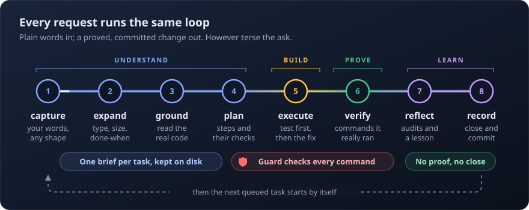
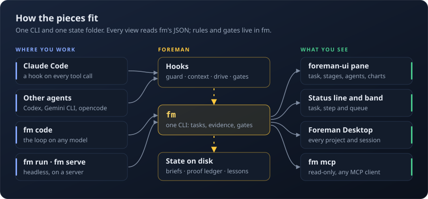
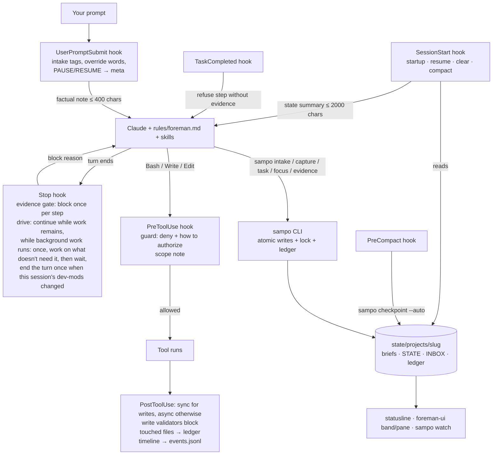

# Sampo — system map

Not loaded every session (`~/.claude/rules/foreman.md` points here). Read it when you're unsure where something lives or how the parts interact. `sampo doctor` checks the file map below against disk.

**Names:** Sampo (formerly Foreman) is the product; its parts are Smith (the task loop: plan, build, prove), Rune (Genesis, `sampo rune`), Moons (moonshots), Louhi (the exam, `sampo louhi`), Underworld (the not-yet ledger) and the Ward (the guard). The old names stay as aliases, and every path, command, plugin id and `FOREMAN_*` variable below keeps its old spelling.

**Contents:** [What it is](#1-what-sampo-is) · [Prompting](#2-how-to-prompt-it) · [File map](#3-file-map) · [Interaction diagram](#4-interaction-diagram) · [Lifecycle](#5-lifecycle-walkthrough-a-fix-line-to-an-archived-task) · [Precedence](#6-source-of-truth-and-precedence) · [Integrations](#7-integrations) · [BUILD_PROMPT](#8-relationship-to-build_promptmd-and-the-repo) · [Operations](#9-operations) · [Limitations](#10-known-limitations) · [Deviations](#11-deviations-from-build_promptmd)

<p align="center"></p>
<p align="center"></p>

## 1. What Sampo is

Sampo is a local discipline layer for coding agents: a small state CLI `sampo` and one hook dispatcher, packaged as a Claude Code plugin (hooks, skills, always-on rules, read-only agents) and wired into Codex, Gemini CLI and opencode by `sampo agents install`, with `sampo smith` running the same loop on any model. It runs every request, however terse, through one loop:

**capture → expand → ground → plan → execute → verify → reflect → record**

It keeps one central, current record per project (what's active, what's queued, what was decided, what was learned), refuses "done" without recorded evidence, captures new ideas instead of chasing them, resumes at the exact step after `/compact`, `/clear` or a new session, blocks dangerous commands in bypass mode, audits finished work through independent lenses before it counts as done, asks for consent in plain chat (never by making you run a command), brainstorms open-ended requests, and keeps working through the queue ("drive", optionally in full autonomy) until it's empty or it needs you. It's cheap: ~62 always-on instruction lines and ~1.3k tokens of skill/agent descriptions; hooks run at p50 ≈ 29 ms, p95 ≤ 33 ms (no `traceback` or `dataclasses` on the hook path: `fmcore.record` stands in for `@dataclass`, tracebacks load only on errors; `tests/test_core.py` keeps it that way).

## 2. How to prompt it

A plain one-line request gets the full treatment: Claude classifies it ("Treating this as FIX, tier S."), writes a brief, plans to the tier, executes, verifies with evidence and records.

```
fix the login timeout on slow wifi                       ← one-liner: classified and planned
FIX: login times out after 30s on slow networks          ← tagged
FEATURE: export report as CSV @src/reports #T-0012       ← @scope, depends on T-0012
CLEAN!: collapse the three date helpers into one         ← ! urgent (preempts)
PERF?: dashboard first paint takes 4s                    ← ? explore: options + recommendation, no code yet
SECURITY: review the upload endpoint
CONTEXT: Django app; don't touch migrations              ← applies to every item in the block
NEVER: push to main                                      ← CONSTRAINT / MUST / NEVER
DONE-WHEN: all tests pass and the CSV opens in Excel     ← block acceptance
SKIP: mobile layout                                      ← non-goal
```
Tags: CLEAN (REFACTOR, TIDY) · PERFORMANCE (PERF) · SECURITY (SEC) · FIX (BUG) · FEATURE (FEAT, CAPABILITY, CAP, ADD) · RESEARCH (SPIKE, INVESTIGATE) · CONTEXT (NOTE) · CONSTRAINT (MUST, NEVER) · DONE-WHEN (ACCEPT) · SKIP (OUT).

Order: BASELINE → RESEARCH → CLEAN → PERFORMANCE → SECURITY → FIX → FEATURE → FINAL VERIFY → REFLECT. Dependencies override it; a baseline-breaking FIX and critical security findings are hoisted.

Override words: `NOW:` (checkpoint, switch, offer to resume) · `PAUSE` / stop / hold on (checkpoint; drive pauses) · `RESUME` · `STATUS` · `FULL AUTO` / `STANDARD AUTONOMY` (whole message) · "that's for the current task" (your last message was a steer, not new work). Anything new while a task is active is captured, not started.

Plain words work too: Claude runs every command itself ("is sampo ok?" → doctor, "clean up" → tidy, "this repo is sensitive" → `sampo sensitive on`). Open-ended ("super improve it"), exhaustive ("limitless", "every possible …") and broad ("a ton of …") requests go to `/foreman:brainstorm` (eight lenses, capability map and approaches among them; every idea cluster grounded and shown to you); a repo-wide cleanup goes to the `clean/repo-sweep.md` playbook. When Claude needs your consent for a guard category it runs `sampo ask`, and Claude Code shows you its own permission prompt saying exactly what would be granted; approving grants it (only an approved prompt for that very call can), refusing refuses it, and nothing you type in chat cancels it. For ongoing work on Sampo itself, `sampo ask ID core --standing` asks once for a standing yes that covers Sampo's own code, rules and evals for every later task (settings, state and the guard file still ask; like trust, it covers a finding that names one file by its real path, a relative shell write included, never a tree write or a target not known before it runs: T-0180); `sampo standing` shows it and `sampo standing off` revokes it. `/fm-trust on`, typed by you (the mod checks the prompt came from you), also lets Claude edit the guard and Claude Code settings until `/fm-trust off` or `sampo trust off`; `sampo trust` shows it, and Claude can never turn it on. Other questions come as an AskUserQuestion prompt. In full autonomy nothing is asked mid-run; what only you can grant is asked at the end.

Slash commands (Claude can start all but capture, tidy, doctor, design-extract, genesis and initiative itself): `/foreman:intake` · `/foreman:brainstorm` · `/foreman:next` · `/foreman:resume` · `/foreman:status` · `/foreman:capture <text>` · `/foreman:tidy` · `/foreman:doctor` · `/foreman:reflect` · `/foreman:improve` · `/foreman:playbooks` · `/foreman:debug-test` · `/foreman:release` · `/foreman:research` · `/foreman:refactor` · `/foreman:performance` · `/foreman:security-audit` · `/foreman:write-docs` · `/foreman:directions <sentence>` · `/foreman:ui-design` · `/foreman:design-extract [ui root | seed]` · `/foreman:build` · `/foreman:initiative` (user-only: map, find, prove and fix a repo's proven findings, stopping at a receipt, T-2123) · `/foreman:genesis` (user-only: drives `sampo rune step` from gen-0 to the report).

CLI (on the Bash tool PATH): `sampo init|state|queue|next|resume|watch|ui [--json --follow]|projects [--json --follow]|session start|list|tail [--follow]|send|stop|rm|agents|claude list [--all --follow]|show ID [--agent A --follow]|agents|image|files|file|send|serve status --json|intake|capture [--from-file PATH|-]|task new [--interpretation --approach]|show|set|step|ac|evidence [--run CMD]|finish|prove [--run CMD|--hunks|--vacuous|--same CMD]|audit|log|done|block|drop [--done-in ID]|defer [--until DATE]|packet ID [--out PATH]|focus|checkpoint|sentinel|log|ask|decide [--kind costly,outward --reverses T --revisit TRIGGER --revisited T --cites REF --check CMD --review] [--ask Q --default A|--options … --urgent] [--digest] [--answer N]|taste [adopt|decline N]|looks [rank|keep|revert|not|calibrate|learn]|surprise TEXT|vetoes [rm N]|rule [list|add PATTERN [--on bash|path] [--block|--warn] [--why T]|add --from-veto N|rm N]|task assume ID add [--check CMD]|verify N|research add [--from-agent FILE]|list|show NAME|ideas [--rounds N --dry K --deepen K]|recall [--corrections] [TEXT|--task ID]|map [--rebuild]|impact PATH|outline PATH|why FILE[:LINE]|instruments|sym PATH:NAME|fail [FILE]|logs FILE [--since-good FILE]|data FILE|trace [FILE]|pr ID|tour ID|second plan|debate|session|export agents [--out PATH --force]` and
`sampo landscape [--if-due]|deps [--research N]|replay [--days N --accept] [--cmd TEXT --cwd DIR]|bench build [--judged]|run|show|compare|gate|models|duel PLUGIN|versions REV|court|soak|lane new|list|rm|brief ID|gates [TYPE TIER]|quiet -- CMD|cost [--days N]|usage [--prune]|wiring|digest|proof [--days N --json]|share on/off|evals add ID|notify CMD|compact-output [on|off|status]|orders [add --every P|--on-change PATH TEXT|rm N|run]|sensitive on|off|drive on|off|posture [lite|full]|autonomy [standard|full]|ideas|serve [start|status|stop] [PATH]|run [--models S=…,L=…] [--stall MIN]|check [add|rm|list] [--evidence ID] [--repeat N]|audit prep ID [--note TEXT]|audit scan [--base REV]|repeats [dismiss KEY]|triggers [--days N --json]|sync [on|off|status|import|export]|plugins find|check|install|enable|disable|add-marketplace|forget|docs [--strict]|tidy|doctor [--full|--restore-state|--repair]|sweep FIX [--grep TEXT --dry-run]|adopt|inbox gh [--repo R]|canary [--if-changed]|machine [--name NAME]|install-user|uninstall-user` — see `fm --help`.

The procedure is enforced by the harness, not recalled: each task's stage (captured → planning → ready → executing → verifying → auditing → closing) is derived from its brief; `sampo next` and every prompt, session start and Stop note name the one next required action and its procedure (`fmcore.SKILL_FOR`: the skill or playbook that fits, named once a session per hint, T-1697); `sampo focus` refuses a brief that isn't planned for its tier; file edits inside a Sampo project are refused while no task is active (`sampo task new … --ac … --step … --focus` starts a small one in one command).

## 3. File map

By area; each table folds. Columns: path, purpose, owner, when it loads, budget.

Each entry below is one index line: the first words of its full entry and a link to the docs/map shard that holds it whole (module bullets sorted by name). Add a new entry's full text to its shard and one index line here.

### Top level

The repo root: the specs, the installers and the marketplace.

- `BUILD_PROMPT.md` origin spec [→ files-1](docs/map/files-1.md)
- `MASTER.md` this map [→ files-1](docs/map/files-1.md)
- `README.md` repo overview, install [→ files-1](docs/map/files-1.md)
- `CHANGELOG.md` per-version changes [→ files-1](docs/map/files-1.md)
- `install.sh` one-line bootstrap: clone, plugins, marketplace + plugin, bypass… [→ files-1](docs/map/files-1.md)
- `setup-plugins.sh` curated plugin setup, `--dry-run` [→ files-1](docs/map/files-1.md)
- `configure-repo.sh` point install at a GitHub repo (one-time) [→ files-1](docs/map/files-1.md)
- `reset-claude.sh` optional behavior-layer reset before installing [→ files-1](docs/map/files-1.md)
- `.claude-plugin/marketplace.json` local marketplace `foreman` → `./plugin` [→ files-1](docs/map/files-1.md)

### plugin/

The plugin itself: CLI, hooks, rules, skills, agents, tests.

- `plugin/.claude-plugin/plugin.json` plugin manifest (name, version) [→ files-1](docs/map/files-1.md)
- `plugin/settings.json` plugin default `subagentStatusLine` [→ files-1](docs/map/files-1.md)
- `plugin/bin/fm` CLI entry (on the Bash tool PATH; protected) [→ files-1](docs/map/files-1.md)
- `plugin/lib/` the Python modules, one line each under "plugin/lib modules"… [→ files-1](docs/map/files-1.md)
- `plugin/hooks/hooks.json` one handler per event (13 events), exec form… [→ files-1](docs/map/files-1.md)
- `plugin/defaults.json` every setting's default as the last release shipped it… [→ files-1](docs/map/files-1.md)
- `plugin/protocols.json` how much deliberation each tier gets: S no panel, M a… [→ files-1](docs/map/files-1.md)
- `plugin/hooks/hook` dispatcher `hook <Event>`, and… [→ files-1](docs/map/files-1.md)
- `plugin/integrations/opencode/foreman.ts` opencode plugin… [→ files-1](docs/map/files-1.md)
- `plugin/hooks/statusline` statusLine: one true-color session line + Sampo line… [→ files-1](docs/map/files-1.md)
- `plugin/monitors/monitors.json` plugin monitor `foreman-mail`… [→ files-1](docs/map/files-1.md)
- `plugin/hooks/subagent-statusline` per-subagent rows (task, tokens vs window… [→ files-1](docs/map/files-1.md)
- `plugin/rules/foreman.md` always-on operating rules (protected; symlinked into… [→ files-1](docs/map/files-1.md)
- `plugin/output-styles/foreman.md` the Sampo reply format (task/stage header… [→ files-1](docs/map/files-1.md)
- `plugin/skills/` intake (+ references: planning, execute, audit lenses… [→ files-1](docs/map/files-1.md)
- `plugin/agents/` (T-0768: `effort`, `maxTurns`, and `omitClaudeMd` on the… [→ files-1](docs/map/files-1.md)
- `plugin/commands/build.md` `/foreman:build` (the bootstrap) [→ files-1](docs/map/files-1.md)
- `plugin/commands/backlog.md` `/foreman:backlog` (T-1664: `sampo inbox first`… [→ files-1](docs/map/files-1.md)
- `plugin/workflows/` `/foreman:review` and `/foreman:ideas` multi-agent… [→ files-1](docs/map/files-1.md)
- `plugin/templates/` `brief.md` template; `mcp-server/` (sampo mcp new)… [→ files-1](docs/map/files-1.md)
- `plugin/themes/` optional Sampo color theme (`/theme`) [→ files-1](docs/map/files-1.md)
- `plugin/observability/` telegraf OTel input, Grafana dashboard, setup notes [→ files-1](docs/map/files-1.md)
- `plugin/evals/` `claude plugin eval` cases with the rules embedded (protected) [→ files-1](docs/map/files-1.md)
- `plugin/tests/` unit/behaviour tests, fixtures, hook bench, `e2e/` (live… [→ files-1](docs/map/files-1.md)
- `plugin/uninstall.sh` remove wiring, plugin and marketplace; keeps state unless… [→ files-1](docs/map/files-1.md)
- `plugin/README.md` plugin overview [→ files-1](docs/map/files-1.md)
- `plugin/THIRD_PARTY_LICENSES.md` MIT licenses of ported ECC and superpowers… [→ files-1](docs/map/files-1.md)

### plugin/lib modules

One line per module, so two changes to different modules never touch the same line (T-1713).

- 3D checks offline (T-1530, `fmscene`): an animation may target `camera`… [→ files-lib-1](docs/map/files-lib-1.md)
- `fmtidy._prune_exam_work` (T-2568: `sampo tidy --apply` removes… [→ files-lib-1](docs/map/files-lib-1.md)
- `sampo log NAME [DATA]` (T-2244): a session's note, recorded as event `log`… [→ files-lib-1](docs/map/files-lib-1.md)
- `sampo prove --docs [FILE...]` (T-2381, `fmprove.docs_proof` over… [→ files-lib-1](docs/map/files-lib-1.md)
- `sampo prove --rollup [--days N] [--json]` (`fmcore.unproven`, T-2273, T-2391… [→ files-lib-1](docs/map/files-lib-1.md)
- `fmregen` (T-2918, M-02 slice: `sampo moons regen PATH [--model P]` (also… [→ files-lib-1](docs/map/files-lib-1.md)
- Build what's missing (T-2278): `sampo new tool NAME [DIR]` (`fmnew._scaffold`… [→ files-lib-1](docs/map/files-lib-1.md)
- Capability miss (T-2270): the PostToolUseFailure hook (main thread only) reads… [→ files-lib-1](docs/map/files-lib-1.md)
- Design sprint (T-1538, `fmdesign`): `sampo design sprint [ROOT]` (`sprint`… [→ files-lib-1](docs/map/files-lib-1.md)
- Divergence (T-1536, `fmtaste`)… [→ files-lib-1](docs/map/files-lib-1.md)
- fmmodels profile keys for local generation (T-2893): `body` (an object merged… [→ files-lib-1](docs/map/files-lib-1.md)
- Learning from playbooks (T-1525, `fmplaybooks`)… [→ files-lib-1](docs/map/files-lib-1.md)
- Literacy and prompt variants (T-1403): `sampo smith runners --probe MODEL`… [→ files-lib-1](docs/map/files-lib-1.md)
- Offers (T-1397): `sampo smith` prints one… [→ files-lib-1](docs/map/files-lib-1.md)
- Playbooks from this repo's own work (T-1523, `fmplaybooks`)… [→ files-lib-1](docs/map/files-lib-1.md)
- Plugin parity (T-1822, memory cc-plugin-parity): `tests/test_plugin_parity.py`… [→ files-lib-1](docs/map/files-lib-1.md)
- Receipts and review (T-1547, `fmcli`): `sampo task receipt ID --svg FILE`… [→ files-lib-1](docs/map/files-lib-1.md)
- sampo smith app extras (T-1546, `fmcodetui`): F (`photo`, `App.take_photo`; the… [→ files-lib-1](docs/map/files-lib-1.md)
- Scaffolding and dev loop (T-1554): `sampo new NAME DIR` into a folder that… [→ files-lib-1](docs/map/files-lib-1.md)
- Session and release care (T-1549): `fmideas.user_voice` keeps each quote once… [→ files-lib-1](docs/map/files-lib-1.md)
- Shader sketchbook (T-1784, `fmscene`): each shader look card has a `## Sketch`… [→ files-lib-1](docs/map/files-lib-1.md)
- Site build and stories (T-1541): `fmcodetui.snapshot` draws at t=0, so… [→ files-lib-1](docs/map/files-lib-1.md)
- T-2782: modules renamed into the sampo package (T-2742) keep their entries… [→ files-lib-1](docs/map/files-lib-1.md)
- Taste follow-ups (T-1672, `fmtaste`): `sampo looks roll` draws the look of the… [→ files-lib-1](docs/map/files-lib-1.md)
- Upstream watch (T-1391, `fmscout`): a stale skill source whose remote HEAD… [→ files-lib-1](docs/map/files-lib-1.md)
- `fmagents` (`sampo agents list|install|uninstall codex|gemini|opencode`: `list`… [→ files-lib-1](docs/map/files-lib-1.md)
- `fmambient` (`sampo check ambient on`: the affected tests run detached after… [→ files-lib-1](docs/map/files-lib-1.md)
- `fmanergy` (T-2563, gen-2 moonshot: anergy for permission prompts [→ files-lib-1](docs/map/files-lib-1.md)
- `fmauditrun` (T-1186: `sampo audit run ID`, the audit lenses as headless… [→ files-lib-1](docs/map/files-lib-1.md)
- `fmaway` (T-1155: `sampo away`, the summary on return after a long gap) [→ files-lib-1](docs/map/files-lib-1.md)
- `fmbacktest` (T-1058: `sampo backtest`, where a changed rule, known fix or card… [→ files-lib-1](docs/map/files-lib-1.md)
- `fmbench`… [→ files-lib-1](docs/map/files-lib-1.md)
- `fmbudget` (`sampo budget`: one spend ledger for child runs and subagents, caps… [→ files-lib-1](docs/map/files-lib-1.md)
- `fmbus` (`sampo bus`, `sampo lease`, `sampo conductor`: messages between… [→ files-lib-1](docs/map/files-lib-1.md)
- `fmchange` (`sampo spec "<wish>" --module M`: a one-line wish as a red unittest… [→ files-lib-1](docs/map/files-lib-1.md)
- `fmci` (T-1052: `sampo ci-watch`, the branch's latest GitHub Actions run polled… [→ files-lib-1](docs/map/files-lib-1.md)
- `fmclaude` (`sampo claude`: every Claude Code session on the device from its… [→ files-lib-1](docs/map/files-lib-1.md)
- `fmcli` [→ files-lib-1](docs/map/files-lib-1.md)
- `fmcode` (T-1212: `sampo smith`, Sampo's loop run by the harness on any… [→ files-lib-1](docs/map/files-lib-1.md)
- `fmcodebench` (T-1215: `sampo smith bench`, a model or worker CLI graded as a… [→ files-lib-1](docs/map/files-lib-1.md)
- `fmcodemod`… [→ files-lib-1](docs/map/files-lib-1.md)
- `fmcodeterm` (T-1300: the terminal under `sampo smith tui` without curses: ANSI… [→ files-lib-1](docs/map/files-lib-1.md)
- `fmcodetui` (T-1283: `sampo smith tui`, sampo smith's terminal UI, drawn only… [→ files-lib-1](docs/map/files-lib-1.md)
- `fmcontract` (T-1158: `sampo contract`, how long and how much an unattended run… [→ files-lib-1](docs/map/files-lib-1.md)
- `fmcore` (state, briefs, queue, intake, ledger, locks, audits; T-2015… [→ files-lib-1](docs/map/files-lib-1.md)
- `fmcost` (`sampo burden`: Sampo's own cost per session and version from the… [→ files-lib-1](docs/map/files-lib-1.md)
- `fmcritique` (T-1642: `sampo critique URL|FILE`, a computed-style census of the… [→ files-lib-1](docs/map/files-lib-1.md)
- `fmdataproof`… [→ files-lib-1](docs/map/files-lib-1.md)
- `fmdebug` (`sampo whyred --suspects`, `sampo whyred`, `sampo record`: a red… [→ files-lib-1](docs/map/files-lib-1.md)
- `fmdemo` (`sampo demo`: the real sampo CLI and guard fix a seeded bug in a… [→ files-lib-1](docs/map/files-lib-1.md)
- `fmdeps` (T-1049: a package new to the project in an npm/pip/cargo install gets… [→ files-lib-1](docs/map/files-lib-1.md)
- `fmdesign` (T-1645: `sampo design check [ROOT]` runs the gates DESIGN.md's… [→ files-lib-1](docs/map/files-lib-1.md)
- `fmdocs` (`sampo docs`: doc drift against the code) [→ files-lib-1](docs/map/files-lib-1.md)
- `fmdoctor` (T-2398: proof worlds: each fm-run evidence line carries [world H]… [→ files-lib-1](docs/map/files-lib-1.md)
- `fmdojo` (T-1608: `sampo dojo [--rounds N] [--seed S] [--quiz]`, a drill for… [→ files-lib-1](docs/map/files-lib-1.md)
- `fmdoors` (T-2342, Mission 5 #8; T-2424: _ambiguous also reads rival_split, so… [→ files-lib-1](docs/map/files-lib-1.md)
- `fmdraft` (T-1062: `sampo draft`, a headless claude drafts the top queued S… [→ files-lib-1](docs/map/files-lib-1.md)
- `fmdrill` (T-1669: `sampo drill [--seed N] [--faults 3-7]`), a scripted day… [→ files-lib-1](docs/map/files-lib-1.md)
- `fmeco` (`sampo projects --sweep`, `sampo adopt`, `sampo inbox gh`… [→ files-lib-1](docs/map/files-lib-1.md)
- `fmedit` (T-1089: `sampo edit` and `sampo sub`, many exact replacements in one… [→ files-lib-1](docs/map/files-lib-1.md)
- `fmevolve` (`sampo evolve`: one bench-gated generation revising or ablating one… [→ files-lib-1](docs/map/files-lib-1.md)
- `fmexam` (T-2524: kind package, #10 beside beyond, Python only (PY_ONLY: draw… [→ files-lib-1](docs/map/files-lib-1.md)
- `fmextras`… [→ files-lib-2](docs/map/files-lib-2.md)
- `fmfind` (`sampo find [PATH] [--rank] [--capture N] [--json]`, T-2121… [→ files-lib-2](docs/map/files-lib-2.md)
- `fmfixes` (T-1032: known fixes, `sampo fix list|add|rm`: a failed Bash command… [→ files-lib-2](docs/map/files-lib-2.md)
- `fmflow` (T-1639: `sampo flow FILE`, a journey of goto/click/type/expect/wait… [→ files-lib-2](docs/map/files-lib-2.md)
- `fmforesight` (T-2554: `_requests(p, clean=True)` leaves out briefs a Genesis… [→ files-lib-2](docs/map/files-lib-2.md)
- `fmfriction` (`sampo friction`: the self-improvement digest and trigger… [→ files-lib-2](docs/map/files-lib-2.md)
- `fmgenesis`… [→ files-lib-2](docs/map/files-lib-2.md)
- `fmgrants` (T-2374: the install-grant queue [→ files-lib-2](docs/map/files-lib-2.md)
- `fmgraph` (`sampo graph blast|pack|build`: one local sqlite graph of code… [→ files-lib-2](docs/map/files-lib-2.md)
- `fmguard` [→ files-lib-2](docs/map/files-lib-2.md)
- `fmhome` (T-1665: `sampo home export [--out FILE]` / `sampo home import FILE`… [→ files-lib-2](docs/map/files-lib-2.md)
- `fmhomemove` (T-2746: `sampo migrate [--undo] [--dry-run] [--json]`) renames… [→ files-lib-2](docs/map/files-lib-2.md)
- `fmhooks` (incl [→ files-lib-2](docs/map/files-lib-2.md)
- `fmideas` (tool-less brainstorm children with a coverage map and holes per… [→ files-lib-2](docs/map/files-lib-2.md)
- `fmimg` (T-1630: `sampo img info|diff`, a stdlib PNG codec, 8-bit and below… [→ files-lib-2](docs/map/files-lib-2.md)
- `fmincident` (T-2388: `sampo capture --incident '<impact>' --signal CMD` runs… [→ files-lib-2](docs/map/files-lib-2.md)
- `fminfra` (`sampo prove --infra [PATH] [--yes-run] [--json]`, T-2385: each… [→ files-lib-2](docs/map/files-lib-2.md)
- `fminstr` (`sampo which --instruments`: the zero-token instruments `sampo sym`… [→ files-lib-2](docs/map/files-lib-2.md)
- `fmintegrations` (T-1551: Sampo for other tools, read-only: `sampo timeline` as… [→ files-lib-2](docs/map/files-lib-2.md)
- `fmjeffexport` (T-2970: Sampo's own decider on Jeff, `sampo exam models --jeff DIR` and `--train-jeff`: Examples… [→ files-lib-2](docs/map/files-lib-2.md)
- `fmlake` (T-2974: the training lake, `sampo exam models --export DIR [--with-agent]`: outcome-labelled… [→ files-lib-2](docs/map/files-lib-2.md)
- `fmlandlock` (T-1607: a sampo smith worker's writes confined with Landlock… [→ files-lib-2](docs/map/files-lib-2.md)
- `fmlanes` (`sampo lane`: git worktrees as lanes with their own active task… [→ files-lib-2](docs/map/files-lib-2.md)
- `fmledger` (`sampo verify-ledger`: the ledger's hash chain proved line by line… [→ files-lib-2](docs/map/files-lib-2.md)
- `fmlib` (T-0933: `sampo lib` — the stack library: card parsing and lint, stack… [→ files-lib-2](docs/map/files-lib-2.md)
- `fmlong`… [→ files-lib-2](docs/map/files-lib-2.md)
- `fmloop` (T-1057: `sampo loop`, an empty queue starts an improvement round… [→ files-lib-2](docs/map/files-lib-2.md)
- `fmmandate` (T-2557: a goal keeps its raw text's "Done when:" bullets… [→ files-lib-2](docs/map/files-lib-2.md)
- `fmmap` (`sampo map`, `sampo impact`; `sampo map --cold`: hot files no session… [→ files-lib-3](docs/map/files-lib-3.md)
- `fmmarks`… [→ files-lib-3](docs/map/files-lib-3.md)
- `fmmcp` (`sampo mcp`: read-only MCP tools over stdio) T-2378: `which`… [→ files-lib-3](docs/map/files-lib-3.md)
- `fmmigrate` (`sampo prove --migration [PATH] [--yes-run] [--json]`, T-2386, the… [→ files-lib-3](docs/map/files-lib-3.md)
- `fmmiss` (T-2369: the open capability misses of a task — `open_misses`, `gaps`… [→ files-lib-3](docs/map/files-lib-3.md)
- `fmmission` (`sampo mission`: the mission, surfaces, lenses and pack for an… [→ files-lib-3](docs/map/files-lib-3.md)
- `fmmodels` (T-2485, the user's gen-2 model layer… [→ files-lib-3](docs/map/files-lib-3.md)
- `fmmoonscale` (`sampo moons grow [--target N] [--batch K] [--max-calls M]`… [→ files-lib-3](docs/map/files-lib-3.md)
- `fmmoonshot` (`sampo moons [status|rate|order|check]`, T-2626, MOONSHOT.md part… [→ files-lib-3](docs/map/files-lib-3.md)
- `fmmotion` (`sampo motion check [PATH]`, T-1624: the Motion Score… [→ files-lib-3](docs/map/files-lib-3.md)
- `fmmutate` (T-1066: mutation tests for the guard, one ast mutant per rule site… [→ files-lib-3](docs/map/files-lib-3.md)
- `fmnew` (`sampo new [list] | NAME [DIR] [--force] | check PATH... [--run]`… [→ files-lib-3](docs/map/files-lib-3.md)
- `fmnight` (T-2607: each tick records the trigger kinds it could not watch with… [→ files-lib-3](docs/map/files-lib-3.md)
- `fmoffice` (T-1406: `sampo check office FILE`, a stdlib asserter for… [→ files-lib-3](docs/map/files-lib-3.md)
- `fmoracle` (T-1553: the guard's oracle, a line run in a throwaway bwrap sandbox… [→ files-lib-3](docs/map/files-lib-3.md)
- `fmorders` (`sampo orders`: standing orders that capture a task on a schedule… [→ files-lib-3](docs/map/files-lib-3.md)
- `fmoutcomes` (`sampo outcomes`: each finished task's fate — reverted, fixed… [→ files-lib-3](docs/map/files-lib-3.md)
- `fmoutside` (`sampo landscape`, `sampo deps`: the outside view… [→ files-lib-3](docs/map/files-lib-3.md)
- `fmpage` + `page.html`… [→ files-lib-3](docs/map/files-lib-3.md)
- `fmplaybooks` (`sampo check playbooks [ratchet]`, T-1505: the playbook… [→ files-lib-3](docs/map/files-lib-3.md)
- `fmplugins` (`sampo plugins`: marketplace search, conflict check) [→ files-lib-3](docs/map/files-lib-3.md)
- `fmpr` (T-2430: sampo pr train runs fmselfgate.gate on each PR head after its… [→ files-lib-3](docs/map/files-lib-3.md)
- `fmprove`… [→ files-lib-3](docs/map/files-lib-3.md)
- `fmpy` (T-0368: below Python 3.12.7, sampo and the statusline re-exec and the… [→ files-lib-3](docs/map/files-lib-3.md)
- `fmraster` (T-1631: an integer rasteriser, edge functions, a 1/z z-buffer and… [→ files-lib-3](docs/map/files-lib-3.md)
- `fmrecall` (T-2546's MASTER-clause matcher and `sampo recall --backtest-built`… [→ files-lib-3](docs/map/files-lib-3.md)
- `fmrelate` (`sampo relate`: inferred dependencies and groups between open… [→ files-lib-3](docs/map/files-lib-3.md)
- `fmrelease` (T-1188: `sampo release VERSION`, the release ritual as named… [→ files-lib-3](docs/map/files-lib-3.md)
- `fmrelproof` (`sampo prove --release [PATH] [--yes-run] [--json]`, T-2389… [→ files-lib-3](docs/map/files-lib-3.md)
- `fmrepeats` (`sampo repeats`; `--draft`: a playbook draft from repeated step… [→ files-lib-3](docs/map/files-lib-3.md)
- `fmreplay` (`sampo replay`: the guard's verdicts on real past commands, against… [→ files-lib-3](docs/map/files-lib-3.md)
- `fmresearch` (`sampo research ask`; T-2397: each claim line says how it was… [→ files-lib-3](docs/map/files-lib-3.md)
- `fmreverify` (T-1663: the re-verify queue in reverify.json; `sampo sentinel`… [→ files-lib-3](docs/map/files-lib-3.md)
- `fmrisk` (T-1080: the daily risk budget: destructive blocks, failed closes and… [→ files-lib-3](docs/map/files-lib-3.md)
- `fmroll` (T-1648: `sampo design roll`, a seeded, coherent pick of one look… [→ files-lib-3](docs/map/files-lib-3.md)
- `fmrollback` (T-1085: a snapshot of every project's record before a new version… [→ files-lib-3](docs/map/files-lib-3.md)
- `fmscene` (T-1633: scene.json validated, `sampo scene compile --to three`… [→ files-lib-3](docs/map/files-lib-3.md)
- `fmscout` (`sampo scout`, T-0950: Sampo finds its own work; T-2178… [→ files-lib-3](docs/map/files-lib-3.md)
- `fmsecond` (`sampo second`: plan, debate and session second reads; objections… [→ files-lib-3](docs/map/files-lib-3.md)
- `fmsecrets` (`sampo secrets`: the credential audit, and the scan behind… [→ files-lib-3](docs/map/files-lib-3.md)
- `fmselfgate` (T-2352: the self-change gate `sampo lane merge` and… [→ files-lib-3](docs/map/files-lib-3.md)
- `fmserve` (`sampo serve` / `sampo run`; `--fit` small tasks first… [→ files-lib-3](docs/map/files-lib-3.md)
- `fmsession` (`sampo session`: detached agent sessions for claude, codex, gemini… [→ files-lib-3](docs/map/files-lib-3.md)
- `fmsettings` (T-1496: one schema for every setting the sampo smith app's… [→ files-lib-3](docs/map/files-lib-3.md)
- `fmsettingsserve` (T-1659: `sampo settings serve`: the settings schema as a… [→ files-lib-3](docs/map/files-lib-3.md)
- `fmsetup` [→ files-lib-3](docs/map/files-lib-3.md)
- `fmshade` (T-1846: a GLSL ES fragment-shader subset compiled to Python and run… [→ files-lib-3](docs/map/files-lib-3.md)
- `fmshot` (T-1636: `sampo shot URL|FILE...`, a viewport shot, frames in real… [→ files-lib-3](docs/map/files-lib-3.md)
- `fmsmallcards`… [→ files-lib-3](docs/map/files-lib-3.md)
- `fmmint`… [→ files-lib-3](docs/map/files-lib-3.md)
- `fmsmoke` + `smoke_web.cjs` (`sampo smoke`: the web UI crawled in the project's… [→ files-lib-3](docs/map/files-lib-3.md)
- `fmsplit` (`sampo task split`, `sampo task capsule`: a task's files partitioned… [→ files-lib-3](docs/map/files-lib-3.md)
- `fmstack` (`sampo task finish --commit … --stack`: one commit per step group… [→ files-lib-3](docs/map/files-lib-3.md)
- `fmsteer`… [→ files-lib-3](docs/map/files-lib-3.md)
- `fmstories` (T-1640: `sampo stories CHART`, a component's state matrix: a JSON… [→ files-lib-3](docs/map/files-lib-3.md)
- `fmsync` (`sampo sync`) [→ files-lib-3](docs/map/files-lib-3.md)
- `fmtaste` (T-1537: `sampo looks`, the taste ledger in state/taste/looks.json… [→ files-lib-3](docs/map/files-lib-3.md)
- `fmtidy` [→ files-lib-3](docs/map/files-lib-3.md)
- `fmtoolproof` (T-2372: a task that ran `sampo new tool` or `sampo mcp new`… [→ files-lib-3](docs/map/files-lib-3.md)
- `fmtraces` (T-2995: green exam Smith runs as training data: the journal kept beside… [→ files-lib-3](docs/map/files-lib-3.md)
- `fmtrials` (T-1059: a self-change as a pre-registered trial, graded by the… [→ files-lib-3](docs/map/files-lib-3.md)
- `fmtriggers` (`sampo triggers [--days N] [--json]`, T-2276): capture events… [→ files-lib-3](docs/map/files-lib-3.md)
- `fmverifier` (T-2977: the close-holds verifier, `sampo exam models --verifier`: a text-free logistic head on lake… [→ files-lib-3](docs/map/files-lib-3.md)
- `fmwatch` (`sampo ui --demo`: a canned view from `ui-demo.json` with every key… [→ files-lib-3](docs/map/files-lib-3.md)
- `fmwhich` (T-1699: `sampo which TASK`, the skills, playbooks and commands that… [→ files-lib-3](docs/map/files-lib-3.md)

### mods/, site/ and demo/

The UI mod, the Pages site and the README's recordings.

- `demo/` the README's recordings [→ files-1](docs/map/files-1.md)
- `site/` the GitHub Pages site (T-1206, T-1220): the hand-built landing… [→ files-1](docs/map/files-1.md)
- `mods/foreman-ui/` the UI mod (function-hook plugin `foreman-ui@foreman`)… [→ files-1](docs/map/files-1.md)

### Runtime: local/, backups/, state/ and ~/.claude

Made on a machine, not shipped in the repo.

- `local/recon.md` Phase 0 recon (machine-specific, runtime, gitignored) [→ files-1](docs/map/files-1.md)
- `local/PLAN.md` build plan, deltas, decisions (runtime, gitignored) [→ files-1](docs/map/files-1.md)
- `local/verification.md` Phase 7 results (runtime, gitignored) [→ files-1](docs/map/files-1.md)
- `backups/` `~/.claude` tarballs and settings.json backups (runtime, gitignored) [→ files-1](docs/map/files-1.md)
- `state/registry.md` project index, generated from meta.json (runtime) [→ files-1](docs/map/files-1.md)
- `state/install-manifest.json` every change outside the repo, with originals… [→ files-1](docs/map/files-1.md)
- `state/events.jsonl` hook/tool timeline for `sampo watch` (runtime; rotated by… [→ files-1](docs/map/files-1.md)
- `state/sessions/<id>.json` statusline snapshots (runtime; cleaned after 7 days) [→ files-1](docs/map/files-1.md)
- `state/logs/hooks.log` hook errors (runtime; rotated by tidy) [→ files-1](docs/map/files-1.md)
- `state/projects/<slug>/meta.json` project metadata: path, sensitive, drive… [→ files-1](docs/map/files-1.md)
- `state/projects/<slug>/STATE.md` focus + queue + inbox, generated from briefs… [→ files-1](docs/map/files-1.md)
- `state/projects/<slug>/INBOX.md` captured items, generated (runtime) [→ files-1](docs/map/files-1.md)
- `state/projects/<slug>/tasks/T-NNNN-*.md` briefs: spec, steps, evidence, log… [→ files-1](docs/map/files-1.md)
- `state/projects/<slug>/decisions.md` decisions: date, tags (`[cites: …]`… [→ files-1](docs/map/files-1.md)
- `state/projects/<slug>/research/` saved recon/research summaries (runtime) [→ files-1](docs/map/files-1.md)
- `state/projects/<slug>/ledger.jsonl` append-only event log (runtime; rolled… [→ files-1](docs/map/files-1.md)
- `state/projects/<slug>/archive/` archived briefs, ledgers, memory copies… [→ files-1](docs/map/files-1.md)
- `state/archive/projects/<slug>/` a project's whole state once its root folder… [→ files-1](docs/map/files-1.md)
- `state/projects/<slug>/gate.json` Stop-gate/drive bookkeeping; with… [→ files-1](docs/map/files-1.md)
- `~/.claude/rules/foreman.md` symlink to `plugin/rules/foreman.md` (runtime… [→ files-1](docs/map/files-1.md)
- `~/.claude/CLAUDE.md` your preferences + a 4-line Sampo block between markers… [→ files-1](docs/map/files-1.md)
- `~/.claude/settings.json` statusLine wrapper, deny rules, drive env, bypass… [→ files-1](docs/map/files-1.md)
- `~/.claude/projects/<encoded path>/memory/` native auto memory: durable… [→ files-1](docs/map/files-1.md)

## 4. Interaction diagram



## 5. Lifecycle walkthrough (a `FIX:` line to an archived task)

1. You type `FIX: login times out on slow wifi`. **UserPromptSubmit** (`plugin/hooks/hook` → `fmhooks.user_prompt_submit`) injects "Message has 1 intake item (FIX). No active task." and updates `meta.json` (session heartbeat).
2. Claude follows `rules/foreman.md` → `/foreman:intake`: `sampo intake` creates `tasks/T-0012-login-times-out-on-slow-wifi.md` (status captured) from `templates/brief.md`, appends `intake` to `ledger.jsonl`, and regenerates `STATE.md`, `INBOX.md`, `state.line`, `badge.txt`.
3. R1–R4: `sampo task new … --from T-0012` (planned), `sampo task set --section …` (T-1886: a captured task that gets criteria and steps from set, ac add or step add turns planned, unless set names a status), `sampo task ac add` (and `sampo task ac ID edit N --verify CMD|--text TEXT` to fix one; T-0985: a criterion locks once a run of its check has evidence, but a run that never reached the check — exit 127, or a missing file or module the command itself names — is marked `(never ran: …)` and doesn't lock it, so a wrong verify path is edited instead of the task being dropped and redone), `sampo task step add` (T-1959: `sampo task step ID edit N "<text>"` and `rm N`, renumbering the rest; refused once evidence sits at or after that step, since evidence is keyed by step number); grounding reads the code; a tier-M plan compares two approaches. Adjacent ideas go to `sampo capture --source followup` (new briefs).
4. `sampo log baseline …`, then `sampo focus T-0012` (status active). **PreToolUse** runs the guard on every Bash/Write/Edit (`lib/fmguard.py`), notes out-of-scope edits and adds a stack card's pitfalls to a file's first edit (T-0949); a one-line note it already gave since the session's last start or compaction is dropped (`_said_once`, `sessions/<sid>.said`, T-1258), and `test_context_tax` replays a session against per-event byte budgets; a separate, never-blocking Read entry answers the first full Read of a 600+ line file with its outline (T-0724); **PostToolUse** records `touched` files and the timeline (`state/events.jsonl`), and validates each write (T-0947). The reply badge `[T-0012 FIX · 2/4 · 14:02]` comes from **MessageDisplay** (screen only).
5. Each step: `sampo task step T-0012 done N --evidence "<cmd>" "<result>"` (refused without evidence). Steers go in with `sampo task log`. If Claude claims "done" without evidence, the **Stop** hook blocks once (`gate.json`); if work remains, **drive** continues it.
5b. Resuming: `claude --continue` with drive on, full autonomy and open work starts its own first turn (SessionStart `initialUserMessage`). A driven turn that changed this session's hot-reloaded mods (`~/.claude/dev-mods/<session>/`) ends on purpose, since Claude Code reloads a mod only when a turn really ends; the Stop hook records `resume_after_reload` in meta and the reloaded foreman-ui submits "Continue the Foreman drive" once (`sampo ui --json` carries the record for 10 minutes; the next prompt clears it).
6. `/compact` mid-task: **PreCompact** writes the auto resume block into the brief; **SessionStart(compact)** re-injects the focus and resume notes.
7. Audits (`references/audit.md`): tier M → `intent` plus the riskiest other lens, each a `foreman:fm-reviewer` run with its own context slice; findings are reproduced, fixed test-first or captured, then `sampo task audit T-0012 <lens> …`. `sampo task ac T-0012 check N --evidence …`, `sampo task done T-0012` (refused unless every step and criterion has evidence and the tier's audits postdate the last edit). `/foreman:reflect`: `sampo decide …` → `decisions.md`; learnings → auto memory; Sampo ideas → `sampo capture --self`.
8. 14 days later `sampo tidy --apply` moves the brief to `archive/YYYY-MM/`, rolls old ledger months into `archive/ledger-YYYY-MM.jsonl`, and records `last_tidy`.

## 6. Source of truth and precedence

| Information | Lives in | Loaded into context |
|---|---|---|
| Sampo operating rules | `~/.claude/rules/foreman.md` (symlink) | every session |
| Your stable preferences | `~/.claude/CLAUDE.md` | every session |
| Project conventions and commands | project `CLAUDE.md` | every session in that project |
| Path/topic-specific rules | `.claude/rules/*.md` with `paths:` | when matching files are read |
| Procedures | skills (`plugin/skills/`) | on demand |
| Current focus and next step | `STATE.md` (generated from briefs) | injected at startup/resume/clear/compact |
| Task specs, progress, evidence | `tasks/T-*.md` | on demand |
| Unplanned requests | briefs with status `captured` (`INBOX.md` is a view) | count + titles injected |
| Why things were decided | `decisions.md` | on demand |
| Durable learnings and gotchas | native auto memory (`MEMORY.md` + topic files) | startup window, then on demand |
| History | `ledger.jsonl` | never wholesale; via `sampo` |
| Pending consent | `meta.json` `pending_approvals` (written by `sampo ask`, decided only by your next prompt typed at an interactive Claude Code; T-1226: a prompt from a `-p`/`--print`/stream-json/SDK process, or a CronCreate/ScheduleWakeup/RemoteTrigger prompt starting with a yes, never decides it) | reported by the prompt hook |
| In-session checklist | the brief's Steps (built-in task tools are off on current models; the TaskCompleted gate is ready if enabled) | via `sampo resume` |
| Knowledge graph | none installed | — |

Precedence: your current message > project CLAUDE.md and rules > `rules/foreman.md` > skill defaults. Safety guards are never overridden.

## 7. Integrations

| Plugin / tool | Stage | How |
|---|---|---|
| context7 (MCP) | GROUND | library/API docs during R2 |
| clangd-lsp, rust-analyzer-lsp | GROUND, VERIFY | diagnostics |
| ponytail | CLEAN, all | minimal-code discipline; `/ponytail:ponytail-audit`, `-debt`, `-review` for CLEAN (injects ~5.7k chars at SessionStart and into every subagent) |
| security-guidance | SECURITY | continuous edit warnings + async Stop/commit reviews (non-blocking; coexists with the Stop gate) |
| code-review | FINAL VERIFY (L) | `/code-review`; `foreman:fm-reviewer` for an independent read-only review |
| skill-creator, `claude plugin eval` | REFLECT / improve | author and evaluate skills; eval referee |
| claude-md-management | REFLECT | content revision on demand; mechanical CLAUDE.md lint is owned by `sampo tidy` |
| frontend-design | FEATURE (UI) | on demand |
| claude-hud | visibility | rendered inside the Sampo statusline wrapper |
| plugin-dev | build only | disabled after the build |
| ECC | disabled | ~41k always-on tokens, sync hooks on every tool call, competing memory/planning, transcript sent to a model at compaction; useful procedures ported to `/foreman:playbooks` |
| superpowers | disabled | competing orchestrator; debugging, TDD and verification ported into intake references |
| pyright-lsp, typescript-lsp | disabled | language servers not installed (re-enable after installing them) |
| playwright, chrome-devtools-mcp | disabled at user scope | enable per web repo: `claude plugin enable <id> --scope local` |
| design, figma (synced) | turned off locally | not doing design work |
| Grafana/InfluxDB/telegraf | history | `plugin/observability/`; enable once the collector endpoint is known |

`sampo next` also names, while a task executes, up to three installed skills that fit its stage (T-0205): enabled plugins', the user's and the project's skills whose name or first description sentence carries the stage's words (UI words when the scope has UI files), ones invoked before in this project first, then Claude Code's own (`/security-review`, `/simplify`); skills for authoring skills or plugins and ones duplicating Sampo's process are left out. The index is cached in the project's state until the plugin registry, settings or a skills folder changes. Re-enable anything with `claude plugin enable <id>`; `plugin/uninstall.sh` lists what Sampo disabled.

## 8. Relationship to BUILD_PROMPT.md and the repo

`BUILD_PROMPT.md` is the origin spec; this repo is how Sampo travels between machines (`install.sh` one-liner). Changes to Sampo itself go through intake as tasks against `~/.claude/foreman/plugin` (Sampo's own project), and MASTER.md is updated in the same commit; `sampo doctor` fails if the file map drifts from disk. Self-improvements are bounded and eval-gated (`/foreman:improve`): built in an `improve/<date>` worktree, compared with `claude plugin eval`, and merged only with your approval. The guard blocks agent writes to protected core (all Sampo code in `plugin/lib`, `bin` and `hooks`, the rules, evals, BUILD_PROMPT.md, settings), including writes from interpreter code, and agents can't grant themselves `core`: Claude runs `sampo ask <ID> core` and your yes grants it. The same holds for `remote` (starting `sampo serve`) and `plugin` (`claude plugin install|enable|disable|uninstall|update`, `claude plugin marketplace add|remove|update`, `claude mcp add|remove`, `claude config set`, `sampo plugins install|enable|disable|add-marketplace`, writes under `~/.claude/plugins` (installed plugins' code and registries, including `git pull`/`checkout` there), and `claude --settings|--mcp-config|--plugin-dir` sessions, and creating a skill, agent or command file under `~/.claude` or the project's `.claude/`), and `~/.claude.json` (workspace trust, MCP servers) counts as core; user systemd unit files count as `system`. `confine` (T-0234) is never grantable: in a builder's worktree (its task carries `builder`), every write outside the worktree is refused but scratch, and the project's main checkout never counts as scratch. `confirm` (T-0289) is user-only too: a request `sampo second session` found in an old transcript is worked only after `sampo ask ID confirm` and the user's yes — not `approved=true`, `explore=false`, batching or full autonomy.

## 9. Operations

The notes below are grouped; each group folds. `sampo outline MASTER.md` lists the groups.

| Group | What's in it | Notes |
|---|---|---|
| [Dev loop and install](#dev-loop-and-install) | Edit, reload, test; the shell, time travel, MCP, plugin workflows, integrations, install and health checks, plugins, Claude Code and portability notes | 15 |
| [Tasks, batches and backlog](#tasks-batches-and-backlog) | Batches, capture nudges, inbox and backlog tools, waits, many ids at once, tours, away and todo, queue preview and ranking | 15 |
| [Lanes and builders](#lanes-and-builders) | Linked worktrees, defect classes, merge-prone files, changed text still found elsewhere, stalled and dropped builders, claims, racing builders, cut-off lane repair | 9 |
| [Evidence, gates and verification](#evidence-gates-and-verification) | Evidence, gate runs and reuse, affected tests, close gates, hunk proofs, audits, second reads, test claims, print-mode holds, recurring failures | 19 |
| [Guard and security](#guard-and-security) | The guard's reads, scripts, oracle, mutation and ratchets; credentials, stored commands, install checks, approvals, outbound, sandbox | 19 |
| [Hooks, notes and steering](#hooks-notes-and-steering) | What the hooks say and when: steering as data, session map, tripwires, write validators, outside text, breakers, postures | 11 |
| [Recall, lessons and self-improvement](#recall-lessons-and-self-improvement) | Recall, lessons, taste, trials, drafts, friction, evolve, scout, backtests, repeated work, forge, outside view | 24 |
| [Cost, usage and performance](#cost-usage-and-performance) | Cost and budget, forecast, retry tax, read memos, fast active task, performance notes | 9 |
| [Bench](#bench) | sampo bench: build, duel, long sessions, false dones, the family, unattended checks | 6 |
| [Release, ship, CI and PRs](#release-ship-ci-and-prs) | sampo release, sampo ship, CI watch, review threads and the merge train | 5 |
| [Night, drive and autonomy](#night-drive-and-autonomy) | Run contract, forever loop, night jobs, risk budget, repeat-session skip | 6 |
| [Crash, snapshots and rollback](#crash-snapshots-and-rollback) | Crash damage and hygiene, fsck, work snapshots, rollback, small verbs | 6 |
| [Cards and library](#cards-and-library) | The project map, stack cards at edit and prompt time, import-matched cards, library growth | 5 |
| [Pane and UI](#pane-and-ui) | foreman-ui's modules, economy mode, speedrun splits, palette and scrubber | 4 |
| [Sampo Code](#sampo-code) | sampo smith: workers, TUI, motion, leases, failures, width oracle, macOS runners | 3 |
| [Running it](#running-it) | Headless, disable, uninstall, restore, logs, another machine, rendering tips | 7 |

The dev loop:


Each note below is one index line: the first words of its full note and a link to the docs/map shard that holds it whole. Add a new note's full text to its shard and one index line here.

### Dev loop and install

- Dev loop: edit `plugin/` → `/reload-plugins` (the local marketplace loads in… [→ ops-1](docs/map/ops-1.md)
- Time travel (T-0898): `sampo at TARGET -- CMD` runs CMD in a throwaway worktree… [→ ops-1](docs/map/ops-1.md)
- Shell (T-0917, T-0924): bare `sampo` in a project prints the status line and… [→ ops-1](docs/map/ops-1.md)
- Plugin workflows (T-0787, `plugin/workflows/*.js`, run as… [→ ops-1](docs/map/ops-1.md)
- MCP server (T-0245, `fmmcp.py`): `sampo mcp` speaks MCP over stdio (JSON-RPC… [→ ops-1](docs/map/ops-1.md)
- Integrations (T-1551, `fmintegrations.py`; stdlib, read-only, never a port)… [→ ops-1](docs/map/ops-1.md)
- Health: `sampo doctor` (`--full` also runs `install.sh --no-plugins`; T-0954… [→ ops-1](docs/map/ops-1.md)
- State location: `state/`, unless `~/.claude` is read-only (Bash sandbox… [→ ops-1](docs/map/ops-1.md)
- Commands: `sampo help` (or bare `sampo`) lists every command once, in tiers… [→ ops-1](docs/map/ops-1.md)
- State in the repo (opt-in): `sampo sync on` mirrors the project's briefs… [→ ops-1](docs/map/ops-1.md)
- Plugins: `sampo plugins find <need>` searches the local marketplace indexes… [→ ops-1](docs/map/ops-1.md)
- Driven by another tool (T-0077): a session started with `FOREMAN_QUIET=1` in… [→ ops-1](docs/map/ops-1.md)
- Claude Code integration (2026-10-14 round): a one-off `claude -p` in a Sampo… [→ ops-1](docs/map/ops-1.md)
- Compact output (T-0783, opt-in): `sampo compact-output on` adds a PostToolUse… [→ ops-1](docs/map/ops-1.md)
- Oldest-Python gate (T-1805): `sampo check --python VER|oldest` (oldest =… [→ ops-1](docs/map/ops-1.md)

### Tasks, batches and backlog

- Batches (T-0257): `sampo batch ID ID … [--title T]` builds a host brief (type… [→ ops-1](docs/map/ops-1.md)
- Smarter nudges (T-0262): `sampo capture` and `sampo task new` say first when a… [→ ops-1](docs/map/ops-1.md)
- Review risk (T-0885): every `sampo tour` row carries a verdict — review, glance… [→ ops-1](docs/map/ops-1.md)
- Handoff (T-0263): `sampo tour ID` lists a task's changed files in reading order… [→ ops-1](docs/map/ops-1.md)
- `sampo inbox spec FILE` (T-1165, `fmeco.inbox_spec`): each unchecked… [→ ops-1](docs/map/ops-1.md)
- Backlog tools (T-1664, `fmeco`; `/foreman:backlog` asks through… [→ ops-1](docs/map/ops-1.md)
- Waiting on the outside world (T-1183, `fmcore.until_condition`/`deferral_due`)… [→ ops-1](docs/map/ops-1.md)
- Many ids at once (T-1877, `fmcli.task_ids`/`_task_each`)… [→ ops-1](docs/map/ops-1.md)
- The user's uncommitted work stays out of task commits (T-1169): the first… [→ ops-1](docs/map/ops-1.md)
- `sampo away [--json]` (T-1155, `fmaway.py`): what closed, blocked, was asked… [→ ops-1](docs/map/ops-1.md)
- `sampo todo [--json]` (T-1157): what only the user can do now, each with what… [→ ops-1](docs/map/ops-1.md)
- Batch edits (T-1089, `fmedit.py`): `sampo edit [--dry-run]` parses a stdin spec… [→ ops-1](docs/map/ops-1.md)
- Queue preview (T-0114): `sampo queue --preview` lists the queue and the ranked… [→ ops-1](docs/map/ops-1.md)
- Inbox ranking (T-0111): captured items are listed (sampo state, INBOX.md, the… [→ ops-1](docs/map/ops-1.md)
- Across projects, machines and tools (T-0673, `fmeco`; nothing edits another… [→ ops-1](docs/map/ops-1.md)

### Lanes and builders

- Defect classes (T-1164, `fmlanes.defect_classes`): every builder brief carries… [→ ops-1](docs/map/ops-1.md)
- Merge-prone files (T-1161, `fmlanes.hot_files`): a conflicting… [→ ops-1](docs/map/ops-1.md)
- Changed text still found elsewhere (T-2861, `fmlanes.twins`): a merged… [→ ops-1](docs/map/ops-1.md)
- Dropped builder redo (T-1823): `sampo lane rm ID --why REASON` (main thread… [→ ops-1](docs/map/ops-1.md)
- Cut-off lane repair (T-2257): a lane whose creation was interrupted (0-byte… [→ ops-1](docs/map/ops-1.md)
- Stalled builders (T-1156, `fmlanes.stalled`): a lane whose builder process is… [→ ops-1](docs/map/ops-1.md)
- Lanes (T-0134): a linked git worktree of a registered repo is a lane of its… [→ ops-1](docs/map/ops-1.md)
- Lane claims (T-1068, `fmbus`): `sampo lease take FILE[::SYM]...` refuses the… [→ ops-1](docs/map/ops-1.md)
- Racing builders (T-1069, `fmlanes.race/score/pick`): `sampo lane race T` (S/M… [→ ops-1](docs/map/ops-1.md)

### Evidence, gates and verification

- Unaccounted clauses (T-2138): when the final message claims done and… [→ ops-1](docs/map/ops-1.md)
- Print mode (T-2192): `claude -p` returns only the session's last message, so… [→ ops-1](docs/map/ops-1.md)
- Test claims (T-0886): when the final message says the tests, suite, checks or… [→ ops-1](docs/map/ops-1.md)
- Ablation at close (T-1067): `sampo task finish ID --ablate` runs the hunk proof… [→ ops-1](docs/map/ops-1.md)
- Hunk mutation proof (T-0271, pass 2)… [→ ops-1](docs/map/ops-1.md)
- `sampo audit run ID [--lens L …] [--model M] [--timeout S]` (T-1186… [→ ops-1](docs/map/ops-1.md)
- Gate and CLI friction (T-0274, pass 2): `sampo check` reads the names of… [→ ops-1](docs/map/ops-1.md)
- Second reads (T-0276, pass 3; the review family as one primitive… [→ ops-1](docs/map/ops-1.md)
- Gates by path (T-0126): `sampo check paths N GLOB…` declares the files gate N… [→ ops-1](docs/map/ops-1.md)
- Evidence and gates: `sampo task evidence ID --step N --run "<cmd>"` runs the… [→ ops-1](docs/map/ops-1.md)
- Affected tests per runner (T-1131, T-1135)… [→ ops-1](docs/map/ops-1.md)
- Auto-evidence: a Bash command that is exactly an acceptance criterion's verify… [→ ops-1](docs/map/ops-1.md)
- Cheaper runs: `sampo check` reuses the newest full run when it was on the exact… [→ ops-1](docs/map/ops-1.md)
- Verification memory: a FIX task can't be done without red→green proof, a… [→ ops-1](docs/map/ops-1.md)
- Recurring failures (T-2272): a failure signature recorded under 3+ distinct… [→ ops-1](docs/map/ops-1.md)
- Done gates from the diff (T-0071): `sampo gates [TYPE TIER | ID]` lists what… [→ ops-1](docs/map/ops-1.md)
- Also (T-0071 rounds F–H): a bare "status" prompt is answered by the… [→ ops-1](docs/map/ops-1.md)
- Close gates (T-1117): `sampo task finish` runs `fmcli._close_affected` (the… [→ ops-1](docs/map/ops-1.md)
- Survival grading (T-1060): `fmoutcomes.outcomes` adds `survival` per close… [→ ops-1](docs/map/ops-1.md)

### Guard and security

- Credential reads and exfiltration (T-1224, `fmguard`): `classify_read` refuses… [→ ops-2](docs/map/ops-2.md)
- Script reading (T-0275): the Bash guard reads what a command runs: script files… [→ ops-2](docs/map/ops-2.md)
- Self-improvement pass 1 (T-0269, from research brainstorm-pass-1): the guard… [→ ops-2](docs/map/ops-2.md)
- `sampo ward mine [--days N] [--json]` (T-1187, `fmreplay.mine`): this project's… [→ ops-2](docs/map/ops-2.md)
- Labelled guard cases (T-1162, `fmreplay.add_case/drift/report_cases`)… [→ ops-2](docs/map/ops-2.md)
- `sampo ward try "CMD" [--cwd DIR] [--tool Edit --path P] [--json]` (T-1146)… [→ ops-2](docs/map/ops-2.md)
- Session-review security fixes (T-0291, batch of T-0288/T-0289/T-0290; found by… [→ ops-2](docs/map/ops-2.md)
- Session-review follow-ups (T-0296, batch of T-0292/T-0293/T-0294): docs drift… [→ ops-2](docs/map/ops-2.md)
- Install checks (T-1049, `fmdeps.py`): PreToolUse parses… [→ ops-2](docs/map/ops-2.md)
- Approvals: `sampo ask` raises a permission prompt (PreToolUse `ask`); the… [→ ops-2](docs/map/ops-2.md)
- Stored commands (T-0901): everything sampo keeps to run later gets the guard's… [→ ops-2](docs/map/ops-2.md)
- Credentials and commits (T-0132): `sampo secrets` names (never prints)… [→ ops-2](docs/map/ops-2.md)
- Worker confinement (T-1607): `fmlandlock` applies Landlock (Linux 5.13+… [→ ops-2](docs/map/ops-2.md)
- Guard trust (T-1606): `fmcore.secret_kinds` names what `redact` would replace… [→ ops-2](docs/map/ops-2.md)
- Guard ratchets (T-1605): `test_guard_hardening.Mutation` drops each category… [→ ops-2](docs/map/ops-2.md)
- Guard oracle (T-1553): `fmoracle` runs a line in a throwaway bwrap sandbox… [→ ops-2](docs/map/ops-2.md)
- Guard mutation (T-1066): `fmmutate` ast-parses fmguard.py into rule sites… [→ ops-2](docs/map/ops-2.md)
- Outbound and sandbox (T-1086): `fmhooks._outbound` logs `outbound` {tool… [→ ops-2](docs/map/ops-2.md)
- Read approvals (T-0974): `sampo approve-reads on|off` sets `approve_reads` in… [→ ops-2](docs/map/ops-2.md)

### Hooks, notes and steering

- Steering as data (T-0264): a correction that says never/don't/stop X… [→ ops-2](docs/map/ops-2.md)
- Session map (T-0215): SessionStart adds `fmmap.compact` — one ≤ 500-char line… [→ ops-2](docs/map/ops-2.md)
- Stale-fact tripwire (T-0113): `sampo resume`, the session-start context and a… [→ ops-2](docs/map/ops-2.md)
- Write validators (T-0947): each Write/Edit/MultiEdit/NotebookEdit in a Sampo… [→ ops-2](docs/map/ops-2.md)
- Session signals (T-0957): a Stop with an active or queued task that nothing… [→ ops-2](docs/map/ops-2.md)
- Close reuse (T-2644): `sampo task finish` reuses a criterion's run when… [→ ops-2](docs/map/ops-2.md)
- Shadowed names at edit time (T-2630): the sync PostToolUseValidate entry, after… [→ ops-2](docs/map/ops-2.md)
- Outside text (T-0972): the sync PostToolUseValidate entry also matches… [→ ops-2](docs/map/ops-2.md)
- Test first at edit time (T-0969): the PreToolUse note chain's last note… [→ ops-2](docs/map/ops-2.md)
- Postures and rivals (T-0963): `sampo posture lite|full` sets `posture` in the… [→ ops-2](docs/map/ops-2.md)
- Hook circuit breaker (T-0087): a hook event (not PreToolUse) whose handler… [→ ops-2](docs/map/ops-2.md)

### Recall, lessons and self-improvement

- Knowledge out (T-0958): `sampo recall --export-rules` writes finished tasks'… [→ ops-2](docs/map/ops-2.md)
- Self-improvement pass 4 (T-0286, batch of T-0282/T-0283/T-0284/T-0285/T-0279)… [→ ops-2](docs/map/ops-2.md)
- Guard parse fixes (T-2629): `_hide_quoted_ops` turns an unquoted ASCII fd… [→ ops-2](docs/map/ops-2.md)
- Interpreter-code refusal names its clause (T-2068): `fmguard._drives_fm`… [→ ops-2](docs/map/ops-2.md)
- Self-improvement pass 5 (T-0287; the pass's other ideas grounded as built or… [→ ops-2](docs/map/ops-2.md)
- Research rigor (T-0277): fetched pages are cached for the day under… [→ ops-2](docs/map/ops-2.md)
- Outside view (T-0278, batch of T-0237/T-0238; `fmoutside.py`)… [→ ops-2](docs/map/ops-2.md)
- Evolve (T-0224)… [→ ops-2](docs/map/ops-2.md)
- Taste profile (T-0112): `sampo taste` reads what the user's choices say: their… [→ ops-2](docs/map/ops-2.md)
- Autonomy and the user (T-0671: T-0439, T-0461, T-0477): `sampo taste` also… [→ ops-2](docs/map/ops-2.md)
- Relate (T-0383, `fmrelate.py`)… [→ ops-2](docs/map/ops-2.md)
- History lessons (T-1047, `fmeco.seed_history`): `sampo adopt` (or… [→ ops-2](docs/map/ops-2.md)
- What Sampo learned (T-1045): `sampo digest` (text and JSON `learned`) and the… [→ ops-2](docs/map/ops-2.md)
- Backtest (T-1058, `fmbacktest.py`, `fmreplay.events()`)… [→ ops-2](docs/map/ops-2.md)
- Trials (T-1059, `fmtrials.py`): `sampo rule add` and `sampo evolve` take… [→ ops-2](docs/map/ops-2.md)
- Drafts (T-1062, `fmdraft.py`): `sampo draft` has a headless claude… [→ ops-2](docs/map/ops-2.md)
- Draft ahead (T-2407, `fmdraft.ahead`/`adopt`): on the tick (after the… [→ ops-2](docs/map/ops-2.md)
- Scout (T-0950): Sampo finds its own work so the user never has to ask [→ ops-2](docs/map/ops-2.md)
- Recall and lessons: `sampo focus` writes a "Related" section into the brief… [→ ops-2](docs/map/ops-2.md)
- Brainstorm and cost leftovers (T-0959): a brainstorm child that prints text and… [→ ops-2](docs/map/ops-2.md)
- Self-improvement loop (T-0125): `sampo friction` digests Sampo's own friction… [→ ops-2](docs/map/ops-2.md)
- Forge (T-1070): `fmrepeats.forge(p)` writes `research/forge-<kebab>-<hash>.sh`… [→ ops-2](docs/map/ops-2.md)
- Cross-project recall (T-1073): `fmrecall.others(p, text)` walks… [→ ops-2](docs/map/ops-2.md)
- Repeated work: `sampo repeats` reads the project's briefs (archive included)… [→ ops-2](docs/map/ops-2.md)

### Cost, usage and performance

- Budget (T-0227): `sampo budget [--days N]` shows spend by feature against the… [→ ops-2](docs/map/ops-2.md)
- Fast active task (T-1140): `c.active_brief_fast(p, lane)` reads each brief's… [→ ops-2](docs/map/ops-2.md)
- Sampo's share (T-1257): `sampo cost` also says how much of what entered the… [→ ops-2](docs/map/ops-2.md)
- Retry tax (T-1824): `fmcost.retry_windows` spans each step's failing evidence… [→ ops-2](docs/map/ops-2.md)
- Forecast (T-0973): `sampo cost --forecast [--json]` reads the newest statusline… [→ ops-2](docs/map/ops-2.md)
- Round first (T-2327, `fmcore._round_held`): `sampo drive on --round-first on`… [→ ops-2](docs/map/ops-2.md)
- Performance and cost (T-0676: T-0467, T-0486, T-0449, T-0487, T-0448)… [→ ops-2](docs/map/ops-2.md)
- Cost and usage: `sampo cost` reads Claude Code's transcripts for tokens by… [→ ops-2](docs/map/ops-2.md)
- Read memos (T-1082): `fmcore._read_brief` parses a brief once per process while… [→ ops-2](docs/map/ops-2.md)

### Bench

- Benchmark (T-0212): `sampo bench build` (cases from finished single-commit… [→ ops-2](docs/map/ops-2.md)
- Duel fairness and Sampo's own turns (T-1231): `sampo bench duel` leaves court… [→ ops-2](docs/map/ops-2.md)
- Long sessions (T-1242): `sampo bench build --commits R --verify CMD --together`… [→ ops-2](docs/map/ops-2.md)
- False dones (T-1377): `bench/spec-suite/impossible.py` holds round 3, tasks no… [→ ops-2](docs/map/ops-2.md)
- Bench family (T-0280, batch of T-0231/T-0240/T-0241/T-0242/T-0243; all in… [→ ops-2](docs/map/ops-2.md)
- Unattended checks (T-0298, batch of T-0244/T-0236)… [→ ops-2](docs/map/ops-2.md)

### Release, ship, CI and PRs

- Review threads and merge train (T-1087, `fmpr.py`, through gh)… [→ ops-3](docs/map/ops-3.md)
- CI watch (T-1052, `fmci.py`)… [→ ops-3](docs/map/ops-3.md)
- `sampo release VERSION [--ui V] [--push] [--resume] [--dry-run]` (T-1188… [→ ops-3](docs/map/ops-3.md)
- … [→ ops-3](docs/map/ops-3.md)
- PR threads and merge train (T-1087, `fmpr.py`): `sampo pr threads ID [--pr N]`… [→ ops-3](docs/map/ops-3.md)

### Night, drive and autonomy

- Run contract (T-1158, `fmcontract.py`)… [→ ops-3](docs/map/ops-3.md)
- Forever loop (T-1057, `fmloop.py`): `sampo loop on|off|status|round|yield N`… [→ ops-3](docs/map/ops-3.md)
- Risk budget (T-1080, `fmrisk.py`): today's (UTC) ledger spends points: a guard… [→ ops-3](docs/map/ops-3.md)
- Night queue (T-1046): `sampo night` adds a "queue" job when an unblocked S/M… [→ ops-3](docs/map/ops-3.md)
- Night gardening (T-1071): `sampo night` runs two free jobs: compost… [→ ops-3](docs/map/ops-3.md)
- Repeat-session skip (T-1825, `fmserve._repeat_key`): `sampo run`'s serial loop… [→ ops-3](docs/map/ops-3.md)

### Crash, snapshots and rollback

- Crash damage (T-0268, pass 1): sampo doctor's `integrity` check scans Sampo's… [→ ops-3](docs/map/ops-3.md)
- Crash hygiene (T-1405): the long verbs (check, code, release, bench, sentinel)… [→ ops-3](docs/map/ops-3.md)
- `sampo fsck [--fix]` (T-1667, in fmdoctor): read-only, every project, each line… [→ ops-3](docs/map/ops-3.md)
- Work snapshots (T-0884): before a Bash command that discards uncommitted work… [→ ops-3](docs/map/ops-3.md)
- Rollback (T-1085): `fmrollback` snapshots BACKUP_PARTS of every project into… [→ ops-3](docs/map/ops-3.md)
- Small verbs (T-0960): `sampo oops` names the newest work snapshot and its… [→ ops-3](docs/map/ops-3.md)

### Cards and library

- Card library growth (T-1037, `fmlib`)… [→ ops-3](docs/map/ops-3.md)
- Import-matched cards (T-1036): `sampo map` keeps every detected card's `dep:`… [→ ops-3](docs/map/ops-3.md)
- Edit-time stack cards (T-0949): the PreToolUse hook, on a… [→ ops-3](docs/map/ops-3.md)
- Cards at prompt time (T-0977): a UserPromptSubmit whose text names a stack card… [→ ops-3](docs/map/ops-3.md)
- Project map: `sampo map` keeps `map.json` in the project's state dir (gates… [→ ops-3](docs/map/ops-3.md)

### Pane and UI

- foreman-ui's modules (T-0130): `hooks/register.tsx` holds the hooks, the band… [→ ops-3](docs/map/ops-3.md)
- Economy mode (T-0198): foreman-ui reads the account's usage windows… [→ ops-3](docs/map/ops-3.md)
- Speedrun splits (T-1078, `fmwatch.splits`): the pane's task block shows each… [→ ops-3](docs/map/ops-3.md)
- Pane palette and scrubber (T-1081): the mod option `palette: 'cb'` swaps the… [→ ops-3](docs/map/ops-3.md)

### Sampo Code

- Sampo Code (T-1212, `fmcode.py`)… [→ ops-3](docs/map/ops-3.md)
- Width oracle (T-1516): `test_code_tui.HostileWidth` sweeps hostile strings over… [→ ops-3](docs/map/ops-3.md)
- macOS portability (T-1828): `fmcodetui._runners_of_child` names a runner with… [→ ops-3](docs/map/ops-3.md)

### Running it

- Headless (a server, no terminal open): `sampo serve` in a repo runs Claude Code… [→ ops-3](docs/map/ops-3.md)
- Disable: `claude plugin disable foreman@foreman` (Claude Code works normally) [→ ops-3](docs/map/ops-3.md)
- Uninstall: `plugin/uninstall.sh [--dry-run] [--purge-state] [--yes]` removes… [→ ops-3](docs/map/ops-3.md)
- Restore the pre-build backup… [→ ops-3](docs/map/ops-3.md)
- Logs: `state/logs/hooks.log` (hook errors), `state/events.jsonl` (timeline)… [→ ops-3](docs/map/ops-3.md)
- Another machine… [→ ops-3](docs/map/ops-3.md)
- Rendering tips: `/tui fullscreen` (mouse, click-to-expand tool output, live… [→ ops-3](docs/map/ops-3.md)

## 10. Known limitations

- A task's own changes are measured from a snapshot of the working files taken when it is first focused (T-0078). When it is paused (focus moves, block, defer) the files are snapshotted again, and on re-focus, if they changed meanwhile, the start point moves to the files as they are with the task's own changes taken back out (T-0136), so another task's or the user's work isn't counted as its own; when both changed the same lines the start point stays and the brief's log says so.
- Edit attribution comes from the Edit/Write hooks and, for Bash (T-0086), from `git status` after each call: a file whose mtime falls inside the call is the active task's touch and gets the same scope note (a file another process changes during a long command is counted too; tripwires still see only Edit/Write targets, which are known before the edit); `sampo cost` attributes tokens to the task of the newest ledger event, an approximation when sessions interleave; the pre-audit and sensitive-change checks are regex heuristics that point reviewers, not proofs.
- The guard is a speed bump, not a sandbox: shell text can be obfuscated (a script file that writes elsewhere, computed paths). Interpreter code that names a protected path and writes is caught, and archives, clones and copies are checked by where they write (not by archive members). Running `claude plugin|mcp|config` changes (directly, with global options first, from interpreter code, or as a `/plugin install`-style prompt in argv, stdin or a heredoc) needs `plugin`, but an obfuscated spelling isn't recognized (interpreter code is read whole: only a real top-level `sampo … --run "<cmd>"` argument is left out, being checked as a command of its own, and `$'…'` quoting or a heredoc form the parser doesn't know leaves nothing out); "driving Sampo's modules" parses quoted heredocs fed straight to python (T-0170): a real `import fm…` plus a writer, or any `from fm… import`, blocks; text that only mentions them doesn't, but only when the parsed code can't run what its strings hold: it imports nothing beyond a few plain modules (re, json, os, sys, pathlib…), calls no exec, eval, getattr or process function (system, subprocess, spawn, exec…) and touches no dunder attribute; anything unparseable, dynamic or outside such a body is read as text, as before; a quoted `cat`/`tee` heredoc with no pipe or substitution on its line is data, not interpreter code (T-0171: a script written, not run); when every interpreter in a command is such a fed python heredoc and each provably writes only
  through builtin `open` (no import but whitelisted pure `re`/`json`/`textwrap`/`sys` functions, nothing dynamic, no dunder or frame attribute, `open` never rebound or passed on, each write-mode `open` naming a literal or a name bound once to one), only those files count as written (T-0176), in the starting folder and every folder the command names after a `cd`; a `cd` on the heredoc's own line keeps the coarse rule, which reads only path-like strings; every command substitution a shell would run (backticks and `$( … )`, nested, in double quotes or an unquoted heredoc) is read as a command of its own and also to the end of the command, and a `#` comment ends at its line; a heredoc starts only outside quotes (T-0178: `echo '<<EOF'` made every later line an unread body); `sampo replay` (T-0189) runs the real shell commands of the last 14 days of Claude Code sessions (their logs under ~/.claude/projects, up to 5000 distinct, each in the folder it ran in, no grants) through the current guard and lists what it now blocks (likely false positives) or lets through (possible bypasses) against the last accepted run (`--accept`; state/guard-replay.json keeps hashes and verdicts, never a command), and is a project gate whenever plugin/lib/fmguard.py changes; `plugin/tests/test_guard_diff.py` runs ~50 shell forms of each dangerous payload in real bash inside bubblewrap (read-only /, tmpfs /home, no network) with logging stand-ins and fails on any call the guard didn't block (it found
  trap, find -exec, setsid, flock and script -c); a variable in an `rm`, write, copy or `cd` target (T-0175: write targets with a `$` used to be skipped) is resolved only in a straight-line command (joined by `;` and newlines, or only by `&&`, where a command runs only after every earlier one did); a name the command can't set (never written bare, no `eval`/`read`/`declare`-like builtin, no computed command name) takes Claude Code's environment for write targets (a shell profile that changes it is beyond the guard), `HOME` the user's, and only `HOME` for `rm`; write targets are checked in every place the shell may be (a `cd` replaces the place when it surely happened: in an `&&` chain, or in a straight command into a folder that exists or that `mkdir -p` made there; otherwise, in a branch, a subshell, after `!` or into a folder that may be missing, it adds one; `pushd`'s stack forms and `cd -` go somewhere unnamed, as does a `cd` to an unknown folder, and a relative one CDPATH may redirect (assumed whenever any name may be set) leaves paths below an unnamed folder; `~+`, `~-` and `~user` are read); a write target is also checked as bash expands it (T-0177: comma and sequence braces, globs against existing paths, 1024 of each; extglob and globstar forms, which need a `shopt` first, are not); a target the command itself makes unknown counts as writing every path it names in the unknown part's place (T-0183: the command's own words, fm's text arguments left out, the first two
  unknown parts paired; a NAME=literal set once in a branchy command's straight prefix, before any branch or pipe, is known throughout, for `rm` too (T-0190); a variable's own name is never a guess), and a relative one below an unnamed folder, every existing folder it names (coarse but closed, like interpreter code; impossible paths skipped; a resolved target is named by its path, so a standing or trusted yes covers it); the text after `$(` is also read from the first folder (T-0158), so `cd $(mktemp -d) && echo > .foreman/x` still reads as the mirror; these from unquoted `NAME=literal` words read as written (quotes kept), and stops at any builtin outside a short inert list (only builtins can change a shell variable), a computed command name (`$X`, a backtick command, a glob) or any `+=`, `[i]=`, prefix, tilde, glob, space or `IFS` form; names bash sets itself (`$_`, `PWD`, `RANDOM`, `BASH*`) are never resolved; a `#` starts a comment only at the start of a word outside quotes; writes that cover a whole tree (checkouts, extractions, recursive copies, rsync) are checked for the protected paths they contain, so a checkout at Sampo's root or an extraction into `~` needs `core` (a project's own `.claude/settings*.json` counts for writes aimed inside the project, not for branch work at its root); persistence is gated as `system` where it is recognizable (user units, autostart, shell startup files and `.bashrc.d`, fish functions, desktop entries, git hooks and `core.hooksPath` in
  any spelling, `crontab`, `at`, `direnv allow`), not through arbitrary scripts; deny rules and git are the other layers. When the working copy of `fmguard.py` fails to import or run, the hook uses the committed guard (git HEAD) instead of locking every call, logging it to hooks.log; without a committed copy it still fails closed. `sampo doctor` warns when protected core differs from the last commit. The same holds for the rest of the library: if the working copy can't be imported, the hook script loads the committed library; if `fmcore` fails at runtime, the active task (and its grants) is read with the committed `fmcore`, so the fix itself is never refused. `fmguard` imports nothing from Sampo, so its committed copy loads even when the rest is broken.
- Hints vs gates: the next action injected each turn is a hint the model can ignore; the gates are enforced by code (no edits without an active task — since T-0308 the guard's `brief` category, so a shell write into the project (redirect, `sed -i`, `cp`, `tee`, python `open()`) counts as much as Edit/Write; scratch, state, `~/.claude/projects` and checkout-wide git writes are exempt, and `FOREMAN_QUIET` sessions skip it — `sampo focus` plan gate — by content since T-2269: an M/L Interpretation names 2+ readings (or the one ruled out) and its Approach lists 3+ options and a choice, each option with a likely outcome or failure mode, one use-what-exists and one do-less option, near-copy options or readings counting once, the two from different options, a ruled-out reading with a reason after it (T-2335), an L adds Risks and rollback, a `(low)` assumption needs `research/NAME`, `spike T-NNNN` or a verified tag, and a started task isn't re-gated (a plan Sampo's harness wrote, sampo smith's or a hook's, carries `--harness-plan` and is exempt; unstarted M/L briefs written before this gate show stage "planning" and need re-planning before a lane takes them) since T-2277 an M/L focus with literal scope files also writes one `Blast radius (sampo graph blast):` line into Risks and rollback — top co-change neighbours and past FIXes, once (T-2336: with no scope, the repo files its Interpretation, Approach or Steps name; files with no co-change history write `unknown, no co-change history for …`), from a built graph within 50 commits of HEAD only (a missing or older one starts one detached `sampo graph build`, guarded by a `graph.building` lock file, unless FOREMAN_NO_BACKGROUND; the next focus has the line), under a 1 s cap — `sampo task done` blockers). Doc drift blocks done only in docs a task says it updated; elsewhere `sampo docs` and done report it.
- `sampo run` spots a usage limit by Claude Code's own message wording on the last line a failed session printed (stderr's when it has any, so a crash that merely mentions a limit still stops the run) and retries on backoff rather than parsing the reset time; a monthly limit just spends the `--wait` budget and stops (exit 1 for every stop reason; the message and log say which). Remote Control's own stderr lands in the journal unredacted. Remote Control output (it includes the session URL) is discarded, never logged.
- `sampo audit prep` seeds lens briefs with past findings from the research folder, and with `sampo sync` on, research can arrive from the repo: a crafted file could put a misleading 200-character line in a reviewer's brief (labelled as data, not instructions; the reviewer is read-only and its findings are verified by the main thread).
- A pinned plugin yes checks the marketplace's local copy right before the install; Claude Code could still refresh the marketplace between that check and its copy, and a remote-source entry pins the code only as far as it names a ref or sha. No yes is ever spent on a plugin change the guard can't tie to one plugin (interpreter code running claude's plugin/MCP/config commands, a prompt's /plugin or /mcp): run the sampo plugins or claude command itself. While a pin is in place, the yes covers nothing but installing or enabling that plugin; an unpinned yes still covers other plugin changes (a marketplace, an MCP server, a new skill file, a write under ~/.claude/plugins), and the dialog says when a pin covers only a remote source's marketplace entry.
- The state fallback is found through each process's `XDG_STATE_HOME` and temp dir; processes that disagree on those would split state.
- The prompt path trusts Claude Code's dialog: a mode or another hook that auto-approves permission dialogs would also approve an `sampo ask`. The chat fallback trusts that a reply starting with yes answers the question just asked; pasted text never counts, and requests expire after 24 h or at your next reply.
- Subagents can't be tool-less (an empty `tools:` list means every tool), so brainstormers run as `claude -p` children via `sampo ideas` (no tools, no MCP, no user plugins).
- Built-in task tools are off on current models, so the TaskCompleted gate is dormant unless `CLAUDE_CODE_ENABLE_TODO_TOOLS=1`.
- `footerLinksRegexes` isn't used (only http(s)/editor URLs are allowed; T-ids can't reach brief files).
- Evals run in a temp HOME, so each case embeds the rules (`tests/e2e/sync_evals.py`). Score at 1.1.0: 1.0 (5/5 cases, one run each; single runs are noisy, so compare candidates over several).
- Konsole may ignore OSC 777 notifications and OSC 9;4 progress; titles work.
- Telemetry needs the collector endpoint before it can be enabled.
- A per-repo opt-out must use `defaultMode: "default"` (Claude Code ignores `auto` and `bypassPermissions` in project/local settings).

## 11. Deviations from BUILD_PROMPT.md

| Deviation | Why |
|---|---|
| Python stdlib `sampo` (jq absent) | jq isn't installed |
| captures are briefs with status `captured`; INBOX.md, STATE.md and registry.md are generated views | one record per item; the views are rebuilt from the briefs |
| `sampo intake`, `sampo task log`, `sampo decide`, `sampo research add`, `sampo sensitive`, `sampo drive`, `sampo install-user/uninstall-user` added | the loop needed them and the prompt had none |
| per-repo opt-out uses `default` | see `local/PLAN.md` §1 |
| task-tool mirroring dormant | see `local/PLAN.md` §1 |
| statusLine wraps your original line plus claude-hud | see `local/PLAN.md` §1 |
| footerLinksRegexes skipped | only http(s) and editor URLs are allowed; T-ids can't reach brief files (section 10) |
| RESEARCH ordered right after BASELINE | see `local/PLAN.md` §1 |
| one Stop handler (evidence gate + drive + terminal sequences) | see `local/PLAN.md` §1 |
| drive mode (your request) with `CLAUDE_CODE_STOP_HOOK_BLOCK_CAP=60` | your request |
| ECC procedures ported (your request) into one on-demand playbooks skill | your request |
| eval cases embed the rules | see `local/PLAN.md` §1 |
| guard category `self-authorize` (found by live verification) | found by live verification |
| 1.1: chat approvals (`sampo ask`), tiered audits gating done, full autonomy, brainstorm with tool-less children, all Sampo code protected. | the 1.1 release; see `local/PLAN.md` §1 |

Details and reasons: `local/PLAN.md` §1 (D1–D22).
