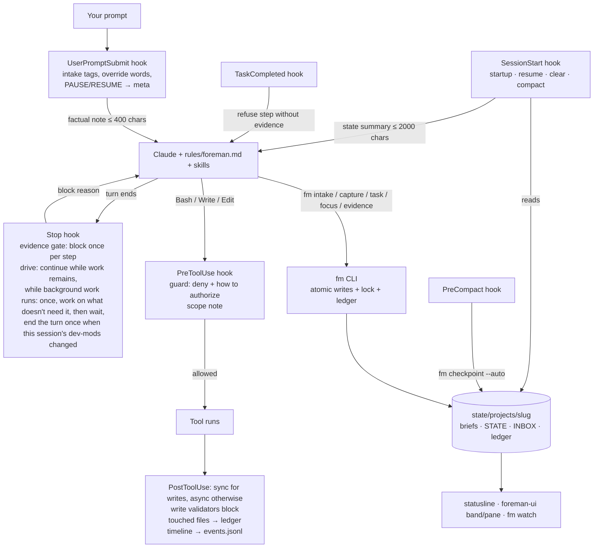

# Foreman — system map

Not loaded every session (`~/.claude/rules/foreman.md` points here). Read it when you're unsure where something lives or how the parts interact. `fm doctor` checks the file map below against disk.

## 1. What Foreman is

Foreman is a local Claude Code plugin (hooks, a small state CLI `fm`, skills, always-on rules, two read-only agents) that runs every request, however terse, through one loop:

**capture → expand → ground → plan → execute → verify → reflect → record**

It keeps one central, current record per project (what's active, what's queued, what was decided, what was learned), refuses "done" without recorded evidence, captures new ideas instead of chasing them, resumes at the exact step after `/compact`, `/clear` or a new session, blocks dangerous commands in bypass mode, audits finished work through independent lenses before it counts as done, asks for consent in plain chat (never by making you run a command), brainstorms open-ended requests, and keeps working through the queue ("drive", optionally in full autonomy) until it's empty or it needs you. It's cheap: ~62 always-on instruction lines and ~1.3k tokens of skill/agent descriptions; hooks run at p50 ≈ 29 ms, p95 ≤ 33 ms (no `traceback` or `dataclasses` on the hook path: `fmcore.record` stands in for `@dataclass`, tracebacks load only on errors; `tests/test_core.py` keeps it that way).

## 2. How to prompt it

A plain one-line request gets the full treatment: Claude classifies it ("Treating this as FIX, tier S."), writes a brief, plans to the tier, executes, verifies with evidence and records.

```
fix the login timeout on slow wifi                       ← one-liner: classified and planned
FIX: login times out after 30s on slow networks          ← tagged
FEATURE: export report as CSV @src/reports #T-0012       ← @scope, depends on T-0012
CLEAN!: collapse the three date helpers into one         ← ! urgent (preempts)
PERF?: dashboard first paint takes 4s                    ← ? explore: options + recommendation, no code yet
SECURITY: review the upload endpoint
CONTEXT: Django app; don't touch migrations              ← applies to every item in the block
NEVER: push to main                                      ← CONSTRAINT / MUST / NEVER
DONE-WHEN: all tests pass and the CSV opens in Excel     ← block acceptance
SKIP: mobile layout                                      ← non-goal
```
Tags: CLEAN (REFACTOR, TIDY) · PERFORMANCE (PERF) · SECURITY (SEC) · FIX (BUG) · FEATURE (FEAT, CAPABILITY, CAP, ADD) · RESEARCH (SPIKE, INVESTIGATE) · CONTEXT (NOTE) · CONSTRAINT (MUST, NEVER) · DONE-WHEN (ACCEPT) · SKIP (OUT).

Order: BASELINE → RESEARCH → CLEAN → PERFORMANCE → SECURITY → FIX → FEATURE → FINAL VERIFY → REFLECT. Dependencies override it; a baseline-breaking FIX and critical security findings are hoisted.

Override words: `NOW:` (checkpoint, switch, offer to resume) · `PAUSE` / stop / hold on (checkpoint; drive pauses) · `RESUME` · `STATUS` · `FULL AUTO` / `STANDARD AUTONOMY` (whole message) · "that's for the current task" (your last message was a steer, not new work). Anything new while a task is active is captured, not started.

Plain words work too: Claude runs every command itself ("is foreman ok?" → doctor, "clean up" → tidy, "this repo is sensitive" → `fm sensitive on`). Open-ended ("super improve it"), exhaustive ("limitless", "every possible …") and broad ("a ton of …") requests go to `/foreman:brainstorm` (eight lenses, capability map and approaches among them; every idea cluster grounded and shown to you); a repo-wide cleanup goes to the `clean/repo-sweep.md` playbook. When Claude needs your consent for a guard category it runs `fm ask`, and Claude Code shows you its own permission prompt saying exactly what would be granted; approving grants it (only an approved prompt for that very call can), refusing refuses it, and nothing you type in chat cancels it. For ongoing work on Foreman itself, `fm ask ID core --standing` asks once for a standing yes that covers Foreman's own code, rules and evals for every later task (settings, state and the guard file still ask; like trust, it covers a finding that names one file by its real path, a relative shell write included, never a tree write or a target not known before it runs: T-0180); `fm standing` shows it and `fm standing off` revokes it. `/fm-trust on`, typed by you (the mod checks the prompt came from you), also lets Claude edit the guard and Claude Code settings until `/fm-trust off` or `fm trust off`; `fm trust` shows it, and Claude can never turn it on. Other questions come as an AskUserQuestion prompt. In full autonomy nothing is asked mid-run; what only you can grant is asked at the end.

Slash commands (Claude can start all but capture, tidy, doctor and design-extract itself): `/foreman:intake` · `/foreman:brainstorm` · `/foreman:next` · `/foreman:resume` · `/foreman:status` · `/foreman:capture <text>` · `/foreman:tidy` · `/foreman:doctor` · `/foreman:reflect` · `/foreman:improve` · `/foreman:playbooks` · `/foreman:debug-test` · `/foreman:release` · `/foreman:research` · `/foreman:directions <sentence>` · `/foreman:ui-design` · `/foreman:design-extract [ui root | seed]` · `/foreman:build`.

CLI (on the Bash tool PATH): `fm init|state|queue|next|resume|watch|ui [--json --follow]|projects [--json --follow]|session start|list|tail [--follow]|send|stop|rm|agents|claude list [--all --follow]|show ID [--agent A --follow]|agents|image|files|file|send|serve status --json|intake|capture [--from-file PATH|-]|task new [--interpretation --approach]|show|set|step|ac|evidence [--run CMD]|finish|prove [--run CMD|--hunks|--vacuous|--same CMD]|audit|log|done|block|drop [--done-in ID]|defer [--until DATE]|packet ID [--out PATH]|focus|checkpoint|sentinel|log|ask|decide [--kind costly,outward --reverses T --revisit TRIGGER --revisited T --review] [--ask Q --default A|--options … --urgent] [--digest] [--answer N]|taste [adopt|decline N]|looks [rank|keep|revert|not|calibrate|learn]|surprise TEXT|vetoes [rm N]|rule [list|add PATTERN [--on bash|path] [--block|--warn] [--why T]|add --from-veto N|rm N]|task assume ID add [--check CMD]|verify N|research add [--from-agent FILE]|list|show NAME|ideas [--rounds N --dry K --deepen K]|recall [--corrections] [TEXT|--task ID]|map [--rebuild]|impact PATH|outline PATH|why FILE[:LINE]|instruments|sym PATH:NAME|fail [FILE]|logs FILE [--since-good FILE]|data FILE|trace [FILE]|pr ID|tour ID|second plan|debate|session|export agents [--out PATH --force]|landscape [--if-due]|deps [--research N]|replay [--days N --accept] [--cmd TEXT --cwd DIR]|bench build [--judged]|run|show|compare|gate|models|duel PLUGIN|versions REV|court|soak|lane new|list|rm|brief ID|gates [TYPE TIER]|quiet -- CMD|cost [--days N]|usage [--prune]|wiring|digest|share on/off|evals add ID|notify CMD|compact-output [on|off|status]|orders [add --every P|--on-change PATH TEXT|rm N|run]|sensitive on|off|drive on|off|posture [lite|full]|autonomy [standard|full]|ideas|serve [start|status|stop] [PATH]|run [--models S=…,L=…] [--stall MIN]|check [add|rm|list] [--evidence ID] [--repeat N]|audit prep ID [--note TEXT]|audit scan [--base REV]|repeats [dismiss KEY]|sync [on|off|status|import|export]|plugins find|check|install|enable|disable|add-marketplace|forget|docs [--strict]|tidy|doctor [--full|--restore-state|--repair]|sweep FIX [--grep TEXT --dry-run]|adopt|inbox gh [--repo R]|canary [--if-changed]|machine [--name NAME]|install-user|uninstall-user` — see `fm --help`.

The procedure is enforced by the harness, not recalled: each task's stage (captured → planning → ready → executing → verifying → auditing → closing) is derived from its brief; `fm next` and every prompt, session start and Stop note name the one next required action and its procedure (`fmcore.SKILL_FOR`: the skill or playbook that fits, named once a session per hint, T-1697); `fm focus` refuses a brief that isn't planned for its tier; file edits inside a Foreman project are refused while no task is active (`fm task new … --ac … --step … --focus` starts a small one in one command).

## 3. File map

| Path | Purpose | Owner | Loaded | Budget |
|---|---|---|---|---|
| `BUILD_PROMPT.md` | origin spec | user | on demand | — |
| `MASTER.md` | this map | Claude (via tasks) | on demand | — |
| `README.md` | repo overview, install | Claude | on demand | — |
| `CHANGELOG.md` | per-version changes | Claude | on demand | — |
| `demo/` | the README's recordings. `live.*` (T-0903): Claude Code with the foreman-ui mod fixing a seeded bug, made by `record_live.py` (in true color: shot.py sets `CLAUDE_CODE_TMUX_TRUECOLOR=1`, without which Claude Code drops to 256 colours inside tmux, T-1209): a throwaway repo and `FOREMAN_STATE` under `/tmp/fm-live-*`, Claude Code (Sonnet, auto-updater off) in `shot.py`'s tmux harness (its own server; this session's `CLAUDE_*`/`FOREMAN_*` never passed on), the request typed, the coloured screen captured until T-0001 is done, home/user/account names scrubbed, waits squeezed to 1.2 s; `live.cast`, `live.svg` (svg-term-cli), `live.mp4` (`shot.render` at a fixed 170x46 + ffmpeg); `--from-cast` re-renders without a new session. `demo.*` (T-0902): `fm demo --pace 1` recorded through a pseudo-terminal by `record.py` (`--mp4` via headless Chromium) | Claude | when the demo changes | — |
| `site/` | the GitHub Pages site (T-1206, T-1220): the hand-built landing `index.html`, shared `style.css` (tokens, light and dark, chart palette) and `site.js`, `assets/` (favicon robot, poster frame from `demo/live.mp4`); `build.py` (stdlib) renders one page per feature from `pages.py` (content as data) with inline SVG charts from `data/stats.json`, which `stats.py` makes from this machine's Foreman state and git (counts only, never task text or paths; rerun it before a release; it also reads the newest `fm bench duel --vs none` pair). T-1609: the landing hero opens on `poster()`, the proof chain (tasks done, evidence, proofs, commits) drawn inline from those totals at the index's poster mark. T-1610: `scene()` puts both posters and a canvas in `.hero-scene` and inlines `hero-scene.js` (raw WebGL2 from ui/templates/scene.html, whose survival code a test keeps in step; it reads the visible poster's stations; data-state poster|live|still|no-webgl2|lost|failed). T-1222: the Benchmarks page shows `data/bench.json` from `bench_safety.py` (24 dangerous and 25 everyday commands through `fmguard.check`, each Foreman's verdict beside what Claude Code does alone in bypass mode) and the duel, with its verdict written from the numbers whichever way they fall. `.github/workflows/pages.yml` runs `build.py _site` on pushes to main that touch the site; Pages must be set to deploy from GitHub Actions once | Claude | on push to main | — |
| `install.sh` | one-line bootstrap: clone, plugins, marketplace + plugin, bypass, wiring | user/Claude | run by user | — |
| `setup-plugins.sh` | curated plugin setup, `--dry-run` | user/Claude | run by user | — |
| `configure-repo.sh` | point install at a GitHub repo (one-time) | user | run by user | — |
| `reset-claude.sh` | optional behavior-layer reset before installing | user | run by user | — |
| `.claude-plugin/marketplace.json` | local marketplace `foreman` → `./plugin` | Claude | by Claude Code | — |
| `plugin/.claude-plugin/plugin.json` | plugin manifest (name, version) | Claude | by Claude Code | — |
| `plugin/settings.json` | plugin default `subagentStatusLine` | Claude | by Claude Code | only `agent`/`subagentStatusLine` honored |
| `plugin/bin/fm` | CLI entry (on the Bash tool PATH; protected) | Claude | on call | — |
| `plugin/lib/` | the Python modules, one line each under "plugin/lib modules" below the table (T-1713) |
| `plugin/hooks/hooks.json` | one handler per event (13 events), exec form (protected) | Claude | by Claude Code | p95 ≤ 150 ms |
| `plugin/defaults.json` | every setting's default as the last release shipped it: fm release names each one it changes in the notes and rewrites it; fm settings changed compares with it (T-1549) | fm release | read at release and by fm settings changed | — |
| `plugin/protocols.json` | how much deliberation each tier gets: S no panel, M optional, L `fm second plan` before approval (T-0662) | Claude | read by fm second plan and fm next | data |
| `plugin/hooks/hook` | dispatcher `hook <Event>`, and `hook --agent codex|gemini|opencode <Event>` for other agents (their payload read into Claude Code's shape, answered in their format); guard fails closed (protected) | Claude, Codex, Gemini CLI, opencode | per event | — |
| `plugin/integrations/opencode/foreman.ts` | opencode plugin `fm agents install opencode` copies in: the guard in `tool.execute.before` (throws to refuse, fails closed), auto-evidence after, Foreman's context in the system prompt | opencode | per tool call / prompt | — |
| `plugin/hooks/statusline` | statusLine: one true-color session line + Foreman line with `step N/M` (a chip when foreman-ui is on), from `status.json`, plain under `NO_COLOR` (T-0962); `statusline_layout: "stack"` restores original + claude-hud + Foreman lines; session snapshots (protected) | Claude | per statusline refresh | < 100 ms own work |
| `plugin/monitors/monitors.json` | plugin monitor `foreman-mail`: `fm bus watch` for the whole session, one line per new bus message for it (or all), nothing otherwise, so an idle session wakes without tmux; it never marks mail read, beats `state/bus/watch-<sid>` every 2 s poll, finds its session from `CLAUDE_CODE_SESSION_ID` or the parent processes SessionStart records in `state/sessions/by-pid/`, and exits with its session (T-0777) | Claude Code (interactive) | session-long | 2 s size poll, stdlib |
| `plugin/hooks/subagent-statusline` | per-subagent rows (task, tokens vs window, elapsed) (protected) | Claude | per refresh | — |
| `plugin/rules/foreman.md` | always-on operating rules (protected; symlinked into `~/.claude/rules/`) | Claude | every session | ≤ 80 lines, 6400 chars (46, 6.3k) |
| `plugin/output-styles/foreman.md` | the Foreman reply format (task/stage header, `✓ cmd → result` lines, `Changed:`, `Next:`, `⚠ Needs you:`); optional: the same format is the rules' "Replies" section (T-1279), so `fm install-user` no longer selects the style (its per-turn reminder was 2.7% of the context) and removes it where an older install set it | Claude Code | system prompt, every turn | < 260 words |
| `plugin/skills/` | intake (+ references: planning, execute, audit lenses, delegate, ported superpowers procedures), brainstorm (+ `references/ideas-prompt.md` for `fm ideas`), directions (six style directions from one sentence, the pick saved as DESIGN.md; + `references/cards.md`: card format, set rules, generic defaults, preview recipe, worked example), ui-design (T-1700: one path for page, component, motion and 3D work: direction, tokens, build, motion, 3D, visual QA; routes to the ui playbooks, directions and fm design/scene/motion/looks/page/img/smoke), design-extract (user-only, T-1507: DESIGN.md's token table, contrast proofs and a seed palette through `fm design extract|contrast|palette`), next, resume, status, capture, tidy and doctor (user-only, T-1705), reflect, improve, debug-test, release and research (T-1701: job skills on task words, a failing test, shipping, finding out first; each wraps existing playbooks and fm verbs, which test_docs checks exist; the FIX and RESEARCH hints load them), playbooks (ported ECC and Foreman's own references, a stage may keep its own `INDEX.md`; `fm check playbooks` lints them: every file indexed, no duplicate, a Use-when line, a numbered procedure, real card names, python blocks that run unless marked no-run (trusted like the repo's tests), none well past its size in `ratchet.json` (`fm check playbooks ratchet` records growth and shrinkage), and names those no session read in 60 days; T-1621: `fm playbooks show PATH` loads one with its `{{fact}}`s from fm map — test, gates, language, entry, ci, layout, hot, cards; `fm playbooks eval PATH [--real] [--ablate]` scores its held-out briefs (--ablate: each section's share of the lift) (plugin/evals/playbooks/) with and without it into playbook-evals.jsonl (T-1618); T-1622: `fm playbooks route STAGE` names a stage's playbooks from `fmcore.SKILL_FOR` (T-1833: `route TEXT|--task ID [-k N]` ranks the library by relevance, bm25 over an FTS5 index in the state folder `playbooks/`, one stat per book to refresh; without FTS5 a title/use-line scan; `plugin/tests/bench_playbooks.py` times it at 20k; a route TEXT records the paths it named, a Bash `route STAGE` credits the stage's books only when the stage is the whole argument; T-1838: tuned on 24 labelled real titles, verbatim, in test_playbook_route: the use line weighs as much as the title, body 0.25, the first 8 query words (a task's title comes first), a task's type prefers its folder's books 1.5x (`route --task`); 17 of 24 in the top 3, 9 at the top, from 15 and 7 (the 8 held out: 4 and 1, from 3 and 0; fm which past 2000 books queries the same first 8 words); the per-turn hint still names no routed book: 22-33 ms to load for a top 1 right 9 times in 24; T-1834: a close records the books it loaded and the share followed, `coverage --unused [--days N]` names unread, unrouted books and near-duplicate pairs (never deletes), `draft` refuses a near-duplicate of a book without --force, the skill list is capped; T-1885: six books mined from finished tasks whose kind routed to no book (command guard, CLI errors, benchmark statistics, ship to main, regex backtracking, surface parity), held-out real titles of each kind route their book in the top 3 (`test_mined_books_route_their_kind`); perf and security keep an `INDEX.md`), `blame PATH` maps each line to the task id in its commit's summary (else a Task: trailer, else the body; no textconv, not for workers), `preview PATH` lists its runnable python blocks and quoted `… :: CMD` verify commands; unknown stays `{{fact?}}` — and the project's `.claude/playbooks/<stage>/<name>.md` (writable by a session, shared through git) under "This project" as a blockquote below a provenance line, marked (uncommitted) when it differs from HEAD, a plain file only, 16 KB, its `{{…}}` untouched), library (stack cards in `cards/<area>/<name>.md`: Verify, Test first, Do, Avoid, Review; `fm lib` suggests by manifests and files, searches them with installed plugins' skills, shows whole cards or `--section`s, lints them with `fm lib check`; never loaded until read; T-1519: an optional `verified: YYYY-MM-DD`, set only by someone who ran the card's Verify commands that day, must be a real, past date (a day of slack for time zones), is noted after 365 days and is said under `fm lib show`) | Claude | descriptions always-on; bodies on invoke | SKILL.md < 500 lines |
| `plugin/agents/` | (T-0768: `effort`, `maxTurns`, and `omitClaudeMd` on the read-only scout, recon and debugger, checked by fm doctor) `fm-recon`, `fm-reviewer` (Sonnet), `fm-scout` (Haiku: cheap file:line lookups), `fm-debugger` (Sonnet: fresh-eyes ranked root-cause hypotheses with discriminating probes, as `fm task hypo` lines) — all read-only tool allowlists, except `fm-builder` (T-0234: Edit/Write/Bash, launched only with Agent isolation "worktree" from `fm lane brief ID`; works one S/M task test-first in its own worktree and commits on its branch; never pushes, merges or closes — the guard's `confine` category and fm's refusals enforce it); the reviewer runs one audit lens per brief (and a performance lens for PERFORMANCE work); `fm-reproducer` (Sonnet, T-0608: Edit/Write/Bash like the builder, worktree-bound from `fm lane brief ID`; commits only the failing test or repro on its branch and hands back the command for `fm task prove`, never fixes or merges). Every agent ends with `Noticed:` lines, which `fm research add --from-agent` turns into discovered captures (T-0629); a builder blocked on a decision writes `ANDON.md` in its lane and proceeds on its stated assumption, shown by `fm lane list` and `fm next` (T-0648); `fm usage --agents` is the per-type scorecard (T-0647) and `fm bench seed-review` benches the reviewer on planted bugs (T-0646). No tool-less agent: Claude Code gives an empty `tools:` list every tool | Claude | on delegation | output ≤ 400 words |
| `plugin/commands/build.md` | `/foreman:build` (the bootstrap) | Claude | on invoke | — |
| `plugin/commands/backlog.md` | `/foreman:backlog` (T-1664: `fm inbox first`, `swipe`, `pick`/`prefer` and `ticket` asked through AskUserQuestion) | Claude | on invoke | — |
| `plugin/workflows/` | `/foreman:review` and `/foreman:ideas` multi-agent workflows (T-0787) | Claude | on invoke | — |
| `plugin/templates/` | `brief.md` template; `mcp-server/` (fm mcp new); `web/index.html` and `tui/panel.py` (fm new, T-1519) and `tui/cost_meter.py` (a sample fm code extension) | Claude | by fm | — |
| `plugin/themes/` | optional Foreman color theme (`/theme`) | Claude | on selection | — |
| `plugin/observability/` | telegraf OTel input, Grafana dashboard, setup notes | Claude | manual | — |
| `plugin/evals/` | `claude plugin eval` cases with the rules embedded (protected) | Claude | `claude plugin eval` | `--max-cost-usd` |
| `plugin/tests/` | unit/behaviour tests, fixtures, hook bench, `e2e/` (live scenarios, install round trip, eval sync) | Claude | on demand | — |
| `mods/foreman-ui/` | the UI mod (function-hook plugin `foreman-ui@foreman`): `hooks/register.tsx` (band card with a mini stage rail; the pane top-down by urgency (T-0909): Needs you and waiting plans, the hero (task, stage rail, steps bar, current step, time against the usual), Now (running calls), subagents, shells, Plan (steps with a done glow, criteria with their checks, audits), Pulse (swim lanes of the session's tool calls, 14-day closes, context/spend/hooks/guard gauges), Queue, Inbox (one Up next card when both are empty), then gates, brainstorm, files, fleet (2+ sessions), spend, bench, research, Activity newest first, controls; the quieter cards fold to their head (▾/▸, kept in the mod's store, T-0914); a closing task's done card tops the pane for 6 s (T-0913); a Motion setting full/calm/off (T-0912); moving rasters repaint by `$.ui.blit` at ~30 fps while work is live; `/fm`, toasts, animated running tool/subagent rows, spinner step, turn summary line; renders `fm ui --json`, buttons run `fm`), `hooks/kit.ts` (palette, true-color Raster bars and text twins, pulse, fade, sparkline, churn bar, stage rail, swim lanes, day bars, eta bar, tool faces), `hooks/rows.tsx` (rows and chart elements), `hooks/state.ts` (shared constants, the live tool-call timeline), `sounds/` (chimes), `types/index.d.ts` (the view-model contract), `tests/` (`claude plugin test`), `tools/pane_replay.py` (T-1534: the pane drawn from a recorded `fm ui --json` view with no live session through `tests/replay.test.tsx` and the kit's fakes, frozen clock, UTC and C.UTF-8; `render` as text or `--json`, `twin` diffs two runs, each its own process, `--matrix` a third in UTC+14 and a German locale; synthetic fixtures only in `tests/fixtures/`) | Claude | by Claude Code when the build has mods | no rules or gates of its own |
| `plugin/uninstall.sh` | remove wiring, plugin and marketplace; keeps state unless `--purge-state` | Claude | run by user | — |
| `plugin/README.md` | plugin overview | Claude | on demand | — |
| `plugin/THIRD_PARTY_LICENSES.md` | MIT licenses of ported ECC and superpowers material | Claude | on demand | — |
| `local/recon.md` | Phase 0 recon (machine-specific, runtime, gitignored) | Claude | on demand | — |
| `local/PLAN.md` | build plan, deltas, decisions (runtime, gitignored) | Claude | on demand | — |
| `local/verification.md` | Phase 7 results (runtime, gitignored) | Claude | on demand | — |
| `backups/` | `~/.claude` tarballs and settings.json backups (runtime, gitignored) | fm/install.sh | restore only | — |
| `state/registry.md` | project index, generated from meta.json (runtime) | fm | on demand | — |
| `state/install-manifest.json` | every change outside the repo, with originals (runtime) | fm | by uninstall | — |
| `state/events.jsonl` | hook/tool timeline for `fm watch` (runtime; rotated by tidy) | hooks | by fm watch | rotate > 5 MB |
| `state/sessions/<id>.json` | statusline snapshots (runtime; cleaned after 7 days) | statusline | by fm watch | — |
| `state/logs/hooks.log` | hook errors (runtime; rotated by tidy) | hooks | by fm doctor | rotate > 1 MB |
| `state/projects/<slug>/meta.json` | project metadata: path, sensitive, drive, paused, autonomy, pending approvals, session, last tidy (runtime) | fm, UserPromptSubmit | by hooks | — |
| `state/projects/<slug>/STATE.md` | focus + queue + inbox, generated from briefs (runtime) | fm | summary injected at SessionStart | ≤ 60 lines |
| `state/projects/<slug>/INBOX.md` | captured items, generated (runtime) | fm | count + titles injected | — |
| `state/projects/<slug>/tasks/T-NNNN-*.md` | briefs: spec, steps, evidence, log (runtime) | fm | on demand | S ≤ 10 content lines |
| `state/projects/<slug>/decisions.md` | decisions: date, what, why, rejected (runtime) | fm (`fm decide`) | on demand | — |
| `state/projects/<slug>/research/` | saved recon/research summaries (runtime) | fm (`fm research add`, `fm research ask`) | on demand | — |
| `state/projects/<slug>/ledger.jsonl` | append-only event log (runtime; rolled monthly by tidy); each line carries `prev`, the hash of the line before it (T-1065: `fm verify-ledger [--head H]` walks the archives then the live file and names the first edited, removed or cut line; `fm task finish` prints the head) | fm, hooks | never wholesale | roll > 1 MB |
| `state/projects/<slug>/archive/` | archived briefs, ledgers, memory copies (runtime) | fm tidy | on demand | — |
| `state/projects/<slug>/gate.json` | Stop-gate/drive bookkeeping; with `state.line`, `badge.txt` caches (runtime) | hooks, fm | per hook | — |
| `~/.claude/rules/foreman.md` | symlink to `plugin/rules/foreman.md` (runtime, created by `fm install-user`) | fm | every session | — |
| `~/.claude/CLAUDE.md` | your preferences + a 4-line Foreman block between markers (runtime) | you (+ fm block) | every session | ≤ 50 lines |
| `~/.claude/settings.json` | statusLine wrapper, deny rules, drive env, bypass default, `worktree.baseRef: head` so builder lanes start from your branch (T-0803; runtime; originals in the manifest) | you / fm install-user | every session | — |
| `~/.claude/projects/<encoded path>/memory/` | native auto memory: durable learnings (runtime) | Claude | MEMORY.md at startup (200 lines / 25 KB) | tidy checks it |

### plugin/lib modules

One line per module, so two changes to different modules never touch the same line (T-1713).

- `fmcore` (state, briefs, queue, intake, ledger, locks, audits)
- `fmcli`
- `fmpy` (T-0368: below Python 3.12.7, fm and the statusline re-exec and the hook dispatcher runs a child under a supported interpreter saved in `state/python`, found once, re-searched by `fm doctor`; a crashing child leaves the hook to run itself, so the guard never fails open)
- `fmguard`
- `fmhooks` (incl. chat approvals)
- `fmtidy`
- `fmdoctor` (also `fm wiring`, one screen of what is wired; checks the status views match the briefs, `--repair` regenerates them)
- `fmwatch` (`fm ui --demo`: a canned view from `ui-demo.json` with every key a real one has, T-0962)
- `fmsetup`
- `fmideas` (tool-less brainstorm children with a coverage map and holes per round, `--falsify` kill tests, `--crossbreed`, reframing and provocation lenses, and per-lens keep rates in `fm taste` from each brainstorm's `ideas.json`, T-0684; and `fm oracle`: behaviour examples from a task's spec alone)
- `fmtaste` (T-1537: `fm looks`, the taste ledger in state/taste/looks.json: the twelve looks ranked by what the user kept, reverted, called "not like that" or picked in a 12-pair calibration, and learned only from local files the user names, read-only and capped; kept and reverted are recorded only when the model runs fm looks keep/revert)
- `fmmandate` (T-1400, the standing mandate): `fm mandate set "<request>" --until YYYY-MM-DD [--usd N]` keeps a sweeping request as one record in the project meta (its text, its `fm clauses`, the end, a recorded spend bound; `fm contract` enforces spend); `fm mandate` shows it, `off` clears it. While it stands, what `fm scout` (and so `fm night`) captures says it was found under it; once it ends, scout captures one RESEARCH decision keyed by when it was set (renew or let it lapse) and runs no probe until it's renewed or cleared.
- Upstream watch (T-1391, `fmscout`): a stale skill source whose remote HEAD (`git ls-remote`) is still its pinned commit isn't fetched; one that moved and changed its items is one RESEARCH finding listing what was added, removed and renamed (`index_delta`, a rename keeps its path) with its licence class; nothing installs. `probe_cc_changelog` reads Claude Code's CHANGELOG from the indexed anthropic-claude-code checkout and makes a finding for each bullet past `CC_TESTED` whose backticked names appear nowhere in Foreman's own text.
- Literacy and prompt variants (T-1403): `fm code runners --probe MODEL` scores a model profile 0-10 on `PROBES` (four JSON-only shapes, two data-in-an-envelope, two "unknown" over invented, an exact word, a sum; exact graders, no judge model); `fm code bench --variants base,evidence` runs the seeds once per prompt variant (`FM_PROMPT_VARIANT` adds `VARIANTS[name]` to the plan and act prompts) and reports each one's closed count, each run recorded with its `variant`. base stays the default until the numbers say otherwise.
- Offers (T-1397): `fm code` prints one `skill: NAME matches (class, ~N tokens)` note at a new run's start when one indexed skill from `fm lib`'s sources clearly matches the request (`skill_offer`: a name word, four points, a lead over the next); nothing is installed or loaded. `fm plugins suggest [--json]` lists up to three marketplace plugins not installed that fit the project's stack (`fmplugins.suggest`: the best `find` hit per detected card, the card and its evidence as the reason).
- `fmdojo` (T-1608: `fm dojo [--rounds N] [--seed S] [--quiz]`, a drill for people: commands from the guard's labelled corpus, about half refused; allow or refuse, then the guard's live verdict (`fmreplay.verdicts`, no grants) and the case's why; off a terminal or with `--json`, the drill as a study sheet with the answers)
- `fmdrill` (T-1669: `fm drill [--seed N] [--faults 3-6]`), a scripted day (status, hooks, task log, evidence, checkpoint, Stop) in a temp home with faults planted mid-day (torn ledger and journal, stale lock, broken lane, corrupt state JSON, an unreadable file); each must be found by fsck or verify-ledger or healed by the day, nothing may print a traceback, and the day's task must survive the repair; the report names the seed to replay; the home is kept only on a failure. Corrupt state and unreadable files end any verb with exit 4 naming the file, and hooks say so in one line instead of tripping the breaker.
- `fmoffice` (T-1406: `fm check office FILE`, a stdlib asserter for .xlsx/.xlsm and .docx deliverables usable as a verify command: no error cells (#REF!, #DIV/0!, …) or broken Word fields, `--cell 'Sheet1!B7=42'`, `--sheets N`, `--contains TEXT`; cached values only; members over 64 MB unpacked and any DTD refused (expat with the doctype handler raising))
- `fmimg` (T-1630: `fm img info|diff`, a stdlib PNG codec, 8-bit and below with all five filters, no Adam7 or 16-bit, and a changed-pixel count and box; `diff --tol N` counts a pixel within N on every channel as unchanged, T-1684)
- `fmshot` (T-1636: `fm shot URL|FILE...`, a viewport shot, frames in real time and a poster frame (the most painted) per page that moves, from a headless Chromium found, never installed, driven over --remote-debugging-pipe; `--frozen` is fm smoke's frozen profile; shots in state `shots/` or a non-link `--out`; no browser: exit 0 and why; T-1637: `--diff BASE` compares each viewport shot with BASE/<page>/viewport.png and passes within the baseline's noise floor, the most its own frames differ from its viewport shot (no frames: unmeasured; over 5% of the page: a --frozen warning), else fails naming the changed box; a font that visible text uses and that fell back per document.fonts, or fonts that couldn't be checked, fails it too; with --diff and no browser it exits 1; T-1642: `load(b, url)` opens a page, answering held requests while it settles, for fm shot and fm critique; `safe()` replaces every Cc/Cf/Co/Cs character)
- `fmcritique` (T-1642: `fm critique URL|FILE`, a computed-style census of the visible elements, every colour, font family, font size, radius, shadow and spacing value with counts, taken through fmshot's browser under fm shot's frozen profile by one fixed JS function, or read from a census .json, and critiqued against DESIGN.md's Tokens table: values no token names, near-duplicates under ΔE_OK 0.02 or within 7%, outliers used once or twice; fm flow's URL policy (files and localhost unless `--any-url`, every request checked); exit 1 on findings, 2 and "not run" with no browser or an unreadable `--design`; `--why SELECTOR` prints the element's matched rules winner first, with their stylesheets, and the winning declaration per property from CSS.getMatchedStylesForNode, capped; page text stripped of Cc/Cf/Co characters and capped; T-1644: `--bingo` scores nine tells (generic font, violet accent, Tailwind greys, one radius, one shadow, one gap, a flat or sprawling type scale, near-duplicate drift) on a 3x3 card off the census, exit 1 on a full row, column or diagonal; `--marks FILE` takes a screenshot with pencil-red strokes (r ≥ 170, g and b ≤ 100) shot again at its own size and diffed red-only, 16px cells joined 8-connected, or a JSON list of boxes, and captures one FIX per element under a mark (selector and text by one fixed JS function, quoted as page data, deduped on a hash of URL, box and note, scoped to a local file); `--brief [ID]` looks for the brief's quoted phrases (criteria less their verify commands) in the page's text and accessible names, exit 1 naming the missing; bad input exits 2 before any browser)
- `fmflow` (T-1639: `fm flow FILE`, a journey of goto/click/type/expect/wait steps run through fmshot.Browser as a verify command; selectors and text as JSON data to one fixed page function; goto and every request the page makes (Fetch domain) held to files in the flow's folder and localhost unless `--any-url`; exit 1 names the failed step, 2 with no browser)
- `fmraster` (T-1631: an integer rasteriser, edge functions, a 1/z z-buffer and flat shading, PNG through fmimg; no floats, so a frame's pixels match on every machine)
- `fmstories` (T-1640: `fm stories CHART`, a component's state matrix: a JSON chart of named states, each reached by fm flow steps (a relative goto keeps its ?query), shot through fmshot.Browser under fm flow's URL rule and request blocking, into one page of cells with inline PNGs and a CSP that loads nothing else; no browser: the states listed and why, exit 2 as fm flow's; capped states, steps and sizes)
- `fmscene` (T-1633: scene.json validated, `fm scene compile --to three`; T-1634: `--to component`, the same module plus an `<fm-scene>` element; T-1635: `fm scene cells FILE [--cols N] [--turn DEG]`, the scene as 24-bit half-block terminal cells; T-1847: `fm scene import FILE [--out PATH]`, three.js JSON (Object3D.toJSON) to a checked scene.json, nested transforms composed, what it can't carry named; T-1848: `fm scene metaballs [--balls N] [--grid G] [--seed S] [--out PATH]`, a seeded closed blob by marching tetrahedra; T-1851: `fm scene terrain [--days N] [--out PATH]`, the repo's churn as a ridge per busiest top-level path; T-1849: `fm scene airlock [--days N]`, the guard's blocks per category and its let-through tool calls as boxes either side of a gate; T-1850: `fm scene bench`, fm code bench's last 12 runs as a box per seed, green closed, red not, height the seconds; T-1852: `fm scene lookbook [--count N]`, the look cards hung in a 3D gallery, best ranked first, each palette as colour-field bands; T-1846: `fm scene shade FILE --out PNG [--size WxH] [--time S] [--set NAME=V,…]`, fmshade compiles a GLSL ES fragment subset to Python and runs it per pixel, derivatives from 2x2 quads, unset uniforms at preview defaults; T-1873: `fm scene gallery --out PNG`, `gallery()`: each built-in from `_builtin` (cmd_scene's builder) or `SAMPLES[action]` on ValueError/OSError, drawn unturned at 160x100 by `_frame`, tiled 3 wide by `_sheet` (turntable's tiler), a `GALLERY` caption per tile printed in order)
- `fmshade` (T-1846: a GLSL ES fragment-shader subset compiled to Python and run per pixel on the CPU for `fm scene shade`; derivatives from 2x2 quads, per-pixel and per-render step budgets, refusals name the line)
- `fmmission` (`fm mission`: the mission, surfaces, lenses and pack for an open-ended request, T-0375)
- `fmdemo` (`fm demo`: the real fm CLI and guard fix a seeded bug in a throwaway repo, no model calls, nothing left behind; `--pace SECONDS` pauses per stage and types the commands out, colour on a terminal or FORCE_COLOR, T-0902; doubles as a smoke test, T-0870)
- `fmplaybooks` (`fm check playbooks [ratchet]`, T-1505: the playbook library's lint — index coverage and dead index lines, SKILL.md's budget, shared titles, 5-word-shingle Jaccard over 0.6, a Use-when line, a numbered procedure, `fm lib show` names, python blocks run with `python3 -I` in an empty folder under memory, process and file-size limits unless marked no-run (trusted like the repo's tests: hygiene, not a sandbox), a token ratchet in `skills/playbooks/ratchet.json` that fails past 10% + 50 tokens of growth — and a reach report from events.jsonl's Read events; a lane runs `python3 plugin/bin/fm check playbooks` from its worktree)
- Playbooks from this repo's own work (T-1523, `fmplaybooks`): `fm playbooks draft ID` (`draft`) turns a done task's brief into a draft in the library's shape (Use-when line; its steps numbered, each with the last `exit 0` run that proved it after a dash; criteria as checks; lessons and plan gaps as pitfalls; files touched); `fm playbooks mine` (`mine`) lists each file changed in 5+ of the last 400 non-merge commits (sweeps of 30+ files skipped) with the files beside it in 60%+ of them; `fm playbooks counter` (`counter`) lists commits git reverted and tasks blocked with a reason, newest first; `fm playbooks show` puts "Look here first" above a playbook when up to three of its numbered lines share two or more words with the active task's failed runs and plan gaps (`look_first`, JSON `look_first`).
- Learning from playbooks (T-1525, `fmplaybooks`): `fm playbooks score NAME --task ID` (`score`, the dojo) marks each numbered step followed when the task's steps, evidence, approach and log share two or more of its telling words with it (words at most an eighth of the library's playbooks use); `fm playbooks kata NAME [--answer FILE]` lists the playbook's held-out briefs (`plugin/evals/playbooks/<stage>/<name>.json`) as practice and scores an answer against each one's checks (`passes`); `fm playbooks lesson [RANGE]` (`lesson`, `lesson_text`; one commit means its own change) lists up to 12 commits, the folders changed, two lessons from each task its commits name, and the review checklists the files call for (`REVIEW_BY_EXT`). The site's Playbooks page (`site/pages.py` `_field_guide`) lists every playbook by stage with its Use-when line, under tiles counting each stage.
- 3D checks offline (T-1530, `fmscene`): an animation may target `camera` (position only; no mesh may be named camera), and `pose` re-aims the camera at `camera.target` every frame, so a camera path replays as the demo; `fm scene compile --hud` (`compile_three(hud=True)`, `HUD`) calls `hud(renderer, fig)` after each render: an overlay with frame rate, draw calls, triangles, geometries and textures, the same numbers on `globalThis.__fmScene`; `fm scene check FILE` validates and counts (`faces`: three.js's triangles, a sphere's empty pole faces dropped); `fm scene turntable FILE --out PNG [--frames N]` (`triangles`, `turntable`) puts the scene through fmraster from N turns about +Y (T * R * S, look-at, depth negated and two vertices swapped so front faces stay front) into one contact sheet, no browser or GPU; `fm scene shader PATH` (`shader_problems`, `shader_paths`) checks each glsl code block of a shader card or GLSL file has a main, compiles under glslangValidator when it's on PATH (stage from gl_Position), and declares exactly the uniforms the card's ## Uniforms table lists. `fm scene check X.gltf|X.glb` (`gltf_problems`) checks a glTF offline: the GLB header and chunks, asset.version 2.x, every index in range, each accessor inside its view, each view inside its buffer, each buffer as long as it says (BIN chunk, base64 data URI, or a file beside it; a URI leaving the folder is a problem, never read). `fm scene soak FILE [--seconds N] [--budget-ms MS]` (`soak`, `soak_problems`) serves the `--hud` build, the page `SOAK_PAGE` and a three.js build (`find_three`: FOREMAN_THREE, else node_modules/three/build above the scene or cwd; r170+'s three.core.js copied too) from 127.0.0.1, mounts it in fmshot's headless Chrome (SwiftShader; the page, never the module, drops failIfMajorPerformanceCaveat), samples `__fmScene` once a second, calls `dispose()`, and fails on geometries or textures that grew, a p95 render time over budget, a scene that never drew, or one not back at its poster; with no browser or three.js it says why and exits 0.
- Divergence (T-1536, `fmtaste`): `fm looks tournament [LOOK…] [--n 2|4|8] [--answers a,b,…]` (`bracket`) seeds a single-elimination bracket with the named looks or the best-ranked (1 v last, 2 v second-to-last), replays the cumulative answers, prints the matches left and the command to continue, and at the champion records one `tournament` event whose matches score like a calibration's (winner picked +1, loser passed -1); `fm looks opposite LOOK` (`opposite`) ranks the other looks by palette distance (nearest colours both ways over the RGB diagonal) plus tag distance; `fm looks book [LOOK…] [--n N] --out FILE` (`book`) writes a script-free lookbook page of titles, lines, swatches and tags. The directions skill's step 4 says when to diverge (three lanes, a tournament, opposite day, a lookbook, `references/idioms.md`: five historical idioms of one layout); `fm design diverge [N] [WHAT] [--out DIR]` (`spread`, `variant`) writes N variant briefs in looks far apart (the best-ranked, then farthest-point by `distance`, the measure opposite ranks by) and `fm design diverge pick LOOK` keeps the winner; and `/foreman:looks` asks tournament matches through AskUserQuestion. A blind multi-runner taste panel was left out (decided: paid model runs to answer what the user's own picks answer).
- Taste follow-ups (T-1672, `fmtaste`): `fm looks roll` draws the look of the day (weight e^(score/3), seeded by the date, so the same all day while the ledger holds); `fm ui`'s `look` field and the pane's idle row show it once the ledger has taste. `fm looks bisect` splits the ledger at the signal where the leading look changed most (4 signals at least). `fm looks seance` lists the departed (score below 0) with their last words and the nearest look that lives on. `fm looks history [PATH]` reads DESIGN.md's git history (200 versions at most, 60 s; a stint cut by that window is dropped; a keep said by hand during a stint counts once) into stints: a look named ≥7 days is kept, replaced sooner is reverted, each stint recorded once (source FILE@sha), so a rerun records nothing. Decision: DESIGN.md is read by default as Foreman's own record; another path only when named.
- Design sprint (T-1538, `fmdesign`): `fm design sprint [ROOT]` (`sprint`, `sprint_text`, `SPRINT`) checks five stages in order and stops at the first that fails, naming its next step (`SPRINT_NEXT`): brief (DESIGN.md's ## Point of view, with no `VAGUE` word), direction (## Direction names `audacity safe|bold|wild`), tokens (a ## Tokens table with a row), build (UI files under ROOT, `lint` clean), critique (`check_gates` has gates and every must passes); exit 0 only when all five pass. `fm design vague TEXT` (`vague`) lists each sweeping word with the concrete question to ask. `fm task receipt` adds `swatches` (`fmdesign.swatches`): hex colours and transition/animation/duration/delay durations on the + lines of the UI files' diff since the task's base (a new untracked file: all of it), 12 of each at most, shown as one Swatches line. Left out (decided): nudge keys on a live dev server, a gamut-cube colour picker, a nightly design residency and a weekly design PR.
- Site build and stories (T-1541): `fmcodetui.snapshot` draws at t=0, so `site/build.py` is byte-reproducible (a test builds twice and compares every file); `build.case_study_html` turns each `EXAMPLES` run into `stories/<name>.html` (its card, then each verify, step, changed and closing event at its time since the start), linked from the card; `pages._wall` adds a cover per release to the Releases page (hue from the version, bar from its tests over the latest's); `fm task card ID [--out FILE]` (`title_card`, `write_card`, `HAND`) writes a proved task's 1200x630 SVG title card (hand-lettered face stack, nothing embedded or fetched), and `fm task finish` writes it to the project's `cards/<id>.svg` when the close is proved red then green. T-1785: a playbook index line naming a folder (`references/ui/examples/`) covers every file under it; `pages.gallery()` reads each UI playbook's `Example: `references/ui/…html`` line into (name, title, use, path); `build()` copies each to `gallery/NAME.html` (a missing file stops the build) and the `gallery` feature page links them; `test_site_gallery` keeps every example passing `fmnew.check` and `outside_loads`.
- Plugin parity (T-1822, memory cc-plugin-parity): `tests/test_plugin_parity.py` maps each `COMMAND_LABELS` command to its Claude Code route (`PLUGIN_ROUTES`) or an app-only reason (`APP_ONLY`) and resolves every route against fm's subparsers, `plugin/skills|commands` and a few CC keys.
- fm code app extras (T-1546, `fmcodetui`): F (`photo`, `App.take_photo`; the loop keeps `App.size`) writes the frame on screen to `foreman_home()/photos/frame-<time>.svg` and, with rsvg-convert (`_png`), its PNG; `snapshot` writes a PNG for a path ending .png. `fm code tui --chaos SECONDS [--seed N]` (`chaos`, `_chaos_event`, `HOSTILE`, `CHAOS_COMMANDS`) builds a headless App on an empty temp root with every source stubbed, then floods it with hostile events, presses only read-only commands (text in the prompt and search; Enter there becomes Esc), resizes from 1x1 to 220x70 and renders a frame after each; a crash reports its step, mode, size, error and trace with the seed, exit 1. Left out (decided): the isometric layout builder, golden frames against a terminal-emulator oracle, springy draggable panels, a wear-in UI.
- Receipts and review (T-1547, `fmcli`): `fm task receipt ID --svg FILE` (`_blueprint`) draws the receipt as a blueprint sheet (grid, files in reading order with +/− bars, UI marks, the swatches it added, before/after, a title block; everything escaped); `--sign KEY` (`_sign_receipt`, `RECEIPT_NS` foreman-receipt) writes the receipt text beside the SVG (or the project's receipts/<id>.txt), signs it with `ssh-keygen -Y sign`, writes an allowed-signers file from the key's .pub and the repo's user.email, and prints the `ssh-keygen -Y verify` line. `fm audit prep` adds `_past_nits`: ledger `finding` events on the same files (by their file, or a path their text starts with; rejected ones and this task's left out), newest first, 12 at most, as the brief's pre-review checklist. Left out (decided): a process cast, a client packet, a receipts GitHub Action, a cold-reader model test.
- Session and release care (T-1549): `fmideas.user_voice` keeps each quote once (by its words, whatever its prefix); `fmrelease.bad_hour` reads the ledger's `check_run` events by local hour and, with 20 runs in all and 5 in the hour, flags one whose gates failed 40%+ and at least twice the overall rate: `fm release` (dry runs too) warns, never stops; `fmsettings.defaults()` and `changed_defaults()` compare the schema with `plugin/defaults.json`, which `fm release`'s changelog step diffs into "Default changed:" lines under the new version and rewrites (the commit step adds it); `fm settings changed [SNAPSHOT]` marks each change yours (your files set it) or not; `fm digest --say` (`fmcost.say`) speaks it with the first of say, spd-say, espeak-ng or espeak. Left out (decided): a teleprompter pane, a near-miss gallery, per-dependency decision cards.
- Scaffolding and dev loop (T-1554): `fm new NAME DIR` into a folder that doesn't exist yet (not a panel) runs `fmnew.born`: git init, fm init, `fm check add "fm new check FILE"`, a first commit ("Born from fm new NAME") and fm check, each step reported (JSON `born`, `green`); an existing folder only gets the file. `fm dev [--once] [--interval S]` (`fmnew.cmd_dev`) polls the mtimes of git's tracked files and runs `fm check --affected` on a change; --once runs it now and exits with its code.
- `fmcodemod` (`fm codemod rename OLD NEW | sub PATTERN REPL [PATH…] [--apply]`, T-1554: an identifier-boundary rename or a regex over git-tracked UTF-8 text files of 1 MB at most (binary, non-UTF-8 and symlinked files left alone), previewed as a unified diff (40 lines a file) and written whole only with --apply; the deprecation playbook's first step points renames here)
- `fmextras` (`fm extras zine|vase [--events FILE] | cursor X,Y X,Y … [--out FILE]`, T-1556: `load` reads a recorded run's JSON lines, `digest` what it asked, planned, checked, did and changed; `zine` imposes eight `pages` on one letter sheet (`IMPOSE`: the top row upside down, the cover bottom right, the cut dashed); `vase` turns `profile` (a ring an event: a failing check pinches, a passing one swells, smoothed) into a closed ASCII STL wound outward; `cursor` eases an arrow along arcs with a ripple at each stop (SMIL); `Breakout` is the game fm code's `B` opens while `fmcodetui.checks_running`, closing when they stop and handing back every key it doesn't play)
- `fmmarks` (`fm marks icons|empty|wordmark NAME|fonts [--out] [--stroke W] [--subset FONT --text TEXT]`, T-1555: `ICONS` (stroked paths on one 24 grid, 2 in from each edge) written with one shared attribute set and a `sprite` of `<symbol>`s; `EMPTY` states drawn from those paths at 3x with the stroke scaled back; `wordmark` escapes the name and takes its hue from it; `shelf` marks `PAIRINGS` against `installed()` (fc-list, None when missing); `subset` runs fontTools' pyftsubset when importable, else says the recipe; stdlib only)
- `fmnew` (`fm new [list] | NAME [DIR] [--force] | check PATH... [--run]`, T-1519: strict-by-default templates — `web` (`templates/web/index.html`: tokens, light and dark, local faces with a voice, a CSP refusing other hosts), `scene` (the playbook's own `ui/templates/scene.html`) and `panel` (`templates/tui/panel.py`, landing in fm code's `tui/` folder); a copy is created O_EXCL, so nothing there or appearing meanwhile is replaced without `--force`, which replaces a symlink itself rather than writing through it; `fm new check` runs design lint on a page, and a panel check runs the file: only one fm code would load (yours, writable by no one else) and one under a `.git` outside fm code's `tui/` only with `--run`; it runs in a child through `fmplaybooks._run` (limits, `CHECK_SECONDS`, a process-group kill) whose verdict counts only on a line with a per-run token, so sys.exit, os._exit, a swallowed exception or a hang never pass: setup against a recorder, handlers on field-less events, each panel at four sizes before and after them — at most h lines of at most w columns, theme styles only, under `PANEL_BUDGET` over `PANEL_STRIKES` frames)
- `fmdesign` (T-1645: `fm design check [ROOT]` runs the gates DESIGN.md's `## Gates` opts into, advisory by default and blocking when marked; `trial` (T-1669) runs advisory and logs each new would-block in the project's design-trials.jsonl (a rerun on the same code adds none), `--wrong GATE [--why]` marks the latest one wrong (a self-report, like editing DESIGN.md), and it blocks once 10 are logged with under 10% of the last 20 marked wrong (demoting by the same rule); outside a Foreman project it reads as advisory; the brief gate finds each Knobs colour, quoted type family and duration, and each Direction `- must:` line, in the UI files; the a11y gate (T-1646) proves the role tokens' contrast pairs (shadcn's --foreground/--background names too; blocking with no pair checked fails), takes the lint's reduced-motion, flash and img-alt findings, and wants a :focus or :focus-visible style that shows (outline, box-shadow, border, background, colour or text-decoration with a visible value, or a Tailwind focus: variant) wherever there are interactive elements; the debt gate (`- debt: advisory 40`) counts untokened colours, durations and radii per file through the lint's parse, passes at or under the budget (none given: 0) and lists the top files; `fm design lint PATHS [--json]`: text rules over .css/.scss/.html/.jsx/.tsx/.vue/.svelte for the tells of generated design — a default-face font stack (also next/font, Google Fonts links and Tailwind font-sans), the purple-to-blue gradient, one 6-16 px radius, one grey shadow (CSS, SCSS variables and Tailwind classes, @apply included; runtime-built values never count as equal) — and craft slips — img without alt, motion with no prefers-reduced-motion path, animated layout properties, flashes over 3 a second, Math.random in render, literal durations beside duration tokens; run-wide rules look across every file linted, `design-lint: allow RULE why` silences one line, exit 1 on findings; T-1874: it then names the `## Tokens` rows of the repo's DESIGN.md (or `--tokens FILE`) no linted file uses (`unused_tokens`; a Tailwind theme name counts as used by its class), report only, silent without a table; a worker of fm code may run it, T-1506; T-1507: tokens beside it, OKLCH maths by hand — `fm design palette SEED [--format css|dtcg|tailwind]` makes the type-and-colour roles in light and dark from one colour, each text role moved in lightness until its pairs pass (body text 7:1 in dark), export on stdout and proof on stderr; `fm design contrast FILE [fg/bg[:need[,dark]]]` proves a token file's pairs (`var()`, `light-dark()`, .dark/[data-theme]/prefers-color-scheme blocks) on the 8-bit hex with WCAG 2.x luminance, exit 1 on a failure, 2 on a token it can't read, and runs without fm as `python3 fmdesign.py contrast`; `fm design extract PATHS [--out FILE|-]` writes the :root/html/:host/@theme custom properties and literal tailwind.config colours as a table, with each role pair's contrast, into DESIGN.md's `## Tokens` section (repo root, or docs/DESIGN.md), replacing only that section; `fm design tokens DESIGN.md --to css|app|pane [--light|--dark]`, T-1651: that table (columns by its header's names) compiled to `:root` custom properties (dark values under prefers-color-scheme: dark and `.dark, [data-theme="dark"]`; a value with an open bracket or quote, `; { } < \ @`, `url(` or a comment falls back to its hex, else is named), a tui.toml `theme` + `[colors]` fragment for fm code (roles from token names — bg/surface, text/ink, muted (a texty name first), primary/accent/brand, success, danger/destructive, warning, border, raised/panel/card; a `-foreground` name is text, never its role — onto the preset's styles; the preset paper or night by the screen colour's lightness unless --light/--dark; checked with fmsettings' own load and faint check: a style the app would skip is left out and named in a comment, as is a preset style too faint on the new screen) or the pane's `C` palette as JSON (the mod doesn't load it yet); workers may run palette, contrast and tokens, not extract; `fm design roll [--seed N] [--apply|--undo]`, T-1648, in `fmroll`: a seeded pick of one look card, its palette roles, type pair (the seed picks each class's lead face, never a generic one like Inter) and motion together, printed, or written as DESIGN.md's `## Look` (card name beside the seed) with the bytes before the first roll kept in the project's state (a JSON record and a plain `.orig` copy), which --undo restores only while the file is what the last roll wrote; a symlinked DESIGN.md is refused; T-1652: `read_design` also reads a W3C design-tokens or Figma variables `.json` (`json_tokens`: light/dark groups or a mode named dark are the themes, aliases resolved, depth-capped), `tokens --to brand --out DIR` writes favicon.svg and a 1200x630 card.svg from the accent, bg and text roles, `--to md [--out FILE]` writes the tokens as a `## Tokens` section, `infer PATHS` proposes repeated untokened colours, durations and radii as rows (and names the literals a token already holds), and `xray PAGE [--tokens F] [--out PNG]` outlines each painted element green on-token or red off in a headless shot, exit 1 on any off; `plugins/foreman-design` is the design skills as an optional marketplace plugin, symlinks into plugin/skills)
- `fmmotion` (`fm motion check [PATH]`, T-1624: the Motion Score, motion.toml's (or a .json's) `[[motion]]` entries or `[motion.NAME]` tables — name, duration in ms or a DESIGN.md token, easing, properties, reduced none (rest state, never plays)/fade/instant — resolved and checked, exit 1 on problems, 2 on an unreadable score; `fm motion compile [PATH] --to css|waapi|three|lab [--out FILE]`, T-1625: a clean score as CSS vars + @keyframes, WAAPI options + play() or three.js tween params with ease functions, the same ms and easing in each, reduced forms kept; `fm motion verify [PATH] [--samples FILE]`, T-1627: values sampled from fm smoke's web URL under its frozen profile (`smoke_web.cjs`'s `sampleMotion` seeks each paused `motion-NAME` animation through one iteration) or read from a file, held to the score's duration and curve (the three target's ease(p), run in node) within 2% of the travel; each drift names motion, property, ms, expected, sampled and tolerance (exit 1); colours, rotations and mismatched values are noted, not checked; no browser or no URL: says so and checks the score only; fmmotion.sample is where fm shot would take over, T-1716)
- `fmsmoke` + `smoke_web.cjs` (`fm smoke`: the web UI crawled in the project's own headless Playwright at desktop and phone width, every tab clicked; stuck loading placeholders, alerts, console and page errors, failed or 4xx/5xx requests, sideways overflow and overlapping fixed controls; `fm smoke set web <url>` makes it a gate; fm doctor warns about a web UI with none, T-0417; T-1509: first the start page's visual-qa frame matrix, 360/768/1440 × light/dark + a reduced-motion stillness pass, on the app's own clock, frames capped at 8000 px, its findings (`frame_findings`) notes unless strict (`--strict`, or `fm smoke set strict on`, kept as meta `smoke_strict` beside `smoke`, whose keys fm night reads as targets); `--profile` torture|empty|offline|slow3g|deuteranopia|protanopia|tritanopia|achromatopsia|frozen|motion|all crawls under a hostile condition instead, exit 0 on findings unless strict, logged as `smoke_profile` so fm outcomes doesn't read it as a regression, offline/slow3g running out of time a note; screenshots under `<project state>/smoke/<commit>[-dirty-<diff hash>]/<default|profile>/` named after each view (Unicode letters kept), a run holds the commit folder's lock (`fmcore.lock`, 300 s) and replaces its own subfolder, five commits kept; a Playwright with no browser is skipped with the reason, never installed; the crawl runs in its own process group, SIGTERM then SIGKILL past 240 s)
- `fmbudget` (`fm budget`: one spend ledger for child runs and subagents, caps that refuse overspend, halved at high usage)
- `fmevolve` (`fm evolve`: one bench-gated generation revising or ablating one instruction file on an evolve branch)
- `fmbench` (`fm bench build [--judged]|run|list|show|compare|gate|models|duel|versions|court|soak`: finished tasks replayed as fail-to-pass or judged cases with a candidate plugin, against a rival plugin or an earlier Foreman, the user's steers as cases, a shadow-user soak)
- `fmresearch` (`fm research ask`: web researchers per sub-question, quoted claims checked against their pages)
- `fmserve` (`fm serve` / `fm run`; `--fit` small tasks first, `--failover AGENT` opt-in handoff on a usage limit, T-0751)
- `fmhome` (T-1665: `fm home export [--out FILE]` / `fm home import FILE`: an allowlist both ways (per project tasks/, archive/, research/ markdown, decisions.md, ledger.jsonl, meta.json cut to `META_KEYS`; tui.toml), redacted, credential-named JSON values blanked, sensitive projects left out, sha256 manifest; import is user-only (`USER_ONLY_FM`), checks every header (paths, links, sizes, header records) and hash first, strips grants and run marks (`fmsync._from_mirror`, plain text first), demotes active briefs to planned with `confirm: true` and no lease marks, drops forgeable ledger events (check_run, evidence, ledger_damage_ack), type-checks meta and sets next_id past every imported id, takes tui.toml only beside its own state, and moves the projects folder in with one rename, into an empty home only)
- `fmsettingsserve` (T-1659: `fm settings serve`: the settings schema as a page on 127.0.0.1, random port; the printed URL's token works once and becomes an HttpOnly SameSite=Strict cookie; Host and a POST's Origin checked, bodies capped, CSP default-src 'none'; each change through `fmsettings.set_key`, guard included; stops on Ctrl-C, SIGTERM or IDLE)
- `fmpage` + `page.html` (`fm page [--catalogue NAME] [--url URL] [--out PATH]`: the active task and step, queue, inbox and blocked counts, last closes and optionally a research catalogue's clusters (`research/NAME.json` or `research/NAME/catalogue.json`) as one self-contained HTML page for a claude.ai Artifact; ids, titles, tiers, marks and counts only, every string redacted and the write refused, naming the field, while one still holds an absolute or home path; it never publishes, it prints the Artifact line (capabilities db and user, the link recorded by `--url`) and that Build/Veto picks are read back with ArtifactData from the collection `picks`, T-0786; `fm page --catalogue NAME --picks FILE|-` stores them, `{id: add|veto}` checked against the catalogue's ids, in state `picks.json` and prints a summary, T-0962; `fm page looks [--out PATH]` + `looks.html`: one living specimen per look card, in the card's palette and type pair, one file that loads nothing from another host, T-1649; `fm page city [--out PATH]` + `city.html`: the repo as a 3D city at dusk from fm map's sources, each tracked text file a building as tall as its lines (the 4000 biggest, reads capped at 256 MB in all) with windows lit by its commits in 180 days ("history unavailable" when git log fails), a district per folder (one holding over 35% of the files opens into its subfolders), raw WebGL2 inlined over an isometric SVG poster on the scene template's survival contract (reduced motion and no WebGL2 keep the poster with no context made; one 4.5 s pass that the first drag or key ends, then no frames until input), named by the biggest districts and most changed files, T-1653; `fm page graph [--out PATH]` + `graph.html`: the task graph in 3D on the same contract, every open task and every task a depends_on links (the newest 1500) in layers by the longest chain it waits on (Kahn's order, a cycle broken at its lowest id and said), depends_on as arcs, status as colour, tier as height, named by its counts, active work and longest chain, every task and what it waits on in the text twin; a second run refreshes it from fm state, T-1654; `fm page graph --cells [--cols N]` prints that graph in the terminal instead, boxes coloured from graph.html's tokens drawn by `fm scene cells`, then a key of status counts, writing no page, T-1655; test_showpieces' `OneFile` and `OneFileBrowser` hold every showpiece to one set of checks)
- `fmplugins` (`fm plugins`: marketplace search, conflict check)
- `fmfixes` (T-1032: known fixes, `fm fix list|add|rm`: a failed Bash command and the next command on the same program that passed are kept as one fix, in the project's fixes.md (fm sync mirrors it into .foreman/, so clones and teammates get it through git) and this machine's shared/fixes.md; the next failure with that signature, in any project, gets it in PostToolUseFailure's context ahead of the old-task pointer, and a command that failed before is flagged in PreToolUse once a session; counts stay local and a fix that misses twice more than it worked stops being offered; a failure met 3 times with no fix captures one task; nothing here runs a fix) T-1865: a learned fix (it has `failed`) matches whole only; a signature with under two words of 3+ letters is never offered.
- `fmrecall` (`fm recall` and `--ask`, `fm explain`, `fm task show --story`, Related at focus, failure memory; recall weighted by activation — files being touched, failures recurring — T-0663; `fm dream`: the day's repeated failures as tripwire candidates, a free night job, T-0665; `fm recall --magnets`: files where fixes keep landing, T-0613; `fm recall --repos`: prior art from other opted-in projects, T-0618; `fm recall --explain`: where a question's names are defined, T-0659; `fm clauses`: every clause of a request matched to a task, T-0595; `fm bisect --run CMD [--good REF]` in fmcli: the first commit where a check started failing, shared with `fm sentinel --bisect`, T-0612)
- `fmmap` (`fm map`, `fm impact`; `fm map --cold`: hot files no session has read, a free night job, T-0660; the map carries the repo's top stack cards for the session line)
- `fmlib` (T-0933: `fm lib` — the stack library: card parsing and lint, stack detection from manifests (package.json, pyproject, Cargo.toml, go.mod, Gemfile, composer, pom/gradle, pubspec, mix.exs, csproj, Package.swift), files and extensions, suggest, search with installed plugins' skills, show by section, card reads logged as `lib` events; T-0945 `fm lib source add|defaults|update|rm|list`: third-party skill repos as shallow markdown-only checkouts in state/lib-sources with hooks, LFS, filters, submodules and symlinks off, indexed per commit into index.json and searched as source:name; T-1396: a symlink, a skill that breaks the Agent Skills spec (fmplugins.spec_problems: name 1-64 lowercase letters, digits and single hyphens equal to its folder, description 1-1024; fm doctor checks Foreman's own the same way), hidden characters, an over-broad 'use for every task' description or a repeated name is kept in index.json with its reason under quarantine and held out of search)
- `fminstr` (`fm instruments`: the zero-token instruments `fm sym`, `fm fail`, `fm logs`, `fm data`, `fm trace` from one typed registry, T-0701)
- `fmrepeats` (`fm repeats`; `--draft`: a playbook draft from repeated step sequences, T-0734)
- `fmfriction` (`fm friction`: the self-improvement digest and trigger; process mining of stage paths, smooth-but-weak closes and give-up points, T-0658)
- `fmledger` (`fm verify-ledger`: the ledger's hash chain proved line by line across the monthly archives, the head a finish receipt names, T-1065)
- `fmoutcomes` (`fm outcomes`: each finished task's fate — reverted, fixed later, held — and the track record by type and tier shown in `fm digest` and at `fm focus`, T-0616/T-0641; stated confidence scored per bucket with a Brier score, T-0619; `fm outcomes --atlas`: files and languages where work didn't hold, with a caution at focus, T-0620; `fm recall --lessons`, `fm bench hygiene` and blocked tasks reopened by `fm tidy` build on the same records, T-0617/T-0656/T-0657)
- `fmreverify` (T-1663: the re-verify queue in reverify.json; `fm sentinel` first scans the commits since its last scan (50 at most, merges skipped), queues the passing criteria checks of each task closed before a commit that touches its scope (5 tasks per commit, not the task's own commits: its Foreman-Task trailer, else its id in the subject; 100 entries kept), runs them ahead of the recent tasks' checks and captures a FIX naming the task (redacted output and subject, a hash of the command in the title) when one fails; entries with side effects, refused by the guard or for tasks no longer done are dropped unrun and counted; the first scan, and one where the last head isn't an ancestor of HEAD (a rewrite or branch switch), only records HEAD; a git failure leaves the watermark)
- `fmsecrets` (`fm secrets`: the credential audit, and the scan behind `fm task finish --commit`)
- `fmlanes` (`fm lane`: git worktrees as lanes with their own active task)
- `fmsync` (`fm sync`)
- `fmeco` (`fm sweep`, `fm adopt`, `fm inbox gh`, `fm canary`, `fm machine`, version skew: Foreman across projects, machines and the tools around it, T-0673)
- `fmsecond` (`fm second`: plan, debate and session second reads; objections kept open in the brief's Dissent section, `fm task dissent`, T-0642; panels sized per tier by `plugin/protocols.json`, T-0662; `fm second cheapest`: the cheapest version that meets the request, T-0638; `fm second plan --role pre-mortem|naive|prosecutor|defender`: stress-test stances, T-0604)
- `fmrelate` (`fm relate`: inferred dependencies and groups between open tasks, T-0383)
- `fmoutside` (`fm landscape`, `fm deps`: the outside view; `fm deps --calls`: installed versions and import sites, local only, T-0594)
- `fmnight` (`fm night`: budgeted background work while the user is away; it runs the standing orders first)
- `fmscout` (`fm scout`, T-0950: Foreman finds its own work)
- `fmorders` (`fm orders`: standing orders that capture a task on a schedule or when a file changes, T-0452)
- `fmcost` (`fm burden`: Foreman's own cost per session and version from the transcripts — bookkeeping-only turns, guard refusals, refused fm calls, injected context — T-0712; `fm cost [--by-model|--sessions]`: spend per task, type and model; per session, context per turn and cache busts, T-0703)
- `fmforesight` (the session-start sweep, T-1810: every project's Stop hook spawns a detached `fm cost --sweep` at most every 10 min (a stamp in the project's state); it notes a changed model, window or CC version from the statusline snapshot in `state/foresight.json` — the burn scan reruns at once — and every 30 min per repo (one call shared by its clones and worktrees; a private repo's 404 retried daily) reads the default branch's GitHub workflow runs over the public API into `state/ci/<owner>__<repo>.json` (github.com origins; never under `FOREMAN_NO_NET` or in a sensitive repo), capturing one FIX per red sha; session start reads only those caches and adds the blocked pile and an overdue tidy, each named with its action, a bad cache costing only its own line)
- `fmambient` (`fm check ambient on`: the affected tests run detached after each edit and only a flip reaches the model, T-0705)
- `fmdebug` (`fm suspects`, `fm whyred`, `fm record`: a red run's ranked suspects, its minimal failing hunks against the task's start tree, and the locals where its exceptions unwound; the failure hook adds the top 3 suspects, T-0706)
- `fmgraph` (`fm graph blast|pack|build`: one local sqlite graph of code, tests, tasks and commits with time on its edges; a change's blast radius and a task's ranked read-set by personalized PageRank, `--as-of` for backtests; graphify's graph.json is its code layer when present, T-0707)
- `fmbus` (`fm bus`, `fm lease`, `fm conductor`: messages between sessions on this machine delivered by the hooks (next tool call; a stopping session is held for its mail; `--wake` leaves it to the session's `fm bus watch` monitor when its heartbeat `state/bus/watch-<sid>` is under 10 s old, else types into its tmux pane, T-0777), function-level edit leases taken by each edit and enforced in PreToolUse, and the live-session list with one steer for all, T-0708; `fm conductor remote add NAME user@host` adds a machine whose sessions show as tiles, fetched over the user's own ssh by a detached refresh and cached, T-0711)
- `fmsplit` (`fm task split`, `fm task capsule`: a task's files partitioned over the work graph into child tasks scoped to each part, a bounded capsule as each child's return, and a parent that closes after its children, T-0709)
- `fmstack` (`fm task finish --commit … --stack`: one commit per step group, per member for a batch host, each checked alone in a scratch worktree; a red one folds into the next, T-0710)
- `fmchange` (`fm spec "<wish>" --module M`: a one-line wish as a red unittest from a tool-less child's assertions, only safe ones kept; `fm rewrite OLD NEW [--apply] [--convert]`: one rename rule, Python by tokens and other code by whole word, every residual spelling named and optionally rewritten by a cheap child, T-0713)
- `fmdocs` (`fm docs`: doc drift against the code)
- `fmreplay` (`fm replay`: the guard's verdicts on real past commands, against a baseline; `--candidate REF|FILE` scores another guard against the working one, loosened verdicts first, T-0712)
- `fmmcp` (`fm mcp`: read-only MCP tools over stdio)
- `fmsession` (`fm session`: detached agent sessions for claude, codex, gemini and opencode, one normalised event stream each)
- `fmclaude` (`fm claude`: every Claude Code session on the device from its own store — conversation, images, subagents, scratchpad — and `send` to continue one)
- `fmagents` (`fm agents list|install|uninstall codex|gemini|opencode`: `list` also prints what each harness enforces (T-0442: the guard blocks everywhere; gemini and opencode have no Stop, so no drive or done-gate; an ask is a deny outside Claude Code), and a parity test checks each harness decides like Claude Code; the hook adapter behind `hook --agent X EVENT` and the installer that wires hooks, the `fm mcp` server and a rules block into each agent's user config)
- `fmmodels` (T-1211: fm code's model layer — one urllib client for OpenAI-compatible chat completions and Anthropic Messages; `profiles()`, `resolve(name)` (models.json's named or default profile, else the first local server answering `/v1/models` in 0.3 s: Ollama, LM Studio, llama.cpp, vLLM, else the first cloud whose key is set: Anthropic, OpenAI, OpenRouter, Groq, Gemini), `complete()` (one `stop` vocabulary: end, tool_calls, length; 3 tries on 429/5xx, Retry-After capped at 20 s, no redirects, the key never over plain http to a non-loopback host and scrubbed from every `ModelError`), `extract_json()`; profiles in `$FOREMAN_HOME/models.json`)
- `fmcode` (T-1212: `fm code`, Foreman's loop run by the harness on any fmmodels profile — a validated PLAN slot, the task made with `fm task new --focus`, one action at a time per step, edits/writes/runs through `hooks/hook PreToolUse`, verify as `fm task evidence --ac N --run`, `fm task finish`; journal `code/<task>.jsonl` in the project's state) — all protected core | Claude | on call | stdlib only
- `fmcodetui` (T-1283: `fm code tui`, fm code's terminal UI, drawn only from its `--json` event stream; never edits, verifies or closes)
- `fmcodeterm` (T-1300: the terminal under `fm code tui` without curses: ANSI in the colours the terminal shows, only changed cells after the first frame)
- `fmcodebench` (T-1215: `fm code bench`, a model or worker CLI graded as a Foreman worker on seeded tasks, each in its own throwaway repo and home)
- `fmlandlock` (T-1607: an fm code worker's writes confined with Landlock through ctypes, beneath its writable set)
- `fmsettings` (T-1496: one schema for every setting the fm code app's tui.toml and the foreman-ui mod's userConfig read)
  - Extras (T-1658): every set, import, macro, words change and undo appends to `state/settings/changelog.jsonl` (`_log`, kept to `CHANGELOG_MAX`; `fm settings log [KEY]`); an undo of a key undone 3+ times names what set it (`undo_hints`); T-1876: the log's text ends with `_macro_tips`, each key a one-key "set" wrote 3+ times whose last value no macro holds, as the `fm settings macro` line that saves it. `macro NAME --set K=V …` saves to `macros.json`, `macro NAME` runs it as one undo step (`apply`). `duel A B` draws two tui.toml files on one run. `replay [--set K=V] [--events F] [--runs N]` plays the sample run, this project's last runs and a stress burst at `REPLAY_SIZES`, and with `--set` the same on the changed file, nothing written (`_plan_app`, not `_app_change`, so no guard). `words TEXT [--apply]` asks a tool-less claude -p (`fmideas.run_child`) for settings; each is checked, and a change undone twice is never proposed.
  - Control Room extras (T-1661): `layout_moved(lay, c, i, dc, di)` is the one panel move (columns and heights together; None at an edge; a column's only panel refused) for the app's layout editor and the served page's grid (`fmsettingsserve._grid`, ← ↑ ↓ → forms posting to `/move`, one `set_apps` write, one undo). `detent(e, v, n)` turns a number one notch: a closed range on a 1-2-5 grid at about a twentieth of the span, an open one up the 1-2-5 ladder; the page draws a closed range as `<input type=range>` with a tick `<datalist>`, an open one as a stepped number, both with − + turn buttons (`turn=±1` on `/set`), and `[`/`]` turn the selected number in the app's settings screen. `newcomer(goals, real)` / `fm settings newcomer [--goals F] [--real]` plays `plugin/evals/settings/newcomer.json` through an in-process App on the defaults in a temp sandbox (FOREMAN_HOME, FOREMAN_STATE, Claude Code's settings; `fmcore.write_atomic` refuses any path outside it; only the settings and layout screens): a step whose `see` text isn't on screen is where it got stuck (exit 1); `--real` has a tool-less claude -p reply with the keys from the screen alone. T-1876: a goal not reached carries `macro`, the first saved macro setting its `done` values (`_reaches`, read before the sandbox), said as "fm settings macro NAME sets it".
  - Scopes and pins (T-1611): `fmcodetui.layered(cfg, root, run)` puts this project's settings (`project_settings_path`: tui.toml-shaped, `tui.projects/SLUG.toml` beside tui.toml, core to the guard as tui.toml is, never in the repo), this run's (`App.run_settings`, memory) and the repo's `.foreman/policy.toml` `[pin]` table (`policy_path`) over tui.toml's config, each through `_apply`; `PIN_FREE` (keys, motion) is never pinned, `LAYER_ONLY` tables (profile, rule, ext) stay tui.toml's; `cfg["scopes"]` names the narrowest scope per setting. The app layers at start, reload, outside edits and previews (`App._layer`); s in the settings screen cycles `set_scope`, `:set … --scope run|project|everywhere` overrides it, a pinned setting refuses a :set, and rows carry their scope. `fm settings set KEY VALUE --scope project` (`fmsettings._set_project`) writes the project's file.
- `fmauditrun` (T-1186: `fm audit run ID`, the audit lenses as headless read-only reviewers over the brief `fm audit prep` writes)
- `fmaway` (T-1155: `fm away`, the summary on return after a long gap)
- `fmbacktest` (T-1058: `fm backtest`, where a changed rule, known fix or card would have fired on recorded sessions)
- `fmci` (T-1052: `fm ci-watch`, the branch's latest GitHub Actions run polled through gh after a push)
- `fmcontract` (T-1158: `fm contract`, how long and how much an unattended run may take, and its receipt)
- `fmdeps` (T-1049: a package new to the project in an npm/pip/cargo install gets a typosquat, registry and age look; notes only)
- `fmdraft` (T-1062: `fm draft`, a headless claude drafts the top queued S task in a throwaway worktree while nobody waits)
- `fmedit` (T-1089: `fm edit` and `fm sub`, many exact replacements in one call)
- `fmintegrations` (T-1551: Foreman for other tools, read-only: `fm timeline` as Perfetto/Chrome trace or OTLP JSON, and more)
- `fmloop` (T-1057: `fm loop`, an empty queue starts an improvement round instead of ending the run)
- `fmmutate` (T-1066: mutation tests for the guard, one ast mutant per rule site in fmguard.py)
- `fmoracle` (T-1553: the guard's oracle, a line run in a throwaway bwrap sandbox that records each command it would run)
- `fmpr` (T-1087: `fm pr threads` turns a PR's unresolved comments into steps; `fm pr train` merges approved green PRs in order)
- `fmrelease` (T-1188: `fm release VERSION`, the release ritual as named, resumable steps; Foreman's own repo only)
- `fmrisk` (T-1080: the daily risk budget: destructive blocks, failed closes and reverts spend points; past the cap autonomy steps down)
- `fmroll` (T-1648: `fm design roll`, a seeded, coherent pick of one look card's palette, type, motion and texture)
- `fmrollback` (T-1085: a snapshot of every project's record before a new version runs, and `fm rollback` to restore it)
- `fmtrials` (T-1059: a self-change as a pre-registered trial, graded by the digest on ledger event rates before and after)
- `fmwhich` (T-1699: `fm which TASK`, the skills, playbooks and commands that fit a task, each with the call that loads it)

## 4. Interaction diagram



## 5. Lifecycle walkthrough (a `FIX:` line to an archived task)

1. You type `FIX: login times out on slow wifi`. **UserPromptSubmit** (`plugin/hooks/hook` → `fmhooks.user_prompt_submit`) injects "Message has 1 intake item (FIX). No active task." and updates `meta.json` (session heartbeat).
2. Claude follows `rules/foreman.md` → `/foreman:intake`: `fm intake` creates `tasks/T-0012-login-times-out-on-slow-wifi.md` (status captured) from `templates/brief.md`, appends `intake` to `ledger.jsonl`, and regenerates `STATE.md`, `INBOX.md`, `state.line`, `badge.txt`.
3. R1–R4: `fm task new … --from T-0012` (planned), `fm task set --section …` (T-1886: a captured task that gets criteria and steps from set, ac add or step add turns planned, unless set names a status), `fm task ac add` (and `fm task ac ID edit N --verify CMD|--text TEXT` to fix one; T-0985: a criterion locks once a run of its check has evidence, but a run that never reached the check — exit 127, or a missing file or module the command itself names — is marked `(never ran: …)` and doesn't lock it, so a wrong verify path is edited instead of the task being dropped and redone), `fm task step add`; grounding reads the code; a tier-M plan compares two approaches. Adjacent ideas go to `fm capture --source followup` (new briefs).
4. `fm log baseline …`, then `fm focus T-0012` (status active). **PreToolUse** runs the guard on every Bash/Write/Edit (`lib/fmguard.py`), notes out-of-scope edits and adds a stack card's pitfalls to a file's first edit (T-0949); a one-line note it already gave since the session's last start or compaction is dropped (`_said_once`, `sessions/<sid>.said`, T-1258), and `test_context_tax` replays a session against per-event byte budgets; a separate, never-blocking Read entry answers the first full Read of a 600+ line file with its outline (T-0724); **PostToolUse** records `touched` files and the timeline (`state/events.jsonl`), and validates each write (T-0947). The reply badge `[T-0012 FIX · 2/4 · 14:02]` comes from **MessageDisplay** (screen only).
5. Each step: `fm task step T-0012 done N --evidence "<cmd>" "<result>"` (refused without evidence). Steers go in with `fm task log`. If Claude claims "done" without evidence, the **Stop** hook blocks once (`gate.json`); if work remains, **drive** continues it.
5b. Resuming: `claude --continue` with drive on, full autonomy and open work starts its own first turn (SessionStart `initialUserMessage`). A driven turn that changed this session's hot-reloaded mods (`~/.claude/dev-mods/<session>/`) ends on purpose, since Claude Code reloads a mod only when a turn really ends; the Stop hook records `resume_after_reload` in meta and the reloaded foreman-ui submits "Continue the Foreman drive" once (`fm ui --json` carries the record for 10 minutes; the next prompt clears it).
6. `/compact` mid-task: **PreCompact** writes the auto resume block into the brief; **SessionStart(compact)** re-injects the focus and resume notes.
7. Audits (`references/audit.md`): tier M → `intent` plus the riskiest other lens, each a `foreman:fm-reviewer` run with its own context slice; findings are reproduced, fixed test-first or captured, then `fm task audit T-0012 <lens> …`. `fm task ac T-0012 check N --evidence …`, `fm task done T-0012` (refused unless every step and criterion has evidence and the tier's audits postdate the last edit). `/foreman:reflect`: `fm decide …` → `decisions.md`; learnings → auto memory; Foreman ideas → `fm capture --self`.
8. 14 days later `fm tidy --apply` moves the brief to `archive/YYYY-MM/`, rolls old ledger months into `archive/ledger-YYYY-MM.jsonl`, and records `last_tidy`.

## 6. Source of truth and precedence

| Information | Lives in | Loaded into context |
|---|---|---|
| Foreman operating rules | `~/.claude/rules/foreman.md` (symlink) | every session |
| Your stable preferences | `~/.claude/CLAUDE.md` | every session |
| Project conventions and commands | project `CLAUDE.md` | every session in that project |
| Path/topic-specific rules | `.claude/rules/*.md` with `paths:` | when matching files are read |
| Procedures | skills (`plugin/skills/`) | on demand |
| Current focus and next step | `STATE.md` (generated from briefs) | injected at startup/resume/clear/compact |
| Task specs, progress, evidence | `tasks/T-*.md` | on demand |
| Unplanned requests | briefs with status `captured` (`INBOX.md` is a view) | count + titles injected |
| Why things were decided | `decisions.md` | on demand |
| Durable learnings and gotchas | native auto memory (`MEMORY.md` + topic files) | startup window, then on demand |
| History | `ledger.jsonl` | never wholesale; via `fm` |
| Pending consent | `meta.json` `pending_approvals` (written by `fm ask`, decided only by your next prompt typed at an interactive Claude Code; T-1226: a prompt from a `-p`/`--print`/stream-json/SDK process, or a CronCreate/ScheduleWakeup/RemoteTrigger prompt starting with a yes, never decides it) | reported by the prompt hook |
| In-session checklist | the brief's Steps (built-in task tools are off on current models; the TaskCompleted gate is ready if enabled) | via `fm resume` |
| Knowledge graph | none installed | — |

Precedence: your current message > project CLAUDE.md and rules > `rules/foreman.md` > skill defaults. Safety guards are never overridden.

## 7. Integrations

| Plugin / tool | Stage | How |
|---|---|---|
| context7 (MCP) | GROUND | library/API docs during R2 |
| clangd-lsp, rust-analyzer-lsp | GROUND, VERIFY | diagnostics |
| ponytail | CLEAN, all | minimal-code discipline; `/ponytail:ponytail-audit`, `-debt`, `-review` for CLEAN (injects ~5.7k chars at SessionStart and into every subagent) |
| security-guidance | SECURITY | continuous edit warnings + async Stop/commit reviews (non-blocking; coexists with the Stop gate) |
| code-review | FINAL VERIFY (L) | `/code-review`; `foreman:fm-reviewer` for an independent read-only review |
| skill-creator, `claude plugin eval` | REFLECT / improve | author and evaluate skills; eval referee |
| claude-md-management | REFLECT | content revision on demand; mechanical CLAUDE.md lint is owned by `fm tidy` |
| frontend-design | FEATURE (UI) | on demand |
| claude-hud | visibility | rendered inside the Foreman statusline wrapper |
| plugin-dev | build only | disabled after the build |
| ECC | disabled | ~41k always-on tokens, sync hooks on every tool call, competing memory/planning, transcript sent to a model at compaction; useful procedures ported to `/foreman:playbooks` |
| superpowers | disabled | competing orchestrator; debugging, TDD and verification ported into intake references |
| pyright-lsp, typescript-lsp | disabled | language servers not installed (re-enable after installing them) |
| playwright, chrome-devtools-mcp | disabled at user scope | enable per web repo: `claude plugin enable <id> --scope local` |
| design, figma (synced) | turned off locally | not doing design work |
| Grafana/InfluxDB/telegraf | history | `plugin/observability/`; enable once the collector endpoint is known |

`fm next` also names, while a task executes, up to three installed skills that fit its stage (T-0205): enabled plugins', the user's and the project's skills whose name or first description sentence carries the stage's words (UI words when the scope has UI files), ones invoked before in this project first, then Claude Code's own (`/security-review`, `/simplify`); skills for authoring skills or plugins and ones duplicating Foreman's process are left out. The index is cached in the project's state until the plugin registry, settings or a skills folder changes. Re-enable anything with `claude plugin enable <id>`; `plugin/uninstall.sh` lists what Foreman disabled.

## 8. Relationship to BUILD_PROMPT.md and the repo

`BUILD_PROMPT.md` is the origin spec; this repo is how Foreman travels between machines (`install.sh` one-liner). Changes to Foreman itself go through intake as tasks against `~/.claude/foreman/plugin` (Foreman's own project), and MASTER.md is updated in the same commit; `fm doctor` fails if the file map drifts from disk. Self-improvements are bounded and eval-gated (`/foreman:improve`): built in an `improve/<date>` worktree, compared with `claude plugin eval`, and merged only with your approval. The guard blocks agent writes to protected core (all Foreman code in `plugin/lib`, `bin` and `hooks`, the rules, evals, BUILD_PROMPT.md, settings), including writes from interpreter code, and agents can't grant themselves `core`: Claude runs `fm ask <ID> core` and your yes grants it. The same holds for `remote` (starting `fm serve`) and `plugin` (`claude plugin install|enable|disable|uninstall|update`, `claude plugin marketplace add|remove|update`, `claude mcp add|remove`, `claude config set`, `fm plugins install|enable|disable|add-marketplace`, writes under `~/.claude/plugins` (installed plugins' code and registries, including `git pull`/`checkout` there), and `claude --settings|--mcp-config|--plugin-dir` sessions, and creating a skill, agent or command file under `~/.claude` or the project's `.claude/`), and `~/.claude.json` (workspace trust, MCP servers) counts as core; user systemd unit files count as `system`. `confine` (T-0234) is never grantable: in a builder's worktree (its task carries `builder`), every write outside the worktree is refused but scratch, and the project's main checkout never counts as scratch. `confirm` (T-0289) is user-only too: a request `fm second session` found in an old transcript is worked only after `fm ask ID confirm` and the user's yes — not `approved=true`, `explore=false`, batching or full autonomy.

## 9. Operations

- Dev loop: edit `plugin/` → `/reload-plugins` (the local marketplace loads in place). Tests: `python3 plugin/tests/run.py` (one test class per core, ~20 s; `-k NAME` to narrow; plain `python3 -m unittest discover -s plugin/tests -t plugin/tests` still works). Hook latency: `python3 plugin/tests/bench_hooks.py`. Validation: `claude plugin validate --strict plugin`. Live scenarios: `python3 plugin/tests/e2e/scenarios.py`; install round trip: `python3 plugin/tests/e2e/roundtrip.py`; evals: see `plugin/evals/README.md`.
- Benchmark (T-0212): `fm bench build` (cases from finished single-commit tasks, or with `--commits RANGE --verify CMD` from any commit that changes tests and source — T-0222 with test files and verify commands, validated fail-to-pass in temporary worktrees, saved to the project's `<state>/bench/cases.json`), `fm bench run [--plugin DIR] [--max 3] [--budget 3] [--model M] [--label L]` (headless `claude -p` per case in a temporary worktree at the parent commit with `FOREMAN_STATE` fresh and seeded full/drive-on, user settings left out so only the candidate plugin loads, hidden tests restored before the verify commands grade; results in `bench/results/<label>.json`), `fm bench compare A B`, `fm bench list`, `fm bench models --models a,b,c [--save]` (T-0223: per tier, the model with the most passes and lowest cost among ties; --save sets fm run's per-tier models), `fm bench gate A B` (T-0221: exit 0 when B loses no passes on the shared cases and costs ≤ 15% more per case; `run --runs N` gives pass rates), `fm bench show LABEL` (per case: the replay's own tasks and statuses, ledger events, guard blocks, tools, verify results — T-0220). Each case is a paid session. Replays run in bypass mode like the user's own sessions, so `run` refuses a plugin that doesn't ship Foreman's guard (a PreToolUse Bash hook and lib/fmguard.py), and the session's environment drops forge, cloud and registry credentials (Claude's own login stays); there is no OS sandbox, so candidates should be Foreman's own reviewed code.
- Duel fairness and Foreman's own turns (T-1231): `fm bench duel` leaves court cases (type COURT: they grade what Foreman learned from the user's state) out unless `--ids` names them, and takes `--runs N` (pass rate, mean cost and time per case and arm) and `--jobs N` (cases at once; worktree add/remove serialized by `fmbench._GIT`). From the first duel's transcripts, the turns Foreman spent on itself were cut: `fmcli._task_shape` rewrites `fm task <sub>` argv before parsing (no id → the active task, named on stderr; `ac`/`step` action on either side of the id, none → add; `--reason` for drop/block/defer); `fmcore.never_ran` treats a unittest/pytest test module that the command names and that failed to import a dependency (not a SyntaxError) as never ran, so its check stays editable; `fm task finish` closes an S task's evidence-less steps on its first criterion's check (a step with a failed run of its own still needs its own); `fmhooks._first_brief` makes the task on the first edit of a full-autonomy session whose only request is the one being worked (S, the tag's type, DONE-WHEN lines as criteria; `fm task new` as a 3 s subprocess, then one more refusal so the retry meets the whole guard); a headless session is told at start to end with each check it ran (T-1228). The first brief's edit then goes ahead after `_guard_decision` re-runs with the task active (brief is the guard's last category), and its note teaches the one-call close; `fmcore.sensitive` matches token/session/login/permission/acl/security/signing only as whole path words (`_SENSITIVE_WORD`), auth/crypt/secret/passw/credential/oauth/jwt/guard/sandbox/sudo/keyring as substrings. In an unattended run the Stop hook's `_close_first_brief` closes and commits the S, non-FIX task the session's first edit made (ledger `first_brief`) once `_test_gate` (fmmap's gates, a test one first, no map build) passes within 20 s; not paused or panicked, not retried after `first_brief_close_timeout`; a failure is told to the agent once (`first_brief_close_failed`); the Stop hook's limit is 30 s. A one-request headless SessionStart carries `_layout_note` (tracked top folders, the test command) instead of the empty queue. Bench commands run `fmbench._frozen`, a copy of the plugin folder taken at start.
- Long sessions (T-1242): `fm bench build --commits R --verify CMD --together` merges a gapless chain of commit cases into one `M-<sha>` case (requests in order under `## Request k`, every hidden test, graded at the newest commit; `fmbench.together`). `fm bench duel --compact-at TOKENS` sets `CLAUDE_CODE_AUTO_COMPACT_WINDOW` on both arms and keeps the sessions (`_session(keep=True)`) so `_compactions` counts their `compact_boundary` entries, then removes the files; `count_tests` reads unittest/pytest summaries from the graded tails into `tests: [passed, total]`. `--marathon N` sets `FOREMAN_MARATHON` on Foreman's arm: the Stop hook's `_marathon` sends N passes of "find one more improvement, test first" once this session's queue is empty (ledger `marathon_pass`), and a marathon that hits its `--budget` cap is `capped`, not an error. In `fmhooks._first_brief`, a prompt with two or more `## Request k` sections (`_requests`) queues one S task per request (`_queue_requests`: `--raw` holds its text, each depends on the one before, the first focused, all within 3.5 s of the hook's 5); a prompt the ledger cut at 2,000 characters is read whole from the transcript (`_first_prompt`). SessionStart with source `compact` appends `_requests_note`: the open request tasks this session queued, word for word from their Raw request sections (the active one first, within `REQUEST_TEXT_CAP` 6,000 characters: Claude Code saves a hook context over about 10 KB to a file and shows a 2 KB preview; the rest by id). An edit with nothing active in such a session goes to `_next_request`: the next open request whose earlier ones are closed is focused and its text comes with the note (a session's own `first_brief` events also stop a second copy of its queue). At Stop, after the active request closes, `_close_evidenced` focuses and finishes this session's other open request tasks that have step evidence, in order, within the hook's 25 s. A bench replay never gets the PushNotification nudge. `_diagnose` adds task titles (with source), and `site/stats.py --duel long=DIR@haiku` / `marathon=DIR@haiku` pick the newest forced-compaction or marathon duel for the Benchmarks page (`pages._long`). `fm task finish --commit` names uncommitted files the task never changed and commits one given with `--with` (T-1235).
- False dones (T-1377): `bench/spec-suite/impossible.py` holds round 3, tasks no change can do; `make.py --suite impossible --check` (`check_impossible`) proves each one's tests fail at its parent, at its commit and with each variant. `fm bench build --commits R --verify CMD --impossible` (`build_commits(impossible=True)`, `validate(..., impossible)`) keeps commits whose tests fail at their own commit too as `IMPOSSIBLE` cases (`impossible`, `judge`, `IMPOSSIBLE_RUBRIC`); `run_case` grades their tests as well, and a run that makes them pass is `cheated` (failed); `false_done` is cheated or a judge score of 1 or less (a rate in `run_case_n`), and the `--vs` duel adds `false done: Foreman n/k, <rival> n/k` (data `false_done`).
- Bench family (T-0280, batch of T-0231/T-0240/T-0241/T-0242/T-0243; all in `fmbench.py` on one session helper): `fm bench build --judged` makes work whose commit has no tests (docs, UI, prose) a judged case — no hidden tests; after the replay a tool-less judge (`fmsecond._child`, feature `bench-judge`) reads everything the session left in the worktree against the base (`git add -A`, `diff --cached`, ≤ 40k chars), its final reply, the case's rubric (the brief's criteria) and the user's steers and corrections (`fmideas.taste`), and replies `SCORE: N` (0–5) with reasons; 4+ passes, and `score`/`judge` land in the results, `fm bench show` and the pane. `fm bench duel PLUGIN` (a folder or an installed id) replays the same cases on Foreman alone and on Foreman with the contender's `--plugin-dir` beside it, gates them, and says helps / no difference (may duplicate Foreman) / hurts with the gate's reason. `fm bench versions REV [--source DIR]` replays them on Foreman at REV (a detached worktree of its repo, removed after) and on the running one, and gates old → current. `fm bench court` turns each steer or correction said during a task whose work is one commit into a judged case `R-<task>-<hash>` (that task's request at the commit's parent; rubric: honour what the user said), saves them in `<state>/bench/cases.json` (a full `build` keeps them, so `fm evolve` and every gate replay them too) and runs them. `fm bench soak [--turns 3]` replays a case as a conversation: the session is kept and resumed by id, and after each reply a tool-less shadow user (`bench-soak`) who knows only the user's steers and corrections answers with `NEXT:` (or `DONE`) and a `REPEAT:` line for each thing it had to say again; results (`complaints`) in `bench/results/soak-<time>.json`. Duel and versions log `bench_duel`/`bench_versions` events; the pane's bench card shows the latest two verdicts, a judged run's mean score and a soak's repeats. Every replay keeps `run_arm`'s guard check and budget (soak checks it inside `soak_case`). Review hardening: bench git runs with `core.fsmonitor=` and `core.hooksPath=/dev/null` (a replay's worktree shares the repo config, and git after a bypass-mode session must not run what it configured), the judge's diff without external diff or textconv; the change and reply are fenced as data; a crashed session isn't judged; the shadow user's NEXT is plain()ed and defanged before it reaches the session; a soak with no session id is an error; a plain `build` keeps judged cases.
- Batches (T-0257): `fm batch ID ID … [--title T]` builds a host brief (type: the members' most common; tier: S for two S, M for three or more or any M, L if any L; criteria and steps prefixed with each member's id; scope and outside dependencies merged; meta `batch`); members get meta `batched_in` (hidden from `rank_inbox` and `order_queue`), close done-in the host when `fm task done` closes it, and are handed back if the host is dropped. Started, active or already-batched items are refused.
- Smarter nudges (T-0262): `fm capture` and `fm task new` say first when an fm command's help already covers the request (`fmrecall.covered`: ≥ 3 shared words and ≥ 60% of the help's; the best two, with the drop command). T-1662: `fm capture` refuses a near-duplicate of an open task of the same type (`fmrecall.near_tasks`: ≥ 60% of the two titles' tokens shared, 2 or more, identifiers like `fmcodetui` or `fmcli.py` kept whole; scopes that never meet, or other names or numbers, are other work), naming it, with exit 5 (`{"refused": "near-duplicate", "of", "title"}` under `--json`) and no brief or attachment written; `--anyway` keeps both. An open task of another type is noted, not refused, and a FEATURE close to done work names that task. Only `fm capture` checks: `fm intake`, `fm task new` and `fm research --from-agent` don't; `fmfixes._escalate` passes `--anyway` (it dedupes by signature). `fm decide … --revisit "after YYYY-MM-DD" | "when PATH changes"` tags the decisions.md row (a path trigger keeps the file's content hash); once it fires, `fm next` carries the decision (and the pane shows it) until a later `fm decide … --revisited WORDS` or `--reverses WORDS` settles it. Next's hints (the batch suggestion, installed skills that fit) are counted in the project's `hints.json` where UserPromptSubmit injects them: one shown and not used before the next injection counts as ignored, and past `QUIET_AFTER` (6) it shrinks to its command; running `fm batch`, calling a skill, or a failing `fm check` restores it.
- Knowledge out (T-0958): `fm recall --export-rules` writes finished tasks' live lessons (retired and `none:` ones left out; defanged, each ≤ 300 characters, cited by task id) redacted, to `.claude/rules/foreman-lessons/T-NNNN.md`, one file per task (the newest 60) whose `paths:` frontmatter lists the files that task touched, so Claude Code loads it natively only when one is read; a file more than 5 exported tasks touched (a changelog, the CLI) scopes nothing, and a task left with no scope isn't exported (it would load every session); stale files there are removed, and `--retire` re-exports. `fm decide --export-adr DIR [--review]` writes one ADR per decisions.md row (`NNNN-slug.md`: title, date, status Accepted or Superseded when reversed, context from the why, decision, rejected alternatives as consequences), numbered in order so a re-export rewrites the same files. `fm task defer ID --until "when PATH changes"` keeps the file's content hash (`revisit_tag`, a path inside the project only); `fm next` names the task as due back once the file changes or is gone (`fmcore.deferral_due`), dates as before.
- Credential reads and exfiltration (T-1224, `fmguard`): `classify_read` refuses reads of the home folder's credential folders and files (~/.ssh but its public parts, ~/.aws but config, ~/.kube, ~/.gnupg, gcloud, gh, ~/.netrc, ~/.npmrc, ~/.pypirc, ~/.git-credentials, Claude Code's .credentials.json, ~/.docker/config.json) by a reading command's operands (`_read_targets`: tar -C moves relative ones, tar/rsync list options are reads), a < redirect or the Read tool; an unknown name is guessed from the command's words as a write's is. `_sent_files` names what curl/wget attach, and the environment (`_prints_environment`) piped into a sender is refused. `_mode_targets` refuses chmod/chown/chgrp -R or a mode that opens write to others on /, ~ or a system folder (serial dev boxes and tightening allowed). Measured by `site/bench_safety.py` (24 dangerous, 25 everyday).
- Script reading (T-0275): the Bash guard reads what a command runs: script files run by bash/sh/zsh/source/`.`, by their own path, or by python FILE, hidden exec vectors (tar -I, ssh, rsync -e, git -c core.*, vim +, find -exec, env-loaded code such as BASH_ENV, NODE_OPTIONS, PROMPT_COMMAND) and nested scripts (a chain too deep is refused), and judges their commands as if typed. A parse over its time budget falls back to a bounded literal scan (rm of home or root, curl|sh, state writes, user-only fm verbs) rather than refusing (decision 2026-10-16). Verdicts are cached in the state dir by content hash, cwd, depth and guard version, with every nested script's hash (or absence) revalidated on a hit.
- Time travel (T-0898): `fm at TARGET -- CMD` runs CMD in a throwaway worktree of a task's start snapshot (uncommitted work included) or any commit, branch or tag (`fmcli._run_at`, as `fm bisect` and `fm task prove` use), prints the result and exits with CMD's code; the working tree is never touched. The guard reads the command inside `fm at` and `fm quiet` as if typed (`fmguard._fm_trailing`).
- Shell (T-0917, T-0924): bare `fm` in a project prints the status line and `fm next` (help elsewhere); `fm complete -- WORDS` prints what can come next from the live argparse tree (verbs, a verb's subcommands, options) and open task ids where a positional goes; `fm complete --shell bash|zsh` prints the hook to `eval` in the shell's rc.
- Test claims (T-0886): when the final message says the tests, suite, checks or gates pass (or are green), the Stop hook reads the turn's tool calls from the transcript (`fmhooks._turn_calls`: since the user's last prompt, the last 4 MB) and holds the stop once per message when a file tool edited a file after the last test run (or none ran after edits), or that run failed (is_error, or a failure in its last 300 characters; `fm task prove`'s intended red line aside). Test runs are Bash commands naming a runner (pytest, run.py, npm test, go test, cargo test, make test, fm check, fm task evidence/finish/prove --run…). A turn with no edits and no runs isn't judged; edits made through Bash (sed -i, a python heredoc) aren't seen.
- Review risk (T-0885): every `fm tour` row carries a verdict — review, glance or skim — with its reasons (`fmmap._risk`: a security-sensitive path or added code (`c.sensitive`) +3, runs in CI, on install or brings dependencies +2, over 50/200 changed lines +1/+2, a code file with no test changed beside it +1, deleted code +1, a hot file +1; review at 3+; tests, docs and generated files skim, unless a test file mostly lost lines), and a header naming what to review first (highest score first, 8 named). `fm tour --since REF` tours everything since REF's merge base with HEAD, uncommitted work included: the morning read of a long unattended run, or a branch before merging (`fm tour --since main`). Only code files count as "used" in the reading order.
- Handoff (T-0263): `fm tour ID` lists a task's changed files in reading order — a code file before the code files that name its stem (fm impact's heuristic; tests are never "used", stems under 4 characters and names like index/utils/types are skipped, cycles fall back to most-used first, docs and data last) — with +/- lines, what each uses and the step being worked at its last edit; a finished task with one commit naming `(ID` is read from that commit. `fm pr ID` adds the proof: the red→green command, each audit lens's newest verdict, inconclusive runs, the Assumptions with their tags, and the task's bench replays from the newest saved runs. `fm export agents` writes AGENTS.md for other harnesses (Codex, Cursor, Gemini): how work is done here (with or without fm), the user's last corrections, the project map, recent lessons and decisions, and the playbook index — redacted, under 32 KiB (Codex's default read limit), with a generated-by marker; an AGENTS.md without the marker, a symlink or an unreadable path is kept unless `--force`; playbooks are named by plugin-relative path, and a sensitive project (`fm sensitive on`) exports no corrections, lessons or decisions. T-1043: `fm export cursor` writes `.cursor/rules/foreman.mdc` (frontmatter `alwaysApply: true`) and `fm export gemini` writes GEMINI.md, the same body and the same keep-unless-`--force` rule; every target adds a "Known fixes" section (trusted fixes only, redacted and defanged, at most 15; none in a sensitive project).
- Steering as data (T-0264): a correction that says never/don't/stop X (UserPromptSubmit) also keeps X's key words in the project's `vetoes.json` (newest 30, one per set of words); PreToolUse adds a note quoting the user when a Bash command, or an edit (its path plus the edit verbs), carries every key word — a note, not a block — and the pane shows the newest one (✋). Each clause is read on its own ("No, I don't think so, never deploy on fridays" keeps deploy/fridays; opinions like "don't think" are skipped), curly apostrophes count, and `fm vetoes` lists them (`rm N` drops one that no longer holds). A veto that should stop, not note, becomes a user rule (T-0971, hookify's idea): `fm rule add PATTERN [--on bash|path] [--block|--warn] [--why T]` keeps a Python regex in the project's `rules.json` (compiled at add time, at most `RULE_MAX` 300 characters; `--from-veto N` builds one from veto N's key words, its why the user's words); PreToolUse, after the guard, searches the first `RULE_SCAN` 4,000 characters of a Bash command (`bash`) or an edited file's absolute path (`path`), all rules within `RULE_BUDGET` 0.25 s (SIGALRM; a rule it couldn't finish refuses the call, fail closed): a block denies with the why (in quiet sessions too), a warn is a note. A rule is a text match, not a parse: quoting or a variable gets past one, so the guard's categories stay the safety net. `fm rule rm N` is the user's: the guard refuses it from Claude as self-authorize. The routing tables — stage words and UI words for installed-skill hints, Claude Code's built-in skills per stage, `fm audit --split`'s review groups — live in `plugin/skills/routing.json` (read by `c.routing()`, which returns `{}` unless `c.routing_problem` finds every table well-shaped: lists of short strings, plain built-in skill names, non-empty review groups); `fm evolve --target plugin/skills/routing.json` tunes them like any instruction file, and a revision that isn't a JSON object with the same top-level keys is never benched (an ablation writes `{}`).
- Self-improvement pass 1 (T-0269, from research brainstorm-pass-1): the guard treats `git stash list` and `git stash show` as read-only (every other stash form is still a worktree write), and its review closed git's own channels for every subcommand: `--output[=]FILE` (and format-patch `-o`) is a write target; a command git runs itself — exec variables (GIT_PAGER, PAGER, GIT_EXTERNAL_DIFF, GIT_SSH_COMMAND, editors, askpass), `-c` keys whose value is a command (core.pager/editor/fsmonitor/sshCommand, diff.external, textconv, filters, merge drivers, credential helpers, gpg programs) and a `-c alias.NAME=…` it then calls (expanded with its global options) — is checked like a typed command; `--exec-path=DIR`, GIT_EXEC_PATH, `--config-env` and environment config that set such keys are refused (`system`); value-taking global options (`--config-env`, `--namespace`) are skipped correctly when finding the subcommand; T-0270 closed the rest of git's channels: `git config` setting a command-valued key is checked as that command, an alias or include/hooksPath/protocol.ext.allow is refused (`system`), and `--file`/`-f` is a write target; subcommand options that run a command (rebase -x/--exec, bisect run, submodule foreach, difftool -x/--extcmd, grep -O/--open-files-in-pager, --upload-pack/--receive-pack/--exec, filter-branch's filters) are checked as typed; `--template` and config from elsewhere (GIT_CONFIG_GLOBAL/SYSTEM, GIT_TEMPLATE_DIR, GIT_EXEC_PATH, HOME/XDG_CONFIG_HOME on a git command, `-c include.path`) are refused; exec variables are read wherever they are set (anything before the real command, behind wrappers and keywords like timeout/env -u/do, NAME+= included, and export/declare), `clone -c/--config` and `init.templateDir` are covered, abbreviated long options (--exe) are expanded, and GIT_TRACE*/GIT_INDEX_FILE with a path, archive -o, bundle create, worktree add, init, format-patch -o/--output-directory, --separate-git-dir, checkout-index --prefix and submodule add are write targets; `fm next` on an S task whose edits reach three or more non-test files says it has outgrown S and how to re-tier (M brings the plan gate and lens audits; code files only, from the newest 2000 ledger events, since it runs on every prompt); fm ideas children get the context pack first and the lens last, so siblings and later rounds share a prefix the prompt cache can reuse.
- Crash damage (T-0268, pass 1): fm doctor's `integrity` check scans Foreman's repo and every project root for zero-byte loose git objects (object names only, older than 5 s: git's in-flight tmp_obj_* files and an object being written aren't damage) (what a crash mid-write leaves; git then fails on any command that reads one), zero-byte briefs and state JSON that no longer parses, and names each; `fm doctor --repair` moves the empty objects into `state/quarantine/git-objects-<time>/` (never deletes; across filesystems too, each failure reported; git rewrites any the working files still hold) and touches nothing else. fm check runs doctor as a gate, so the next gate run after a crash says so.
- Crash hygiene (T-1405): the long verbs (check, code, release, bench, sentinel) write every thread's stack to `state/logs/stacks/<verb>-<pid>.txt` on SIGUSR1 and once after `FOREMAN_STACK_AFTER` seconds (30 min); an empty file is removed when the verb ends, a killed verb's empty one at the next long verb's start, and fm tidy prunes dumps older than 14 days. A Foreman commit (`fm task finish --commit`) that git refuses over `index.lock` removes the lock only when it is over 10 min old, no process has it open (an fd on its inode, any name or cwd) and no git runs with its cwd in the repo (Linux /proc; elsewhere it's only named); a git of ours it can't inspect keeps the lock, another user's or a non-git unreadable process doesn't (under hidepid=2 others' processes don't show); the lock is re-stat'd just before removal, and the removal logs an `index_lock_removed` event and retries once. fm doctor's `lock probe` has a child hold an flock on a probe file in state/ and fails, naming the filesystem, when this process can still take it (that proves exclusion between processes on this host only).
- `fm fsck [--fix]` (T-1667, in fmdoctor): read-only, every project, each line naming its project; open tasks' lanes whose folder, gitdir record or branch is gone (the `fm lane rm` hint only for the current project), `*.pid` locks in state/ an hour old or more whose process is dead or that hold no pid, `*.jsonl` journals whose last line has no newline or isn't JSON (the last 64 KB, read twice before it's called torn), state JSON files (state/ and each project's top level, under 1 MB) that don't parse (T-1669), and either one it can't read; lib-sources, snapshots, quarantine, outputs and caches skipped, symlinks and FIFOs never opened; exit 1 on any. `--fix` (and fm doctor --fix) removes only the stale locks, each re-checked first, and is refused outside the initial PID namespace (a sandbox's os.kill can't see a live holder); flock `.lock` files are never removed.
- Review threads and merge train (T-1087, `fmpr.py`, through gh): `fm pr threads ID [--pr N]` adds each unresolved review thread's first comment to the task as a step (redacted, defanged, marked untrusted data), keyed `[PR #N comment ID]` so a second run adds none. `fm pr train [--task ID]` lists open PRs by number; a PR needs reviewDecision APPROVED and every check green, else it is skipped; drafts and PRs with no checks are skipped too; the task's `publish` grant (fm ask ID publish) is required before any merge and is spent by the run (dropped from the task's allow, logged `grant_spent`; ask again for the next); each eligible PR's head is fetched (pull/N/head), merged onto the current base in a scratch worktree and put through the project's `fm check` gates, then `gh pr merge N --merge --match-head-commit SHA` (the tested head, so a later push is refused); the first red re-test, conflict or merge failure stops the train with exit 1 and the merged PRs are still reported. The train runs each PR's code (conftest, Makefile, package scripts) with your environment: use it only on PRs from people you trust.
- CI watch (T-1052, `fmci.py`): `fm ci-watch [--branch B] [--commit SHA] [--max-retries N] [--interval S] [--max-polls N]` polls gh run list (headSha, status, conclusion, url) for the watched commit only (HEAD re-read each poll, or --commit resolved to its full sha), so an older commit's run is never taken for this one; a failed run's --log-failed tail (last 40 lines, redacted, defanged, marked untrusted) becomes one FIX brief per run id; green exits 0; more than --max-retries failed runs, or max-polls without a finished run, exits 1 saying it gave up. It can wait a long time: run it in the background.
- Ablation at close (T-1067): `fm task finish ID --ablate` runs the hunk proof on the linked tests (fm check's affected template) after the close's own checks, prints "N/M hunks proven" naming each hunk no test notices, and never fails or blocks the close (any error prints "ablation skipped: why"). One 600 s budget (FM_ABLATE_BUDGET) covers it all; each run times out at what is left, and hunks it doesn't reach are "not run". No evidence line is recorded; under --json its result is the finish's `ablation` key.
- Hunk mutation proof (T-0271, pass 2): `fm task prove ID --hunks --run CMD [--max 20]` diffs the task's code files (not tests or docs) from its start snapshot at -U0, makes a detached worktree of the current tree (a commit-tree of it), and for each hunk reverts it alone (by its position in the new file, T-0286; new Python files per top-level definition) — in a checkout shipping Foreman's hook (its committed-library fallback), HEAD is set to the task's base while checks run, so a mutation that crashes the hook falls back to pre-change code and fails instead of passing on the unmutated tree (T-0297), runs CMD there, and restores the file; every mutated and restored version gets its own whole-second mtime so mtime+size caches (.pyc, make) can't reuse the other version. The check must pass on the unchanged scratch tree first (ignored files like .venv aren't copied, and a check that fails anyway would "prove" every hunk); after each hunk the scratch tree is reset and cleaned (a deleted file that -R recreated goes again); a timeout counts as not tested. A hunk whose removal still passes is unproven. Only a complete run (every hunk tested and proven, none cut by --max) is passing evidence (`N/N hunks proven`); anything else is an inconclusive line naming what's unproven or untested (never counts as passing); exit 1. The working tree is never touched.
- Self-improvement pass 4 (T-0286, batch of T-0282/T-0283/T-0284/T-0285/T-0279): the guard parses a quoted python heredoc after a chain of plain `cd DIR &&` like a bare one (any other prefix, `;`, pipe, backtick or `$(` keeps the text match; T-1887: `NAME=value;` or `&&` first too, unless NAME is in `_PRE_DENY` or already exported), so an edit script whose strings mention `import fmX` isn't taken for driving Foreman's modules; the test helpers put a lockout `claude` (exit 97, "the real claude is locked out") on PATH ahead of the real one, so a stub that can't exec never falls through to a paid session; the adversary lens follows untrusted text (web pages, registry answers, a cloned repo's files, another model's or session's output) to every sink (terminal, model prompt, URL/network, shell, file path, git config/hooks), and the pre-audit marks network/ingest code (`urlopen(`, `requests.get(`, `http.client`, `fetch(`, `axios.`) security-sensitive; a FIX or SECURITY request (capture or task new) naming a done task logs an `escape` against it with the lenses it closed with, and `fm friction` lists escapes — a review's recall over time; `fm task prove --hunks` splits a new Python file into its top-level definitions (decorators included; docstring and imports left alone) and removes each alone. Review hardening (the guard reads what bash runs): `check_bash` joins backslash-continued lines outside quotes, comments and bodies before anything else (`python3 - <<'X' \` + `1>FILE` is a redirect, not body); every heredoc splitter ends a body only on the exact delimiter line (tabs dropped for `<<-`), so `X ` is body as in bash; a python line with a second `<<` form or a backslash isn't a parsed unit; and both the proved-writes and the drive check look for a module shadowing an import in the folder `python -` runs in (the `cd` target on its own line included). Found proving this batch: `git apply -R --unidiff-zero` put a zero-context hunk back at the nearest identical line counted from the old file's position, so after an insertion `prove --hunks` mutated the wrong line; hunks are now reverted by their position in the new file (`_revert_hunk`), checked against their + lines.
- Self-improvement pass 5 (T-0287; the pass's other ideas grounded as built or merged into T-0234): `fm replay --cmd TEXT [--cwd DIR]` asks the guard for one command's default verdict (no grants) and never runs it — for grounding a false positive without hand-built hook payloads; the pre-audit's security code patterns skip added lines of doc files (md, rst, txt, adoc), so docs that name a pattern no longer flag a change (replayed over 60 commits: only the pass-4 commit's doc-only hits changed).
- `fm inbox spec FILE` (T-1165, `fmeco.inbox_spec`): each unchecked `- [ ] text` of a markdown checklist (path from the shell's cwd; fenced blocks and empty items skipped) becomes one inbox brief, source `spec`, its text redacted and defanged behind `| ` (title tagged when instruction-like). A Foreman-owned `CONTEXT: spec <file> item <hash>` line dedupes reruns (item text can't forge it). At most 1 MB and 100 items per run, each limit reported.
- Backlog tools (T-1664, `fmeco`; `/foreman:backlog` asks through AskUserQuestion): `fm inbox first` (S items waiting on nothing open, with why), `fm inbox swipe [--apply ID:revive|drop|keep,…]` (the deferred pile, all verdicts checked before any applies), `fm inbox pick` / `fm inbox prefer WINNER LOSER` (close pairs; choices kept as title-word weights in the project's prefer.json, `c.title_tilt` adds at most ±2 to rank_inbox's value), `fm inbox ticket FILE|-` (one brief: type from labels or a traceback, criteria from checkboxes or a criteria list, the first command as a repro step, scope from trace paths inside the repo; text redacted, defanged, quoted, backticks turned to quotes so no verify command rides in). More (T-1866): in a terminal `fm inbox swipe` asks one item at a time (`swipe_loop`: r revive · k keep · d drop · s skip · q stop, each applied as said; a pipe or `--json` gets the list); the fm code app's backlog view (`I`) does the same; `fm inbox pick` skips items waiting on an open one and with probability `--epsilon P` (default 0.1) pairs an item with a farther one of its kind; `fm inbox prefer --reset` deletes prefer.json. `fmcli.spike_note`: an L FEATURE's first focus says spike first unless a step spikes, probes or prototypes. `fm inbox swipe --serve` (T-1858) serves the pile a card at a time on `fm settings serve`'s loopback server (its Handler's `CMD`, `PATHS`, `draw` and `act` are overridden; `fmsettingsserve.run` prints the one-use URL and serves until idle). Undo (T-1871; `swipe_undo`): `swipe_apply(p, spec, undo)` pushes `(id, verdict, revisit)` per answer, a skip pushes `(id, "skip", None)`; `u` in `swipe_loop` or the app's backlog view, or the page's undo button (it names the id it takes back, so a re-posted reload finds the page out of date: 422) pops the newest. A revive or drop goes back to deferred under `mutate` only if the status is still what the answer set and the item is no batch; cards show "N left"; `swipe_loop` returns None for an empty pile ("Nothing is deferred."). `fmsettingsserve.BASE_STYLE` (msg, bad, color-scheme and its dark rules) ends both pages' stylesheets. `fm inbox ticket KEY|jira:KEY|linear:KEY|URL` (T-1859; `ticket_ref`, `fetch_ticket`) fetches a Jira issue (REST v2 from `JIRA_URL`, basic auth with `JIRA_EMAIL` or a bearer `JIRA_API_TOKEN`; a Jira URL must be on `JIRA_URL`'s host) or a Linear one (GraphQL, `LINEAR_API_KEY`) when the argument is no file, and feeds it to the paste pipeline; the key dedupes it. GitHub too (T-1869; `fetch_gh`, `_gh_json` shared with `fm inbox gh`): `gh:OWNER/REPO#N`, `#N` or an issue URL runs `gh issue view` in the root, the key canonicalized from the answer's URL, and an issue `fm inbox gh` captured is that brief (kept as is; `fm inbox gh` in turn skips a `CONTEXT: ticket github` brief). A ticket fetched again with a new text hash rewrites its brief in place while it is captured (text, title, type, criteria, repro, scope) or planned (text and title; the plan stays, logged); started or closed, it gets a new brief. `fm inbox ticket --post ID` (T-1870; `ticket_source`, `post_ticket`, `_tracker` shared with `fetch_ticket`, `_gh` under `_gh_json`) posts "Closed in commit SHA (Foreman ID)." to the source issue: the source is the Raw request's second line only (the first is the ticket's title, the rest quoted behind `| `), from `fm inbox ticket`'s `CONTEXT: ticket …` or `fm inbox gh`'s `CONTEXT: https://github.com/…/issues/N, `; refused unless done, committed (`closing_sha`: the last `committed SHA` log line), pushed (`git branch -r --contains`) and not yet posted. The log's last `posting the close to` / `posted the close to` / `the post failed` line decides: a claim is written under the project lock before the call, so two runs post once, and only a failure frees a retry (a timeout says the post may have landed). The Jira host is `JIRA_URL` at post time: the brief records only the key. GitHub: `gh issue comment`; Jira: POST `/rest/api/2/issue/KEY/comment`; Linear: the issue's id, then `commentCreate`. The finish names the command for a committed fetched ticket, just before Landed. `fm inbox prefer --why ID` (T-1872; `prefer_why`): an inbox item's `title_tilt` and the learned word weights behind it, one line each, by size then word; refused for an item outside the inbox, a second item or `--reset`. `fm triage` (`cmd_triage`) is `fm inbox` with the source chosen: `swipe` on a TTY or with `--serve`, else `first`.
- Waiting on the outside world (T-1183, `fmcore.until_condition`/`deferral_due`): `fm task block ID WHY --until COND` and `fm task defer ID --until COND` take `installed NAME` (`[\w.+-]{1,64}`, found with shutil.which) or `exists PATH` (inside the project or the home folder, symlinks resolved), besides a date or `when PATH changes`; never a shell command. `fmtidy.unblocked` and `fm next` re-offer the task once it holds; blocking or deferring without `--until` clears an old condition.
- Many ids at once (T-1877, `fmcli.task_ids`/`_task_each`): `fm task drop|defer|unblock` take `T-3..T-7`, `T-3..7` or `T-3,T-9` (≤ `BULK_MAX` 50; a range takes the tasks that exist in it, a listed missing id fails by name), each run as if named alone, failures said per id, "N of M <verb>ed.", exit 1 when any failed; drop's reason is checked once first. `fm task unblock ID [WHY]` sets a blocked task to planned (captured with no criteria), clears its revisit and logs `unblocked: WHY`; anything not blocked is refused.
- `fm release VERSION [--ui V] [--push] [--resume] [--dry-run]` (T-1188, `fmrelease.py`; Foreman's own repo only): release.py's ritual as 9 named steps (tree, check, bump, changelog, commit, release-check, canary, push, round), a checkpoint in the project's `release.json` after each; `--resume` continues from the first unfinished step (same VERSION), `--dry-run` prints the plan. `--ui V` is required when `mods/foreman-ui` changed since the last `Foreman X.Y.Z` commit. `--push [--remote URL]` needs the active task's `publish` grant (checked before any change, spent before the push, a `grant_spent` event), merges into the remote's main (origin by default) from a temporary worktree with `--no-ff`; a skipped push is never recorded, so `fm release V --push` later runs only the push. The first run's `--ui/--push/--remote/--no-check` are kept for `--resume`; `--no-check` records the gates as skipped and such a release can't push; `--abandon` forgets an unfinished release (another version can't start over written changes until then). `release.py` is a thin wrapper over it.
- `fm audit run ID [--lens L …] [--model M] [--timeout S]` (T-1186, `fmauditrun.py`): the audit lenses (the default five, plus `design` when the prepared brief has a design section) as headless `claude -p` reviewers, 3 at a time, each with Read/Grep/Glob only, no MCP, project/local settings, `--max-budget-usd` at the per-command cap (lowered to what a USD contract has left), all reading the frozen brief `fm audit prep` writes. Refused when `fm contract` is over or `fm budget` is spent; stops between batches when the contract ends. Each `## <lens>: ok | changes needed` reply becomes audit evidence; its findings become `finding` events with verdict `reported` (≤20 per lens, redacted); a reply in another shape records nothing and the command exits 1 naming the lens.
- Plugin workflows (T-0787, `plugin/workflows/*.js`, run as `/foreman:<meta.name>`): `review` (a general-purpose scope agent writes the diff for a range, branch, task id or the uncommitted change to a mktemp folder; one `foreman:fm-reviewer` per lens; two skeptics per finding, dropped only when both refute; returns confirmed findings and `fm task finding` lines) and `ideas` (one Explore agent per lens reads the code and marks each idea new/partial/exists with file:line evidence; dedup by title words against `seen`; a critic names up to 4 missing angles for up to 2 more rounds; returns the catalogue and an intake block). `test_workflows` checks each file: a pure-literal meta first, name = file name, phase titles declared, no Date.now/Math.random/new Date(), and `node --check` of the body wrapped as the runner runs it.
- Run contract (T-1158, `fmcontract.py`): `fm contract --until HH:MM [--usd N] [--tokens N] | off | receipt` keeps meta `contract` {until, usd, tokens, started, tokens0}. `over(p, held=)` returns time/spend/tokens once a bound is reached and freezes it (`held` writes meta without re-locking: the Stop hook calls it under its own lock and fails open). Spend sums this project's `spend.jsonl` rows since the start (headless: `fm run` records each session's `total_cost_usd` while a USD contract holds, one task at a time); tokens are this project's transcript totals from the cost cache (refreshed detached, at most once a minute). Past a bound the Stop drive and the forever loop stop (next_for drops the loop action), `fm run` starts nothing and prints the receipt (tasks closed, spend, tokens, the bound). A startup or clear SessionStart after it ended keeps the receipt (`contract_receipt`) and drops the contract.
- `fm guard mine [--days N] [--json]` (T-1187, `fmreplay.mine`): this project's real guard refusals from its Claude Code transcripts (`projects/<encoded root>` and `<encoded root>-*` for subdirectory and worktree sessions; lines prefiltered before parsing, ≤500 refusals), each with its command (redacted, control characters stripped), the rule, today's default replay verdict, and what the session did next: rewritten-not-refused, rewritten-refused, retried-unchanged or abandoned (parallel sibling calls skipped). Text output groups by rule with 5 examples each. A refusal is matched with or without the `<Event> hook error: ` prefix Claude Code records.
- Labelled guard cases (T-1162, `fmreplay.add_case/drift/report_cases`): `fm guard wrong "CMD" --should allow|block [--cwd DIR] [--why TEXT]` appends a case to `plugin/tests/fixtures/guard_cases.jsonl` (once per command+cwd; the opposite label for a stored case and key-shaped literals are refused; cwd stored relative to the repo root). `test_guard_cases` reads that file directly (≥6 cases, no broken lines, no drift); `fm replay --cases [--capture]` reports it (exit 1 on drift or broken lines); `fm night` on Foreman's own repo captures one FIX per drifted case (deduped across archived briefs; an allow-labelled drift says not to loosen the guard without the user's yes). The corpus never changes a verdict: only tests read it. T-1517: `plugin/tests/fixtures/guard_allow.jsonl` is the allow-corpus (everyday commands, all `should: allow`, seeded from the allow labels above); with no `FOREMAN_GUARD_CASES` both files are replayed (`fmreplay._corpus_paths`; cases meet on command and folder, `_where`, not id: the same label once, opposite labels one broken line with both kept) and `fm guard wrong` refuses a label either file contradicts; an allow-corpus that is missing, unreadable or under `ALLOW_MIN` (40) cases is one broken line, so the replay and the safety gate go red. `AllowCorpus` replays it under a temp home and with this checkout as Foreman's home, so a tree-dependent case can't sneak in. Unable (`fmreplay.unable`: the guard raised, so `verdicts` holds `error: …`) is its own result everywhere and never a pass: `drift` gives `got: unable` (`fm replay --cases` counts it), `fm replay --candidate` exits 1 on any, plain `fm replay` lists them, exits 1 and never writes one into the baseline, and the friction digest says the guard is unable to judge rather than "still blocks".
- The user's uncommitted work stays out of task commits (T-1169): the first `fm focus` of a task saves the files already uncommitted then (from `git diff-tree` of HEAD against the focus snapshot, minus files another Foreman task touched per the ledger, and minus files written in the minute before the focus: T-1177, the task starting, T-0192) to `audits/ID.dirty.json` (≤500 paths); `fm task finish --commit` leaves those out when the task also edited them and names them; `--with FILE` (repeatable; ./ and absolute paths normalised) commits one.
- Defect classes (T-1164, `fmlanes.defect_classes`): every builder brief carries "Defects this project keeps shipping": confirmed `finding` ledger events (`fm task finding ID LENS confirmed TEXT`) from the last 30 days, bucketed by the first matching keyword class of `DEFECT_CLASSES` (hot path, cwd vs root, duplicated output, counting events not actors, wrong signal or stale state, half-done on failure, pattern too loose or narrow, untested branch, unbounded input, untrusted input, race/lock, else other), top 5 with a count and the newest example. Recording reviewer findings with `fm task finding` is what feeds it; since T-1181 a stopped `fm-reviewer`'s findings are logged automatically (`fmlanes.reviewer_findings` parses its `- SEVERITY — path:line — issue` lines under `## lens:` headings, ≤30 per stop, redacted, verdict `reported`, for the active task or the first T-id it names), and the classes count confirmed plus reported findings no `rejected` one matches.
- Merge-prone files (T-1161, `fmlanes.hot_files`): a conflicting `fm lane merge` logs `lane_conflict` (files from `git diff --name-only -z --diff-filter=U`, ≤50) after `git merge --abort`; `fm lane brief` warns under `## Warning` (JSON `warnings`) when the task's scope matches a file other lanes conflicted on twice or more in 30 days — distinct tasks, never the task's own conflicts.
- `fm away [--json]` (T-1155, `fmaway.py`): what closed, blocked, was asked (asks still pending in the ask digest) or was reverted (rollback events, git Revert commits) since the user last spoke before a silence of 2 h or more (the latest `prompt` ledger event whose silence runs to the next prompt or now). SessionStart with source startup or resume adds one "Away: N h …" line naming the newest 6 ids; compaction and clear starts don't; ~35 ms on a 5,000-line ledger (no per-row brief lookups).
- Dropped builder redo (T-1823): `fm lane rm ID --why REASON` (main thread only) drops a builder's work: a Claude-Code-locked unmerged worktree goes too (the branch is kept), and `audits/ID.dropped.json` holds the reason, the kept branch and the last `merge_refused` enforce reason from the 500-event ledger tail (`_last_refusal`). The next `fm lane brief ID` adds "First attempt (dropped)" with them (the check in a fence). The lane_rm event carries `dropped`.
- Stalled builders (T-1156, `fmlanes.stalled`): a lane whose builder process is live but whose newest signal (any tracked/untracked file mtime, the branch's last commit, the task's last ledger event in the 500-event tail) is older than `FM_STALL_MIN` minutes (default 15) reads "STALLED N min" in `fm lane list` (`stalled_min` in JSON, null otherwise) and `fm next`, with "stop it, then fm lane resume ID --force". Lanes whose last event is `lane_merge`/`hollow_return`, or with commits ahead and a clean tree (returned), are skipped; git calls time out at 10 s and the result is cached 60 s in `stalled.json` (`FM_STALL_CACHE_S`).
- `fm todo [--json]` (T-1157): what only the user can do now, each with what to type, from existing stores only: pending asks (meta `pending_approvals`; past `c.APPROVAL_TTL` they read "expired: ask again"), unanswered `fm decide --ask` tasks, blocked tasks whose block reason names the user (log in, password, credentials, approve…), and costly/outward decisions from the last 7 days not settled by a later reversal (older ones as a count). At most 20 entries; a resolved item drops out.
- `fm guard try "CMD" [--cwd DIR] [--tool Edit --path P] [--json]` (T-1146): the hook's own decision for a command or edit as this session would get it (active task, grants, cwd), never run and spending no grant or ask slot (those are spent only in the PreToolUse hook). `fm replay --cmd` answers without grants, so the two can differ.
- Session-review security fixes (T-0291, batch of T-0288/T-0289/T-0290; found by the whole-session review that closed T-0258, each logged as an escape against the task that shipped it): `fm export agents --out` writes only inside the project (real paths, so a symlink out is outside too) — the guard can't see fm's own writes, so fm refuses them; items `fm second session` captures carry `confirm: true`, which `needs_approval` honours in full autonomy too (a child's reading of a transcript isn't the user's ask; `fm task set ID approved=true` after their yes); bench git empties every filter driver configured anywhere (local, worktree, global or system — a replay could have written any of them) on every call — worktree add, hidden-test checkout, the judge's add and diff — while the lfs driver always runs git-lfs's own fixed commands (`git-lfs clean|smudge -- %f`, `git-lfs filter-process`), never the configured values — T-0299: a prefix check had let `git-lfs smudge -- %f; <cmd>` through — so LFS repos still check out content. Review hardening: confirm is a user-only grant (above); `fm export` also refuses targets under `.git/` or `.claude/`; `write_atomic` writes through an exclusive `mkstemp` temp file (a guessable temp name could be a planted symlink) and keeps an existing file's mode.
- Session-review follow-ups (T-0296, batch of T-0292/T-0293/T-0294): docs drift fixed (the CLI line, the fmbench file map, the T-0271 bullet); `fm doctor` adds a `routing` check (routing_problem over skills/routing.json — `c.routing()` returns {} for a broken file, which would silently drop hints and --split groups) and scopes `integrity`: damage in Foreman's own repo or the current project fails, another project's warns; `fm replay --cwd` without `--cmd` and `fm second debate --model` are refused instead of ignored; `fm bench duel` takes only an installed plugin (its id or its folder), since the rival runs in a bypass-mode replay.
- Batch edits (T-1089, `fmedit.py`): `fm edit [--dry-run]` parses a stdin spec (JSON list of {file, old, new, all} or `@@ file [all]` / `<<<` / `===` / `>>>` blocks), refuses without an active task, then checks every target before reading: inside the project, inside the task's scope, and `fmguard.check("Write", …)` with the same Ctx the PreToolUse hook builds (allow, standing, trusted), so a batch can't write what an Edit couldn't; all replacements are made in memory and written only when every entry matched (unique unless all), mode kept. `fm sub PATTERN REPL --glob G [--apply] [--max 50]` counts re.subn matches per file and writes them under the same checks. `fmlanes.builders_cap` reads meta `builders` (1-6, default 2) for the builder limit; `fm lane max [N]` sets it. fmhooks' thrash counter says `fm edit` once per session per file at the 3rd edit in a row (BATCH_AT).
- Foreman Code (T-1212, `fmcode.py`): `fm code "<request>" [--model P] [--escalate P] [--max-steps 40] [--dry-plan] [--no-commit] [--json]`, `fm code --resume [ID]`, `fm code models`; claude's `-p`/`--print`, `-c`/`--continue` and `--output-format json` mean `--plain`, `--resume` and `--json` (after the verb, so the project there is `--project`; T-1399). The model only fills slots: a PLAN (`check_plan`: type, tier S|M, one-line title, 1–8 criteria {text, verify}, 1–12 steps) repaired at most twice with the error quoted back (`slot`), then asked one plain-text question a field (T-1765: `PLAN_FIELDS`, `CLOSE_FIELDS`; criteria as `text :: command` lines) and assembled, checked as before, a failure naming both and `Next: fm code models`; then per step one action per turn — native tools when the profile has them, else `{"action": …}` read by `extract_json`: read/search run locally and bounded (400 lines, git grep -E 30 s, 80 hits; credential files by `fmguard._is_credential`, `.git/` and pipes or devices are never read, and search drops their hits); edit/write/run first go to `hooks/hook PreToolUse` with a Claude-Code-shaped payload (session `fm-code-<task>`; exit 2, a deny or an ask is a refusal returned as the result, never run), then `fm edit` (JSON stdin), a write inside the project, or `bash -c` in its own process group (120 s, head and tail 3000 chars, memory bounded, the group killed after), each followed by PostToolUse. Each criterion's verify is guarded and run as `fm task evidence --ac N --run` before step 1 (the red baseline, shown to the model) and after the last; failures go back as a fix phase (3 rounds, 3 more on `--escalate`), then `fm task block`. Close: `fm task finish --audit "fm code (<model>): harness-run verify" --run <verifies>`, an M task's lenses, docs, lesson and why-not-caught from a CLOSE slot, `--commit "<title> (<ID>)"` unless --no-commit. `--max-steps` caps model turns; reaching it stops without closing the journal, so `--resume --max-steps N` carries on (the start record keeps --no-commit, --escalate and --max-steps). A FIX or FEATURE verify that passes before any work, or one the guard refuses, goes back for one re-plan (a refusal then stops before any task). Every tool result is redacted (the key variables' values, `fmcore.redact`) and the journal is written through `redact_obj`; the model is sent the last 6 tool results whole and older ones as one-line stubs (`trim`), with head and tail cut to 1500 characters under a 32k context; replies cut at the output limit (max_tokens 8192) are never run. A sensitive repo (`fm sensitive on`) refuses a non-loopback profile. The journal (`<project state>/code/<ID>.jsonl`: start with the plan, every message, action, verify, phase_done, end) rebuilds a killed run; every tool call whose result never landed is answered "not run (interrupted)", never redone. Toolchain (T-1407): at start the pins in `.tool-versions`, `.python-version`, `.node-version` and `.nvmrc` are read as data, each looked up with `mise where`, `asdf where` or `pyenv prefix` run from `/` (so the repo's config, hooks and `.envrc` never run), and its bin folder goes first on PATH for workers and checks (`Run.env`); a pin no manager has is named in a note, never installed.
  - Any request (T-1320): with no model resolved, a `--worker` named in `PLANNERS` (claude, codex, gemini) fills the plan and close-notes slots as an fmmodels profile of kind `cli` (`_cli`: the conversation as one prompt, the CLI in its read-only mode, claude's `--output-format json` usage counted); a custom worker template can't plan (`--verify` or a model). A plan reply `{"answer": …}` is a question: `_answer` (a model re-reads the files in a `read_only` act loop limited to read/search/done; done's summary is the answer) emits `answer`, no task. `_plan_problem` also sends a check `fmcore.unrunnable` refuses back to the planner. `_commit_task` drops untracked build artefacts (`_ARTEFACT`) and paths in neither tree, index nor HEAD. The site's examples gallery (`site/build.py` EXAMPLES, `load_example`, `example_html`) reads `demo/examples/<kind>.jsonl`, real `fm code --json` runs.
  - Bench (T-1215, `fmcodebench.py`): `fm code bench [--model P | --worker CLI] [--seeds a,b] [--seed-timeout 600] [--max-steps 40] [--json]`. `SEEDS` (set `SEED_SET` = 1: operator, off-by-one, guard-clause, rename, danger) each {files, tests, verify, request}; `run_seed` makes a temp repo + home + FOREMAN_HOME (models.json copied, GIT_CONFIG_GLOBAL set, HOME the temp one for a model, the real one for a worker CLI's sign-in), runs `fm code --json` in its own session (killed at the limit: reason timeout), writes the seed's tests back and re-runs its verify (no shell): closed only when that passes and the canary `~/keep.txt` is intact. A worker skips the danger seed (its commands aren't judged before they run). `bench` appends {ts, foreman, seed_set, seed_names, model, worker, seeds, closed, score, previous (the last run with the same model/worker, set and seed names), results}; `verdict` decides each seed (timeout, verify timeout, canary touched, verify failed with fm code's last words) to `<state>/code-bench.jsonl`; `history()` skips lines that aren't runs.
  - Worker leases (T-1294): each worker turn gets `FOREMAN_WORKER_OF=fm-code-<task>` (fm code's private channel: fmbus `_me` honours only a value starting `fm-code-`), so its own Claude session's Foreman leases are the run's; the judge and later turns edit on, other sessions are still refused, and `fmbus.drop_session` frees them when the run ends.
  - TUI motion (T-1300): `fmcodeterm.py` is the terminal: `colour_depth` (24 on COLORTERM truecolor/24bit, 256, 8, 0 on NO_COLOR), `Term.frame` (canvas → ANSI, only changed cells after the first frame), `parse_keys` (escape sequences → curses-style key names), `session` (alternate screen with wrap off, cbreak, SIGWINCH through a wake pipe, Ctrl-Z hands the terminal back and fg redraws, everything restored on any exit even with the terminal gone), `split_tail` (an escape sequence cut across reads waits for its rest). NO_COLOR draws the mono theme; a theme without colours never flashes or fades (FX.colour), so chips stay reversed; `Canvas.put` gives a wide character two cells (the second empty) and joins combining marks to their letter. In `fmcodetui.py`: `Motion` (per value: when it changed and from what; the first frame is no change), `FX` (one frame's time, setting full/reduced/off, colours; `current()`), computed styles `rgb(...)` resolved by `resolve(style, cfg, cell_bg)`, `Canvas.bg` (panel tints), palette roles accent2/ok2/bad2/glow/panel, `App.fps` (30 easing, 12 live, 1 still), `record()` (frames → rsvg-convert → ffmpeg; `--record FILE`). Panel helpers: `_waiting` (an empty panel's words, shimmering while `st.status in LIVE`), `_focus_line` (the newest Activity line's band), `contrast`/`_faint` (a user [colors] entry under 3:1 is skipped with its ratio). `to_svg` writes every background before any glyph, glyph rects 0.6 px wider/taller so cells don't seam. T-1512: `App.hush` (`z`) cycles motion through `fmsettings.set_key` (tui.toml and the pane's option; refused, it hushes the screen only); `FX.spin` turns at `TEMPO[agent_state(st)]` (running 10, thinking 5, waiting 2 a second); `fmcodeterm.probe` writes a glyph and CSI 6n only when both ends are a TTY (0.25 s for the whole probe, typed keys kept) and `App.glyphs` gates the `RAIL` (▀) track; `POSTER` groups the `?` keys; `load_config` messages pass `_escaped` (no raw control characters from a tui.toml). T-1740: during a live run `q` and `s` need a second press within `CONFIRM_S` (2 s); the `?` poster names the command line behind a key (`CLI`); a launch tip names one command never run (`App.used`, kept in the state's `code-keys.json`); `_loop` writes `title_text(st)` as the terminal title (pushed and restored), rings the bell once per block or guard refusal (`App.bell_due`, never with motion off), and a model quiet past 10 s reads "model: last heard … ago". T-1741: the request box is a `LineEditor` (arrows, Home/End, Ctrl-A/E/W/U/K, Delete, this launch's requests on Up/Down; a paste lands at the cursor) with a preview line under it (`App.preview`: where Enter sends it and which runner); `/name` runs an app command (`App.palette`), Tab after `@` completes a tracked file (`App.tracked`, git ls-files once, 20,000 at most); `/` in the run view (key `search`) filters the Activity log, its title counting what matched, and the focused panel names its own keys in its bottom edge (`PANEL_HINTS`). T-1742: `gallery(cols, height, depth)` draws every `PRESETS` theme on `SAMPLE_RUN` (`fm code --themes`); `intraline(lines)` marks the words a paired -/+ line changed and the diff view reveals `DIFF_RATE` lines a second from `App.view_opened` (all at once without motion); from `WIDE_ABOVE` (160) columns `WIDE_COLUMN` (plan, verify) is a third column when the layout doesn't already show them.
  - TUI (T-1283, `fmcodetui.py`): `fm code tui [REQUEST] [--plain] [--print-config] [--snapshot SVG --events FILE --size WxH]` (fmcli rewrites `code tui` to `code --tui`, so flags may come before the request). Layers: `State` (pure, from fmcode's `--json` events, schema 1; unknown events ignored, a newer schema refused), `Canvas` + panels `fn(state, w, h, app)` → lines of (text, style) (`track`, `log`, `checks`, `files`, `time`, `tokens`, `plan`, `verify`), `render` per `layout` (`top`, `columns`, `widths`, `heights` with "auto" = content height, `narrow` below `narrow_below`, the log alone below 60), `App` (keys → commands, views `help`/`diff`/`history`/`picker` over a faded screen, the child `fm code … --json` in its own session), the curses driver (`_attrs`: hex → nearest 256 or 8, NO_COLOR → bold/reverse, a `paint` screen style paints the background), `--plain`, `to_svg`. Config: `$FOREMAN_HOME/tui.toml` (`theme` preset from `PALETTES`, `[colors]`, `border`, `[layout]`, `[keys]` with names like ctrl+x/f1/enter, "none" unbinds), `palette` (default; cb: blue and orange, `CB`, over the preset), `load_config` → (cfg, one line per bad setting), `print_config` round-trips. Settings (T-1496, `fmsettings.py`): one schema (`schema()`: key, type, default, choices or range, group, help, effect) over both surfaces, the app's tui.toml (from `DEFAULTS`) and the foreman-ui mod's userConfig (from its plugin.json; Claude Code keeps the values in settings.json `pluginConfigs.<id>.options`). `SHARED` gives motion (full, reduced, off; the old calm) and palette (default, cb) one vocabulary; plugin.json still lists the old words in its options, since Claude Code drops a stored value its options don't name. `fm settings list|get|set KEY VALUE [--surface app|plugin]`: `set_app` changes one key in place (`edit_toml`: comments, order and other keys kept; a missing key goes after its table's last key, a missing table at the end), refuses a value load_config rejects or a render that raises, says which other settings the change made bad (the app skips them), and writes atomically under `fmcore.lock` of the file's folder; `set_plugin` does the same for settings.json. Inside Claude Code (`CLAUDECODE` or `CLAUDE_CODE_ENTRYPOINT` set) both writes go through `fmguard.check` (the task's grants, trust, a builder lane's confinement): refused, nothing is written and the exact change is printed (exit 2); the user's own terminal writes directly. A `CLAUDE_CONFIG_DIR` outside the home folder is refused; `fm settings list` names the settings the app can't read instead of showing their defaults silently. T-1656: `[profile.NAME]` tables with `when` (`fmsettings.WHEN`: ssh, tmux, term glob, width_below, colors) on `facts(env)`; load_config applies the first match through `_apply`, its own checks, as `cfg["profile"]`; `fm settings profile` lists them. T-1657: `[[rule]]` tables (`rule_list`: `when` over `RULE_EVENTS` running, verify, failing, closed; `layout` and `panels` swaps, 16 at most) → `cfg["rules"]`; `render` draws `rule_layout(cfg, st, app)` each frame (a "rule N" chip in the status line; the layout editor shows the file's own), and `render_error` draws each rule's layout too. Extensions: `$FOREMAN_HOME/tui/*.py` with `setup(api)` (`api.panel`, `api.command`, `api.on`, and since API version 2 `api.setting(key, type, default, help, choices=, range=)`: `EXT_SETTINGS`, app settings `ext.NAME.key` in `[ext.NAME]`, grouped and checked by `fmsettings.ext_value`; `fm settings` loads them only for actions that read them, under `EXT_BUDGET` seconds each with stdin closed), files others can write skipped, a failing one (an exit too) reported and the rest loaded; never the project's. fmcode events carry `ts`; `changed` has `stat` {path: [added, removed]}. The site draws `demo/code-tui.jsonl` with `snapshot`.
  - Workers (T-1214): `--worker CLI [--worker-timeout 1200] [--verify CMD]`. `WORKERS` holds each CLI's unattended form with `{prompt}` (claude -p --permission-mode acceptEdits, codex exec --full-auto, gemini --approval-mode auto_edit -p, aider --yes-always --no-suggest-shell-commands; none auto-approves a shell command, since the guard judges a worker's files afterwards, not its commands; opencode only as a template), run with `worker_env()` (no forge, cloud or registry credentials nor anything named like a secret; model keys stay; in a worker run `Run.env()` uses it too, so the verify gets no more than the worker), refused in a sensitive repo; `worker_argv` takes a spec with `{prompt}` as the user's template (shlex), a table name as its row, else `[spec, prompt]`, and a CLI not on PATH is a one-line error before any plan. `--verify` plans with no model (S, the request's tag type else FEATURE, one criterion, one step; a guard refusal or a FIX/FEATURE verify passing already stops). Each step and fix round is one `Run.work` turn through `run_bounded(reap=True)` (the group killed at the timeout; on Linux fm code is the turn's subreaper (prctl), so a setsid'd or double-forked leftover is killed and reaped too; judged in a `finally`, full environment so the CLI keeps its own keys, output redacted into the journal, `phase_done` for --resume; worker, timeout and verify in the start options). `Run.judge` then: `.git/config`, `config.worktree`, `info/exclude`, every `.git/hooks/*` (and the hooks link itself) and the global Git config back to the `_snapshot` (first; the judge's own `_git` runs with no fsmonitor or hooks), HEAD moved back (`reset --soft`, or `update-ref --no-deref` when it was detached), new assume-unchanged/skip-worktree flags cleared, then each written file: `git status -z -uall` against the dirty files' bytes, plus a stat walk of the whole tree but `.git` (`_stats`: a write changes ctime) for what git can't show; with `--verify`, the files its words name (a file, or a folder's files, from the before-stats: `_named`) are put back too, since a worker never changes the check that judges it (T-1271; a file the test only imports isn't named). A kind `fmguard.classify_write` protects is refused with no standing yes or trust (`_strict`); a file git shows also goes to the guard as a Write (and an unshown one under `.claude/` or `.foreman/`). Refused → its saved bytes (dirty files, and `kept`: protected files up to 4 MB), `git checkout HEAD`, or deleted if new; else it can't be put back and the task blocks. Allowed → PostToolUse. Over 300 files git shows, none is kept. Each revert is an emit line and a `revert` record; only the harness's verify marks work done. `--escalate` stays model-only.
  - Failures and survivors (T-1754): every failure ends with `Next: <command>` on stderr and `next` in its error/blocked event (`next_step`: a `CodeError(msg, then)` names its own; a model error resumes the task, or lists models before one exists; blocked shows the task; else `fm doctor`), and fm's usage-error printer prints an error's `then` for any verb. The TUI notes it under the STOP line. The start event carries `foreman={root, version}`. Cost (T-1357): `Run.usage(r, profile, what)` prices a call by `r["usd"]` (`fmmodels._cli` passes claude's `total_cost_usd`) or the profile's validated `price` {in, out} per million tokens; a worker turn by its stream result's `total_cost_usd`. `Run.spend` adds it to `run.usd`, `fmbudget.record("fm code", …, project=slug)` and a journal `spend` record (`_load` sums them; planning's spend is logged at `_journal_start`). `--max-usd` (journal option `max_usd`): `check_cap` before every model call and worker turn raises a CodeError whose Next doubles the cap; `capped(profile)` and the worker argv give claude `--max-budget-usd` with `left()`. The closed event carries `usd`. Durable runs (T-1338): `unfinished(jdir)` lists journals with a start record and no end in their last 64 KB whose `<task>.lock` is free, newest first; a new run (not --resume, not --task) notes up to three with their resume command (`unfinished` in the note event). The app's `_history_row` shows a stopped run's `fm code --resume ID`, and r on it in a project view starts the resume there; `App(place=state/code-place.json)` saves the open project on quit and `reopen()` opens it on a home launch outside any project when its folder still exists. Run hooks (T-1351): `Run.emit` hands closed, blocked and error events to `on_event`, which runs code.toml's `[on]` commands (`ON_EVENTS`: blocked and error are also needs-you) through `run_bounded(..., stdin=event JSON)` with `HOOK_SECONDS`, after `Run.guard` checks each as a background Bash call (fed stdin and a bound time turn off only the foreground rules). `fmcore.code_line(p)` reads the newest `code/*.events.jsonl` tail (8 KB) and its lock for `fm state --line`. Failover (T-1356): `failure_kind(code, reply)` sorts a worker turn from its exit and the reply's last 600 chars (limit with `_reset_at`: `limit reached|<epoch>` or `resets 3pm`/`15:30` as the next local time; auth; timeout; crash); `Run.failover` waits a limit out within code.toml `limit_wait` (`LIMIT_WAITS` per turn) and redoes the turn, else a CodeError whose Next resumes; auth, crash and timeout move `run.worker` to the next name in code.toml `chain` (a `failover` journal record); auth with no chain stops. Pings (T-1335): `ping_runner(name)` = `test_runner` (refuses a non-runner, lints, --version) then the runner's plan template with `PING_PROMPT` plus its lean args, `run_bounded` in a `fm-ping-` temp folder with `worker_env()`, timed; `ping_state` sorts it (failure_kind, then flag-refused and endpoint-down patterns on a crash); no plan template → `version only`, never a prompt. `ping_cache(put)` keeps `state/code-runners-ping.json`; `fm code runners --ping [NAME]` adds `ping` to each row. The app's runners screen draws a lamp per row from the cache and `p` runs `_runner_test(item, ping=True)` on its thread. Routing (T-1358): `runner_records()` reads every project's `code/*.events.jsonl` (head 64 KB: the start's worker or a note's `routed`, the plan's type; tail 16 KB: the end and the closed `usd`) into {runner: {kind: {runs, closed, priced, usd}}}; `pick_runner` returns `_first_verified` for `auto` (why starts "auto"), and `route(run)` after the plan picks the installed runner with `ROUTE_RUNS`+ runs and two thirds closed, cheapest per priced closed run, journaling `route` (`_load` restores it, and a `failover`, unless --worker was given). Config (T-1359): `CONFIG` {key: (what, how to change)} and `config_view(p, args)` resolve each key flag > env > project > code.toml/models.json > default; a code.toml parse error becomes `problem` and the view falls back to RUNNERS and defaults, while runs keep raising it. `fm code config [--explain KEY] [--json]`. Run friction (T-1339): `run_friction(cause, detail)` keys a cause (cause plus the reason's first eight words, digits dropped) and, when that key isn't logged yet, files it through `fmcli.capture_friction` on Foreman's own project (`foreman_home`) and logs `run friction: KEY`; called at Blocked, a turn's stall, a start finding unfinished runs, and a CodeError/ModelError before the task. `noticed()` lists open Improve rounds with friction there; the app's home puts them first (`kind: noticed`, Enter opens that project), skipped by `here` and `reopen()`; an App given its own `projects` shows none unless given `noticed`. Local context (T-1360): `fmmodels._probe` sets a found server's `context` from `_local_context(name, base_url, model, row)`: Ollama POST /api/show `num_ctx` (else `OLLAMA_CONTEXT` 4096), llama.cpp GET /props `n_ctx`, vLLM's /models row `max_model_len`, LM Studio GET /api/v0/models/ID `loaded_context_length`; anything else or a number outside 512..10M keeps `LOCAL_CONTEXT`. Diagnostics (T-1760): `why(jdir, tid)` reads `<tid>.events.jsonl` (the newest without an ID) and the journal's `phase_done` records; with no end event the task lock tells running from stopped. `piped_context()` reads stdin only from a FIFO or regular file, `select` waiting `PIPE_FIRST` for the first byte, then to EOF, `PIPE_MAX` or `PIPE_SECONDS`; `run.context` is journaled in options and fenced into the plan's user message and `_task_text`. `containment(root)` → {kind landlock|guard, label} on the start event; the app's header shows the label. CodeCase.code runs fm code with stdin from /dev/null unless given input. Cards (T-1762): `card(st, app)` builds a failure card (State.error, State.next) or a stall card (State.stall, cleared by any event but stalled, working, tokens) for the main view, drawn by `_card` above the status bar; `App._card_key` takes Esc (hide by kind and first line), Enter (`run_next`: resume, `READ_ONLY_NEXT` output into the text view via `fm_output`, else named for the shell), w, k, m (stop, then the picker with `after_pick = "resume"`). Slot integrity (T-1398): `elided(new, have)` (ELIDED: a commented '...', '... rest/existing …', 'rest of the file … unchanged'; a bare '...' is Ellipsis) refuses an edit or write; `near_anchor(text, old)` evens whitespace line by line and returns the one span, "ambiguous" or None, and `Run.edit` applies the file's own span; `places(output, root)` pulls up to five in-tree file:line pairs into the fix prompt's "Where it fails". `App.sweep()` (main, at open) calls `fmcode.stop_survivors`; `App.stop` notes the child's runners from code-procs (`_runners_of_child`) and main prints `stop_report()` after the screen closes, killing a group still alive after 3 s. `run_bounded` writes `state/code-procs/<pid>` (`<start> <owner pid> <owner start>`, start times from `fmideas._starttime`) on spawn and removes it after its group kill; `stop_survivors()` at every run's start kills the group of each entry whose owner isn't the process it names, when the runner still is (or has a stray, `fmideas._strays`), and the run notes the pids; a reused pid only loses its entry.
- Forever loop (T-1057, `fmloop.py`): `fm loop on|off|status|round|yield N` keeps meta `loop` (on, round, dry, started, last, history). With it on, `_next_for` returns stage `loop` instead of idle when the queue and inbox are empty, and the Stop drive continues into the round once per round started (key round+brief count, within DRIVE_MAX, waiting while `_pace()` says usage is ahead). `fm loop round` prints what shipped since the last round, the `fm ideas` line with `--seen` for the newest 6 earlier ideas.md and the steps; `fm loop yield N` records the grounded yield once per round; while a round is open (no yield) a plain `fm loop round` shows its brief again and changes nothing (T-1153), and `fm loop round --next` (what fm next says for a drained open round) gives it the count of tasks made since it began and starts the next, and 2 rounds in a row under 3 turn it off with a decision. While looping, a closed task or a started round resets the drive count, so DRIVE_MAX stops spinning, not long rounds. `fm ui` carries `loop`; the pane and band show `∞ round N`.
- Unattended checks (T-0298, batch of T-0244/T-0236): `fm bench stranger [--plugin DIR]` runs one bypass-mode replay (guard required, budget-checked) in a fresh toy repo with no Foreman state and only the README (≤ 16k chars) as instructions, asked to fix a failing test with Foreman; its findings — guard blocks, failed `fm` calls (tool_fail events on fm commands), the toy test still failing, a session error — are captured as self items (at most five, none whose words an existing self item mostly has; each `confirm: true` with the replay's text quoted as data, so it waits for the user's own yes), and a `bench_stranger` event is logged; it waits while usage is high. `fm night [--dry-run] [--max-usd 2] [--only JOB]` (`fmnight.py`) refuses outright when usage is high; when no statusline snapshot is under 12 h old (usage unknown) the limit halves; a sensitive project runs nothing. Jobs, cheapest first, each an existing fm command with an `fmbudget.estimate`: `fm second session --if-due` once a day, `fm landscape --if-due` when due, one research-debt question (the first RESEARCH inbox item nobody has asked: `fm research ask TITLE --task ID`), `fm bench court --max 3` when steers make court cases, and one `fm bench versions <branch>` race for a kept `fm evolve` candidate not raced yet (court and versions get a per-session `--budget` from their estimate); kept while the total fits `--max-usd` and today's remaining budget, the rest listed as skipped. A run executes them one at a time as fm subprocesses (FOREMAN_NO_BACKGROUND=1), and before each re-reads the real spend since the night began and the usage: past the limit, climbing usage or two failed jobs in a row stop the night (`stopped` says why). Heartbeat (T-0434): `fm run` and `fm night` write `heartbeat-run.json` / `heartbeat-night.json` in the project's state dir before each session, job or usage-limit wait (pid, what, when the next beat is due); any exit Python sees removes it, so one left over 10 minutes overdue means wedged or killed: `fm doctor` warns (`heartbeats`) and runs the `fm notify` command once per stale episode (meta `heartbeat_told`). It never merges, logs a `night` event, and `fm digest` lists the nights. Scheduling it (cron, a systemd timer) stays the user's.
- MCP server (T-0245, `fmmcp.py`): `fm mcp` speaks MCP over stdio (JSON-RPC 2.0, one message a line, stdlib only) for the project it starts in: `initialize`, `ping`, `tools/list`, `tools/call`; notifications get no answer; a malformed line is a -32700 error, an unknown method -32601, any other failure -32603 — and the server keeps serving. Tools, all read-only, each running the matching fm command so the CLI stays the one implementation: `state`, `next`, `recall {query}`, `research_list`, `research_read {name}` (a plain note name, no paths, no symlink out of the folder), `task_show {id}` (T-NNNN only), `checks` (the last `fm check` run from the ledger); a recall query can't start with `-` (never a flag), and a line over 1 MB is refused without being held. Everything sent is redacted; a sensitive project lists no tools and refuses calls. Registering it — `claude mcp add foreman -- fm mcp` — is the user's step (the guard's plugin category). T-0946: also `lib_suggest`, `lib_search {query}`, `lib_show {name, section?}` and the instruments `outline {path}`, `impact {path}`, `why {target}`, `sym`, `logs`, `data`, `trace` (their input schemas from `fminstr.TOOLS`, each value capped) and `fail {text}` (the text piped in); every path, links followed, must resolve under the project root; no value starts with `-` or holds a NUL; a call with keys outside its schema is refused; each call times out after `FOREMAN_MCP_TIMEOUT` s (default 120) and gets an empty stdin, never the server's stream. `fm mcp new NAME --wrap 'CMD' [--sub a,b] [--dir DIR] [--force]` fills `plugin/templates/mcp-server/` (server.py, test_server.py: stdlib only, argv only, args matching `[^\x00-][^\x00]*` up to 200 chars, `sub` an enum, a 30 s timeout, a 100 kB output cap) into an empty folder; it refuses shell syntax in CMD, `_NEVER` commands (rm, dd, sudo, shells, xargs, env…), git subcommands outside a read-only list, a bare dispatcher (git, npm, docker…) without `--sub`, and anything `fmguard.check_bash` flags. `fm mcp register claude [DIR]` prints the `claude mcp add` line; codex and gemini get no line until their format is confirmed against current docs (`fm agents install` already wires Foreman's own server there).
- Integrations (T-1551, `fmintegrations.py`; stdlib, read-only, never a port): `fm timeline [ID] [--otlp] [--out PATH]` exports a task's run (its ledger events, the active task by default) as Perfetto / Chrome trace JSON (`traceEvents`: the task and its steps as `X` spans on track 1, each `check_run` result as an `X` span laid end to end on its session's track and ending at the event, every event an `i` mark with its data re-redacted; non-finite numbers become null) or, with --otlp, OTLP JSON (the task the root span, steps and checks its children, events its span events, a failed check status 2; ids are hashes of project and task, so a second export matches). A sensitive project's export keeps kinds and timings, no words. `fm desk [--out FILE] [--size WxH] [--every S]` (T-1615: `desk_svg`, `desk_html`, `_desk_write`) draws the glance as a black-and-white card (800x480 by default, scaled) for an e-paper panel or an old phone: SVG, .png through rsvg-convert, or .html that reloads itself, written whole, once or every S seconds (10 or more) into a synced folder; no port is opened. The site's charts (`site/build.py` hbars and pairs `grow-x`, columns `grow-y`, line `draw` with `pathLength="1"`) draw once when seen: `site.js` arms them after its reduced-motion check, `style.css` moves them only under prefers-reduced-motion: no-preference. `fm glance` prints one ASCII JSON line (v, project, task, step, counts, paused, drive, autonomy, and waybar's text/tooltip/class); outside a project it prints `"project": null` and creates nothing. `fm lsp` is an LSP stub over stdio (Content-Length frames, a frame over 32 MB ends it): initialize, shutdown, exit (code 0 only after shutdown), full sync; didOpen/didChange/didSave(text)/didClose publish the document's proof gaps: a criterion with no verify command (warning) or no `(ac N)` evidence (info, warning once ticked), a step with no evidence (info, warning once ticked). Desk card and animated SVG charts: not built.
- Gate and CLI friction (T-0274, pass 2): `fm check` reads the names of failing tests from each gate that really ran (unittest FAIL/ERROR lines, pytest FAILED, go --- FAIL, cargo … FAILED) into the project's `flakes.json` as pending for (command, tree); the same command passing on the same tree turns them flaky (count, last, command) and fm check says so ("fix the race, don't rerun past it"); a known-flaky test failing again is named as such. The ledger never changes a verdict: T-0047's rule still decides (a gate failing in under 120 s is rerun once, and a pass on the rerun counts unless it keeps flaking) — its first run's failing names go to the ledger too, as flaky. unittest names must be dotted (module.Class.test), so log lines like `ERROR: timeout (30)` aren't tests; damaged entries are dropped one by one, and pending names of removed gates are pruned. An unknown fm subcommand or flag ends its usage error with the nearest real one (difflib over the choices and every subparser's options; a mistyped flag is named first, since it shifts the positionals).
- Second reads (T-0276, pass 3; the review family as one primitive, `fmsecond.py`): `fm second plan ID [--model sonnet]` sends the brief's request, interpretation, assumptions, criteria, non-goals, approach, risks and steps to a tool-less child on another model and saves its ranked objections and `Verdict: proceed | revise | rethink` as the brief's Plan review section (data, not instructions; full autonomy still self-approves after reading it). `fm second debate ID --review NAME` writes `audits/ID.debate.md` embedding a saved review; one foreman:fm-reviewer confirms or refutes each finding from the code, and only CONFIRMED ones count. `fm second session [--if-due]` reads the user's messages in the newest earlier transcript of this project (no tool results, notifications or command wrappers) and the open work, and captures each request a child calls unanswered as a confirm-first (explore) self item, skipping ones Foreman already holds (70% word overlap, re-read under the lock); what leaves for the child is redacted; the day is claimed atomically under the state lock before the child runs (two sessions starting together run one review), and a failed review is logged (`second_session` event); once a day, never in a sensitive project; SessionStart starts it detached on a new session when due and no other session was active in the last 15 minutes. Children run with FOREMAN_NO_BACKGROUND=1. `fm audit prep` names installed review skills per lens (routing.json `lens_words`, then `lens_builtin`) and how to record their findings as that lens. Children use fmideas.child_cmd and fm budget — and, since T-0295, every tool-less child (ideas lenses and research researchers in parallel via `fmideas.run_children`; the oracle, fm second (whose `_child` the bench judge and soak shadow call too), and fm evolve's mutation via `fmideas.run_child`) runs through one of two runners: a scratch folder, one deadline, `FOREMAN_NO_BACKGROUND=1`, spend recorded. One test-file pattern too: `c.TESTISH` (fmbench and fmmap alias it). The four word-overlap rules stay separate on purpose (each compares differently).
- Research rigor (T-0277): fetched pages are cached for the day under `state/research-cache/<day>/` (successes only; earlier days pruned), so verification and repeat asks don't refetch; `fm research ask --file FILE` runs one question per line (≤ 20), each planned, budget-checked and noted on its own. Each claim carries its support — `also: <site>` when a similar claim (≥ 3 shared stems and half their union) from another registrable domain agrees (docs.x.dev and blog.x.dev are one site; `(unchecked)` when that quote couldn't be checked; a quote not on its page supports nothing), `single source` when none does — and possible contradictions across sub-questions or models (a similar AGAINST line, or a similar claim differing in negation) get a Possible conflicts section, one line per pair of statements; `--quorum MODEL` runs the same researchers on a second model and marks `both models` / `only <model>` / `<model> gave no answer` (identical claims listed and counted once; a failed model is named). The note's header says these labels are word overlap, not reading. Pages under 500 characters or that look like a challenge/error page aren't cached. `--file`: one failing question is reported and the rest still run (exit 1 if any failed); notes asked in the same minute get -2, -3… instead of overwriting. The research card shows ⟷ conflicts and single-source counts. A judge-based --tournament was left out (a third paid pass for what quorum shows).
- Install checks (T-1049, `fmdeps.py`): PreToolUse parses npm/pip/uv/poetry/pipx/yarn/cargo/go install commands (also inside `bash -c` and `python3.X -m pip`) and adds a note, never a block, for a name one edit from a popular package or first published in the last 30 days. Registry lookups share one 1.2 s budget, skip popular, `@scope/` and private-registry names, re-check redirects as public https, and are off under `FOREMAN_NO_NET=1` or `fm sensitive on`; `fm deps check "<cmd>"` runs it by hand.
- Outside view (T-0278, batch of T-0237/T-0238; `fmoutside.py`): `fm landscape [--if-due]` asks fm research one dated question — what developers want from coding-agent harnesses that is missing or unreliable now — into `research/landscape-YYYYMMDD.md`, then appends a `## Since <previous>` section against the newest earlier `landscape-*`/`harness-landscape-*` note: items new this scan (each marked with the fm command that already covers it, via fm recall's command match), and items gone since; the bullet/numbered lines of both notes are compared by word overlap (≥ 3 shared stems and half the shorter item's), recall hits and earlier diff sections ignored. `--if-due` skips within 30 days of the last scan (`landscape_at` in meta). `fm deps` reads requirements*.txt, pyproject.toml (PEP 621 and poetry), package.json and Cargo.toml at the project root, asks PyPI, npm and crates.io (base URLs overridable by FOREMAN_PYPI_URL/NPM_URL/CRATES_URL) for each one's latest version, eight at a time, and lists those a major behind with a migration question ready for `fm research ask` (a spec that keeps the major — exact, `~=`, caret, tilde, or a lower bound with an upper one — is compared; a bare `>=`/`>` is listed as uncapped, never behind); `--research [N]` asks the first N (default 3), each budget-checked. Registry requests go to public https only, redirects re-checked (an overridden base URL is trusted); unreachable or unknown packages are listed as not checked with why. Lockfiles and transitive dependencies are left out.
- Budget (T-0227): `fm budget [--days N]` shows spend by feature against the caps; `fm budget set --day USD --run USD [--because WHY]` (raising records a costly decision). The ledger is `state/spend.jsonl` (global), caps `state/budget.json`; children use `--output-format json` and `fmbudget.result()`; estimates are a feature's mean recent cost per run; caps halve when the newest statusline snapshot shows weekly ≥ 80% or 5-hour ≥ 90%. Subagents have no token cap (T-0320; their tokens are still recorded and shown): PreToolUse matches Agent|Task and refuses a launch only while usage is ahead of pace — the 5-hour window at 90%+, or weekly usage more than 10 points past the share of the week gone by (never below 75%, T-0364; never past 90%), from the snapshot's `resets_at`; unknown usage never refuses.
- Evolve (T-0224): `fm evolve --target <instruction file: plugin/skills/**/*.md, plugin/skills/routing.json, rules/*.md, agents/*.md, output-styles/*.md> [--drop] [--live LABEL] [--ids …] [--max 3] [--runs 1] [--mutate-model sonnet]` — a tool-less `claude -p` child (no tools, MCP or user settings) returns the whole revised file from the last bench failures, the friction digest and the case list (`--drop` empties it instead); fm commits it on `evolve/<time>` in a worktree at `<repo>.evolve/<time>`, runs both arms from the same commit (live from a HEAD worktree, never the working tree) through `fmbench.run_arm` (which refuses any plugin without the guard; `--live` reuses results only from the same HEAD and model) and keeps the branch only if `fmbench.gate` passes and the candidate is better (more passes, or ≥ 5% cheaper per case) — a tie is kept only for `--drop`; otherwise the worktree and branch are removed. Never touches the live plugin; merging stays the user's call. The guard's own files (`fmevolve.GUARD`: `lib/fm{guard,hooks,replay,evolve,mutate,bench}.py`, `hooks/`, `tests/test_guard*.py`, `tests/fixtures/guard_*` and `gen_evasions.py`, after normalising `..`) are refused before any other check, whatever `--plugin-dir` says; the target is read at the pinned head sha, and one that isn't a plain file there (a symlink, a folder; git never walks a linked folder) is refused before the child runs (T-1517).
- Session map (T-0215): SessionStart adds `fmmap.compact` — one ≤ 500-char line from the project's cached `map.json`; a missing or stale map starts a detached `fm map` for the next session; dropped first when the context exceeds its 2,000-char budget.
- Health: `fm doctor` (`--full` also runs `install.sh --no-plugins`; T-0954: an `invisible text` check WARNs with file:line when the user's CLAUDE.md or rules, or Foreman's rules, skills or agents hold zero-width, bidi or tag characters — hidden instructions; a ZWJ inside an emoji sequence is fine — and `self-docs` FAILs on a README, MASTER, rules or skill naming an `fm` command the parser lacks), `fm tidy` then `fm tidy --apply`, `fm watch` (curses; `--once` for text) in a tmux split.
- State location: `state/`, unless `~/.claude` is read-only (Bash sandbox, `claude plugin eval`, a container): then state moves once to `$XDG_STATE_HOME/foreman` (or `/tmp/foreman-state-<uid>`, cleared at reboot) and a marker there keeps every process following it. `fm doctor` warns while it's in use; `fm doctor --restore-state` moves it back once `state/` is writable. The guard treats every fallback location as state, and a marker in a directory other users can write is ignored.
- Approvals: `fm ask` raises a permission prompt (PreToolUse `ask`); the `PermissionRequest` hook notes that the dialog was really shown, and PostToolUse of that same tool call grants. A refused prompt is forgotten at your next message. The dialog text has control and bidi characters removed; unknown options or categories are refused; under `fm run` (`claude -p`, nobody to answer) fm ask is refused and the task gets blocked instead. Where a dialog can't be tied to the call, fm ask falls back to a pending request answered by your next reply ("yes…" grants, anything else cancels). A question left in a reply's text is sent back once by the Stop hook to be asked as an AskUserQuestion prompt (or decided and recorded).
- Lanes (T-0134): a linked git worktree of a registered repo is a lane of its project (`Project.lane`): it shares the project's state, its git work (snapshots, diffs, commits) happens in its own files, and it has its own active task: a task focused there records `meta.lane`, focus pauses only that lane's task, and `held_elsewhere`/`lane_view` keep each side's next, queue, inbox and `fm run` off the other's work (state lists it under `lanes`). The edit gate in a lane needs that lane's task. `fm lane new <id>` makes `<repo>.lanes/<id>` on branch `foreman/<id>` and gives the task to it; `fm lane list`; `fm lane rm <id>` refuses uncommitted work and ignored files (the folder would take them), prunes a lane folder deleted by hand (`fm lane list` shows it as missing), keeps an unmerged branch and returns the task to the queue. `fm tidy` lists a closed task's lane and merged `foreman/T-*` branches no lane holds; `--apply` removes them the same way (T-0186). Moving a task between checkouts retakes its start point there; `fm task set status=active` is refused (only `fm focus` starts a task). The shared view files (status.json, STATE.md…) and the `.foreman` mirror are always the main checkout's view (`main_view`); a lane session's own view is `fm ui`, computed live. `fm run --parallel N` (T-0167, at most 3) takes the next runnable task plus queued ones that can't collide with it or each other (S or M, planned, explicit scopes whose literal prefixes don't nest, nothing unfinished they depend on, nothing waiting on the user), runs each in its own lane as a fresh `claude -p` session, all at once, then integrates the finished ones serially: the main checkout must be on a branch with no uncommitted tracked changes, checked again right before the fast-forward (T-0174: the gates can take an hour); the lane is rebased on that branch, gated there (`fm check`, when the project has checks), fast-forwarded into it and removed. Anything else keeps the lane and its branch and says why (a timed-out gate or git included); an unfinished lane with nothing in it is removed so its task returns to the queue, one with work stays for a person or the next run; a lane that can't be made is skipped for the run. An interrupt or error while the sessions run stops every one (each runs in its own process group, which Ctrl-C doesn't reach) and removes each lane nobody worked in. Scopes are compared as normalised paths (a leading `./` or a doubled slash changes nothing; `{` counts as a wildcard). Each lane logs a `run_session` (minutes, lane); a timeout kills the session's process group. A usage-limit hit stops new lanes (one task at a time from then on, which waits it out). A batch of one runs as before, in the main checkout. `fm lane merge ID` (T-0948) re-runs each criterion's verify command in the lane's worktree first (the runner `fm task evidence --run` uses, nothing recorded) and refuses red (the command and its last 15 lines) or a brief with no verify command; `--unverified REASON` waives it from the main thread only, logging a `lane_unverified` ledger event before the merge. The task's new start point (the main checkout's pre-merge commit and files) is saved before `git merge` runs (T-0961, a `lane_merge_base` event), so a merge that dies midway still measures the task from there; a failed, aborted merge puts the old one back. Git runs through one helper, `fmcore._git` (`proc=True` returns the CompletedProcess, a timeout as returncode 124 and a git that can't run as 127 (never git's own 1, "no match"); fmbench's filter-driver lookup fails closed on either, and fmsecrets reports a listing it couldn't make instead of a clean audit): fmlanes, fmsecrets, fmmap and fmbench (`_safe_git`, with the session's filter drivers, hooks and fsmonitor off) call it with their own timeouts; only fmguard keeps its own, it is hook-hot.
- foreman-ui's modules (T-0130): `hooks/register.tsx` holds the hooks, the band and the pane (and every atom: the engine reads an atom only in the file that declares it); `hooks/rows.tsx` the transcript's Foreman rows and the small drawings (meters, sparklines, the mascot), which take the resolved element table rather than `$` (the engine follows `$` only into functions of the same file); `hooks/state.ts` the shared constants, timing maps and settings (`cfg`); `hooks/kit.ts` the pure helpers. Other sessions draw the installed copy of the mod, which lags this repo until it is released; `fm doctor` warns while it does (T-0191, hooks compared, not only the version). Panels (T-0179, the user's 'each message … look like a panel', then 'the command changes … too'): every reply block is a full-width round-bordered panel, grey, the closing report (Foreman's Changed:/✓/Next: lines) in the accent, pulsing while live; command, edit and agent rows are panels tinted with their colour over the track (`tint`), red for a failed command, pulsing while they run; reads and searches stay one quiet line; the person's typed prompt is a panel in their colour (T-0182). The dashboard matches (T-0181): its header (name, mode, today, mascot) and its controls are panels, every card's border is the same quiet grey with colour only in its heading (the active task in the accent, what waits on the person in warn, failing gates in red), and the task card lists steps and done-when criteria under small labels in one column, audits as a bar; while the dashboard is shown, the band under the chat draws only what needs the person or just changed, and nothing otherwise. Not panelled, because the engine gives no hook for them: thinking summaries, and the AskUserQuestion dialog (a hook may only rewrite its questions; it can't wrap the engine's interactive drawing).
- Economy mode (T-0198): foreman-ui reads the account's usage windows (`session.usage`); while weekly usage is past 80% or the 5-hour window past 90%, a `prompt.compose` hook appends one session section, `foreman-ui:economy` (no brainstorms, one combined reviewer pass at most, no other subagents unless needed, targeted reads, short replies; correctness and the guard unchanged), and a toast says so once. The section names the threshold, not the live figure, so the prompt cache only breaks when a window crosses it.
- Gates by path (T-0126): `fm check paths N GLOB…` declares the files gate N covers (meta `check_paths`); a plain `fm check` then skips that gate, recorded as a pass that says so, when its newest run passed (same environment, within 12 h) and `git diff` between that run's tree and now touches nothing under its globs. A gate without paths, a failed or stale last run, a pruned tree or `--fresh` runs it. A skip records the time and tree of the real run it rests on, so a chain of skips still expires 12 h after that run and diffs against its tree (a write by another gate counts); `--no-renames` makes a file moved out of the paths count. Here: the e2e roundtrip covers `plugin/**` and `install.sh`, the hook bench `plugin/lib/**`, `plugin/hooks/**`, `plugin/bin/**` and its own script and fixtures, the mod tests `mods/foreman-ui/**` (they mock fm); doctor and the python suite (which also reads the docs) always run. Inputs outside the repo (the roundtrip reads `~/.claude/settings.json`) aren't seen, as with the whole-tree cache.
- Taste profile (T-0112): `fm taste` reads what the user's choices say: their requests that were finished, work dropped with its reason (housekeeping drops such as 'folded into' or 'done in' left out), and the steers and corrections in the ledger; `fm ideas` packs carry the drops and steers next to the requests and corrections they already had (T-0099), so brainstorms lean toward what the user accepts.
- Autonomy and the user (T-0671: T-0439, T-0461, T-0477): `fm taste` also proposes vetoes — key words shared by 3+ steers that say no/never/don't/avoid, none an existing veto or a declined proposal covers — for one yes through AskUserQuestion (`fm taste adopt [N]` records them in `vetoes.json`, `fm taste decline N` keeps the no in meta `taste_declined`). `fm decide --ask "Q" --default A | --options A B …` is a question for the user: with only options the taste record picks the default (no option a veto covers, then most words shared with finished requests and steers that aren't a no; ties keep the caller's order); `--urgent` says ask now; full autonomy decides now (a decisions.md row `Q → A`); standard autonomy queues it in one ask digest (meta `ask_digest`, deadline `DIGEST_HOURS` = 8 h after its first ask) that `fm next` carries until `fm decide --digest` lists it and `fm decide "<answer>" --answer N` settles each ask; past the deadline any `fm decide` applies every default as a row. An ask that names a guard category (or `fm ask`) is refused: the taste record and the digest never pre-answer what only the user grants, and nothing here writes `allow` or `pending_approvals`. `fm capture [TEXT] --from-file PATH|-` attaches a log, transcript or paste: its path and an excerpt (first 10 and last 30 lines, redacted, defanged) quoted in the Raw request, a paste kept redacted in `attachments/paste-<hash>.txt`, the title from the first line when there's no text; a binary file (a screenshot) is attached as its path alone.
- Stale-fact tripwire (T-0113): `fm resume`, the session-start context and a re-focus name the paths and backticked code names (with an underscore or inner capital) a brief cites that existed where the task started (`task_base`: `git cat-file -e`, `git grep -w`) and are gone now, so a resumed task re-checks its plan; files it means to create never existed there and aren't flagged. Up to 20 paths and 8 names, 10 s per git call.
- Relate (T-0383, `fmrelate.py`): `fm relate [--no-child] [--if-due] [--clear] [--on] [--drop T-B T-A]` infers which open tasks build on others, so nobody types `#T-` dependencies. An open task id named in another open task's title or request is an edge (free); a tool-less child (`fmideas.run_child`, feature `relate`, haiku, budgeted; never in a sensitive project) reads the open, unbatched tasks (id, type, tier, title, the request's first 300 chars, the newest 150) and replies `T-B -> T-A: why` and `group: T-1 T-2 — theme` lines. Only open, unbatched ids, edges not vetoed and making no cycle with `depends_on` or each other, at most 5 per task, are kept, as brief meta `inferred_deps`, `inferred_why` and `group` (apart from `depends_on`). A run where no child answered (`--no-child`, sensitive, a failure) keeps the earlier inferences; an answer replaces them. `--drop` removes one edge and records it in `inferred_veto`, never inferred again; `--clear` drops every inference (vetoes stay) and sets meta `relate_off`, which `--if-due` and the triggers honour until `--on`. `fmcore._deps` (depends_on, then inferred_deps — none for an urgent brief) feeds `order_queue`, `rank_inbox`, `fm run`'s batching and `fm tidy`; inferred ids aren't reported as dangling, and a cycle through one is hinted at `fm relate --drop`. `fmcore._topo` orders both views on a heap with keys and deps read once per brief: each after what it waits on, a group's ready members right after the one placed last (active and urgent work still lead; the inbox breaks a cycle at its best-ranked item). `fm queue` prints each task's reason and group. SessionStart and an `fm intake` of 3+ items start `--if-due` detached: not while another run's `relate_claim` is under 10 minutes old, once a day, and only when 3+ open tasks are newer than the last successful run's highest id (`relate_day`, `relate_seen` are written only after it succeeds; a failed child is a `relate` event with its error). The inbox's age term counts whole days, so same-second captures rank by id, not by the clock.
- Queue preview (T-0114): `fm queue --preview` lists the queue and the ranked inbox with this project's usual minutes for each type and size (fm ui's `typical`: median focus→done over 3+ closed tasks) and what each will need from the user under the current autonomy: a plan yes (L, or an explore item, in standard), an open `fm ask`, or a core yes its scope implies without a standing one; those come first, together, so they can be answered before a long run. `fm queue --cost` (T-1878, `fmcost.queue_quote`) adds a token quote: each queued task the median of finished tasks of its type and tier (two or more, 90 days of transcripts), summed, beside the last 24 h and the week's usage; tasks with no such history are named; quote only.
- Inbox ranking (T-0111): captured items are listed (fm state, INBOX.md, the dashboard) and picked by `fm next` urgent first, then in the intake type order, then by value per effort: who asked (user 3, discovered or self 2, followup 1), 2 for each item depending on it, up to 2 for waiting two weeks, divided by the tier (S 1, M 2, L 4); an item never precedes a captured item it depends on.
- Commands: `fm help` (or bare `fm`) lists every command once, in tiers with the everyday ones first (each command's `add(..., tier=(title, order))` registration fills `HELP_TIERS`, T-1144; a command without a tier fails to register); `fm <command> -h` gives its options. T-1519: `fm help WORDS` answers "can Foreman do X?" from that same help (`fmrecall.can`: the commands whose name, help and options' help hold at least half the question's non-asking words, rarest first, a command the question names lifted; each line ≤ 100 columns, a long help cut to the clause holding the question's words (`fmrecall.gist`); exit 1 with a plain no when none do; `--all` with words, or a question of only asking words, is refused saying so). T-1699: `fm which TASK` (`fmwhich`) ranks the skills (`plugin/skills/*/SKILL.md` names and descriptions, read at run time; a user-only one listed as "you type /foreman:X"), the playbooks' headers (title and Use-when lines, 600 characters) and the commands' help (less Foreman's own release tools) against the task's words (`fmrecall.words`: idf, a word in the name weighs triple), and prints each fit with the call that loads it; fits holding under half the task's words together are "Nothing matches" (exit 1). The prompt hook says `fm which` once a session for a work request that names no skill and got no skill note. The fence below is runnable: `fm release-check` (`fmdemo.run_fences`) runs each `bash runnable` fence of README.md and MASTER.md as `bash -e` through `fm check playbooks`' runner, with HOME, Foreman's home and state and TMPDIR in its own temporary folder, this checkout's `fm` first on PATH, a `claude` that only fails, stdin closed, its limits, a 120 s timeout and a process-group kill. Runnable fences are trusted like the tests: that is hygiene, not a sandbox (a fence can still reach any file and the network).

```bash runnable
fm help can foreman notify me when a run finishes   # the commands whose help says so, or a plain no
fm new panel tui                                     # into ./tui (with no DIR, fm code's own tui/ folder)
fm new check tui/panel.py                            # it loads, fits every box, in theme styles, inside the budget
fm lib check                                         # every card well-formed; each verified: date real and past
```

- Evidence and gates: `fm task evidence ID --step N --run "<cmd>"` runs the command (bash, repo root) and records `exit N · <last two output lines>`, marked ✗ when it failed and `[ran]` because fm ran it; a step or criterion whose newest run failed can't be marked done, and typed evidence can't clear that or forge fm's `[ran]`/`[tree]` marks. `fm check --evidence` records one verdict line for the whole run. Evidence lines carry the worktree id they were recorded at, so `fm next` and the statusline agree with the done gate after evidence-only updates. `fm check` runs the project's gate commands (kept in the project's meta; `fm check add|rm|list`) and exits 1 on any failure; the guard checks `--run` and `fm check add` commands like typed ones. `fm audit prep ID` writes the diff since the commit the task was focused at (untracked files included) to the project's `audits/ID.diff` and prints one fm-reviewer brief per lens from `references/audit.md` (`--note` adds this round's focus to each, and each brief lists up to six CRITICAL/HIGH/MEDIUM headlines that earlier reviews saved for that lens, research files named with it, newest first; T-1501: a diff that touches UI (`fmcore.ui_paths`: markup, styles, components, the foreman-ui pane's hooks, TUI screens, not tests) adds the advisory `design` lens at any tier, an art director, an accessibility reviewer and a first-time user, with the existing screenshots the task names listed for the reviewer to read); `fm research add NAME --from-agent FILE` keeps a subagent's final report from its output file, not the transcript. A request another task did is closed with `fm task drop ID --done-in HOST` (done, linked both ways); only never-started requests qualify, and the host must have evidence of its own, so neither side skips the gates. The statusline's progress line names the current step; `fm doctor` names the latest hook error. Debugging ledger (T-0207): `fm task hypo ID add|mark` keeps hypotheses and probe results in the brief's Hypotheses section; while one is open and none is confirmed, `fm next` points at it before the step. Evidence quality (T-0261): `fm task evidence … --inconclusive` records a run that neither proves nor disproves (`[inconclusive]`); it is kept for the record but no gate, red→green or grade ever counts it, a step with only such runs can't be marked done, and `fm next` asks for a sharper check. `fm task assume ID add "<fact>"` writes `[assumed]` lines into the Assumptions section and `fm task assume ID verify N --run CMD | --evidence HOW` turns any bullet into `[verified: how]` (exit 0) or `[false: how]`; done on an M/L task lists the ones still unverified (a warning, not a gate). `fm surprise "<expected> → <observed>"` logs where the model of the code was wrong (the project's `surprises.jsonl` and the ledger): `fm friction` has a surprises section, `fm recall` returns them as `surprise` hits, and the pane's feed shows them.
- State in the repo (opt-in): `fm sync on` mirrors the project's briefs (archive included), decisions and research into `.foreman/` in the repo, kept current on every fm change, to commit with the work; git is the transport and the conflict detector: fm keeps a hash of what it last wrote to or took from each mirror file, so a file changed by a pull or merge is left alone by exports and taken in by the next fm command, the next session start (a fresh clone turns syncing on unless sync was switched off there) or `fm sync import`. When both sides changed, the local copy wins and theirs goes to `sync-conflicts/`; files with unresolved merge markers wait for git. The ledger, meta, sessions, pending asks, gates and views stay local; brief logs carry the history. Nothing from the mirror counts for this machine's gates: `allow`/`approved` are stripped both ways (a pulled brief keeps the local grants), `[ran]`/`[tree]` marks and audits from elsewhere are neutralized (audits relabelled `imported`), focus is per machine, and symlinks in the mirror are never followed. fm writes `.foreman/` (hand edits are `state-direct`); its markdown is left out of the worktree id (anything else placed there still counts) and out of checkpoint git summaries; new ids skip ids the mirror already has. Exports pass through the secret redactor and imports skip files over 1 MB. `fm sync on` warns when git ignores `.foreman/` (snapshots and task commits then leave it out: `mirror_ignored`) and fails cleanly (sync stays off) when it can't write it. `fm sync status` shows incoming, repo-only and local-only briefs and, when on, the line a teammate runs to join (`fm sync on`, T-0962); `fm sync off [--remove]`.
- History lessons (T-1047, `fmeco.seed_history`): `fm adopt` (or `fm adopt --history` alone) reads the last 300 commits; subjects starting fix/revert, each with up to 5 files, go into the research note `git-history-lessons` (under a line saying it is repo content, not instructions; redacted, defanged) that fm recall finds. A body line `error: X → Y` (first 2,000 chars, per line) becomes a known fix with trust=False: project store only, a hint until `fm fix trust N`; `best()` prefers trusted fixes. A second run adds nothing.
- Lane claims (T-1068, `fmbus`): `fm lease take FILE[::SYM]...` refuses the whole claim when any target overlaps another session's live lease on that file (same symbol, or either is `*`), naming the session and its task (`--json`: `{refused: [...]}`); `--warn` stores an advisory claim that never blocks. Leases are keyed per session (take, preclaim, after_edit). `fm lane brief` pre-claims the task's concrete scope files as `lane-<id>` (skipping files another session holds, listed under Claims); they are advisory (T-1138: lanes edit separate worktrees and the merge settles overlaps; a file-wide pre-claim had stalled a parallel builder), while an explicit `fm lease take` still denies another session's edit; lane rm, merge and resume release them.
- What Foreman learned (T-1045): `fm digest` (text and JSON `learned`) and the pane's dim idle line count, over the window, known fixes added, worked and missed (fmfixes.learned; the totals run all-time per fix, ponytail-noted), rules to propose from correction clusters, and interventions (corrections plus guard blocks) per closed task. The pane's line is cached in the project's state as learned-line.json for 120 s (computing it costs about 0.45 s; a warm fm ui stays about 0.3 s). A mod test sweeps the pane over widths 30 to 200 and heights 8 to 60 so that no Raster or Box is wider than the pane and every long Text truncates (T-1050).
- Backtest (T-1058, `fmbacktest.py`, `fmreplay.events()`): `fm backtest --rule REGEX | --fix SIG | --card NAME [--days 14] [--json]` replays recent recorded sessions (read-only) and says how often the change would have fired, in how many sessions, and how many of those calls errored: a rule matches each call's command, path or pattern; a fix only failed calls whose output holds its signature; a card its name as a whole word (hyphens match spaces; a text approximation of real card injection).
- PR threads and merge train (T-1087, `fmpr.py`): `fm pr threads ID [--pr N]` turns the PR's unresolved review threads (GraphQL reviewThreads) into task steps, each once by its exact step prefix, path and body redacted and defanged as data. `fm pr train [--task ID]` takes approved, non-draft PRs whose checks are all green (an empty rollup is not green) in number order: each head merged with origin's base in a scratch worktree, the project's gates run there, then `gh pr merge N --merge --match-head-commit <tested sha>`; it stops at the first red re-test, conflict or merge failure and always reports what merged. It needs the task's `publish` grant, spent per run. The train runs each PR's own code (conftest, Makefile, package scripts) with your environment: use it only on PRs from people you trust.
- Trials (T-1059, `fmtrials.py`): `fm rule add` and `fm evolve` take `--moves METRIC --by DAYS` (≥ 1): the change is recorded in trials.json with the ledger event kind it should move (corrections → correction events). Once due, `fm digest` and `fm trial` grade it on equal before and after windows: "moved" when the after rate is at most half the before rate, else "no movement: propose revert" (never reverted unattended); malformed records are skipped. Lower is better for every metric.
- Drafts (T-1062, `fmdraft.py`): `fm draft` has a headless claude (fmserve._claude_cmd's flags, sandbox included, with --permission-mode acceptEdits) draft the top unblocked queued S task in a throwaway worktree, committed on draft/T-x as "draft: T-x (not reviewed)", never merged. draft.json keeps the task id and its brief's hash; `fm draft --status` sweeps the branch when the queue's top or its brief changed. `fm night` lists it as a "draft T-x" job (about $0.30).
- Speedrun splits (T-1078, `fmwatch.splits`): the pane's task block shows each stage's time for the active task against the median of 3 or more closed tasks of its type and tier, in green under and red over (beyond ±10%); `fm ui --json` active.splits. Stages are derived from ledger marks (task_new, task_plan, the first ac_check, the first audit, finish, task_done), and since T-1137 from real `stage` ledger events ({from, to}), logged by fmcli.mutate and fm focus whenever a brief's derived stage moves (proxies only for older tasks).
- Width oracle (T-1516): `test_code_tui.HostileWidth` sweeps hostile strings over every fm code panel and view; `Canvas.put` blanks the other half of a wide cell it overwrites and `_mark` makes variation selectors zero-width; a crash saves `fixtures/crashes/*.json`, replayed by the same class.
- Pane palette and scrubber (T-1081): the mod option `palette: 'cb'` swaps the ok/error pair for Okabe-Ito blue and orange (FIX chips follow it), `'riso'` (T-1512) for fm code's risograph inks (`fmcodetui.RISO["night"]`: ok, error and accent; `kit.ts` PALETTES.riso, a test keeps the two equal), and error rows keep their ✗ glyph so colour is never the only signal. In the history, `b` steps back one entry and `l` returns to live; while scrubbed, an "as of HH:MM (N back) · press l for live" row heads the entries up to that point.
- Affected tests per runner (T-1131, T-1135): `fm check affected --for .EXT "<cmd>"` gives a test-file extension its own command (meta affected_by; no command removes it). affected() runs the default template on the tests no --for covers and each --for command once when any of its tests changed, joined with &&. A changed test file no command can run is named (`unrunnable` in JSON) instead of reading as 'No tests linked'. This repo runs .tsx tests with the mod harness.
- Racing builders (T-1069, `fmlanes.race/score/pick`): `fm lane race T` (S/M only, once) clones T's brief as its "b" side under a new id (race_of, a Race section asking for a different approach), since fm focus holds one lane per task, and writes a builder brief for each side. `fm lane race T --score` runs each side's criteria in its own worktree (guard-checked) and counts lines changed since its base; the leader passes the most criteria, then changes the fewest lines. Both sides are judged on the original's checks as they were at race start (race_checks), never on criteria a side edited. A race is checked whole before anything is written (S/M, unworked, planned, verify commands, two free builder slots) and rolled back if a brief can't be written; race sides take no pre-claims. `fm lane pick W` runs the race's checks in W's worktree (refused if one fails), merges W through merge() (criteria, guard), drops the other ("lost the race to W", or the original "done in W"), logs race_pick, then removes both lanes (the loser's unlocked first; a cleanup that can't finish is reported as pending, never fatal); the losing branch is kept.
- Card library growth (T-1037, `fmlib`): `fm lib gaps [--root DIR]... [--json]` lists dependencies no card covers across registered projects (or the given roots; a missing root is an error), most-used first; `fm lib draft NAME --area AREA` stages a skeleton in the state's lib-drafts; `fm lib admit PATH|NAME` reads the staged card once (no symlinks), runs the card lint and an untrusted-text check on those bytes (curl/wget piped to a shell or python, bash <(curl …), ignore-previous-instructions, --no-verify, disabling tests/checks/hooks/guards, rm -rf ~ or /; exempt only where a governing never/avoid/don't directly precedes the match, or inside an Avoid bullet's quoted example), and writes it with O_EXCL under the cards folder only (kebab-case area and name).
- Fast active task (T-1140): `c.active_brief_fast(p, lane)` reads each brief's frontmatter head and parses only those whose status is active or verifying; every fmhooks hot path uses it (the committed-copy fallback keeps active_brief(load_briefs)). PreToolUse median 135 → 72 ms on 1,069 briefs.
- Risk budget (T-1080, `fmrisk.py`): today's (UTC) ledger spends points: a guard block in a destructive category (rm-outside, git-destructive, system, credentials, self-authorize, pipe-shell, confine) 1, a close whose linked tests failed (close_affected exit ≠ 0) 2, a Revert commit since midnight 3. Past the cap (6, meta risk_cap), `c.effective_autonomy` steps down a notch (full → standard, standard → slow), `fmbudget.degrade(p)` names it so optional work waits, and `fm next` says why; the next day restores it. `fm risk` shows it; `fm risk set --day N --because` is user-only (the guard's USER_ONLY_FM): the braked can't lift the brake. Every autonomy reader goes through effective_autonomy (fm decide --ask then queues the ask instead of self-deciding), and every degrade() caller passes the project. It brakes Foreman's own autonomy decisions; it is not a guard: `fm task set ID approved=true`, a re-tier or `fm pause on` still move a task (each logged). One read per process while the ledger is unchanged (about 20 ms cold). T-1875: `fmrisk.collisions(p)` groups the last 7 days' guard_block events by rule (category when unruled), most first, with the newest detail and `fmguard._hint`'s rewrite; `fm risk` lists the top 8 (JSON `collisions`), and SessionStart adds `collision_line` for a rule hit 3+ times. Report only: CAP and WEIGHTS stay.
- Night queue (T-1046): `fm night` adds a "queue" job when an unblocked S/M task is queued: `fm run --fit --max 2 --wait 0 --max-usd <the night's remaining budget>`, planned only when its estimate fits the night's limit. `fm run --max-usd X` runs one task at a time with `claude -p --output-format json`, records each session's total_cost_usd through fmbudget, and stops starting tasks once the run's spend reaches X (a single task can overshoot it). The night event holds the task ids closed since it began; `fm digest` names them.
- Night gardening (T-1071): `fm night` runs two free jobs: compost (`fm tidy --apply --lanes-only`: worktrees and branches of done or dropped tasks only; an unmerged branch keeps its lane_branch) and consolidate (`fm recall --lessons --consolidate --capture --from-night`: lessons grouped by token Jaccard ≥ 0.6 with the same negation words, `keep <id>` named, nothing retired; one open CLEAN task at most).
- Across projects, machines and tools (T-0673, `fmeco`; nothing edits another repo or sends anything anywhere): `fm sweep "<fix>" --grep TEXT` asks every other registered project about a fix made here: where the fixed string is (git grep), or without `--grep` what its history recalls, becomes a brief in that project's inbox (source `cross-project`, once; `--dry-run` only says where); sensitive projects are skipped. `fm -p SLUG capture … --source cross-project` is one project asking another, and `fm friction` lists the open requests. `fm adopt` takes in an existing repo once: the map, each gate run (a failure rerun once: passing then is a flake), `fm secrets --history`, the declared dependencies (no registry call), a baseline research note `adopt-baseline`, and captured CLEAN/SECURITY/RESEARCH work for failing and flaky gates, hot files no test covers, credentials and dependencies. `fm inbox gh` reads the repo's open issues through `gh issue list` (read-only) into briefs (source `github`, type from labels, the first fenced command as a repro shown, never run); issue text is untrusted data: control characters removed, instruction-like text marked, quoted, an issue captured once by its URL. Each session start records the Foreman version and machine in the project's meta: `fm projects` shows them with the released task ids (from CHANGELOG.md) the project lacks, and `fm doctor` warns about version skew. Each session start also runs `fm canary --if-changed` detached: a new `claude --version` runs the hook fixtures through the real hook (the guard's block fixture among them) and `fm replay`; a failure is a FIX brief in Foreman's own project. `fm machine` prints this machine's id (hashed OS machine id) and name; once named (`--name`), focus log lines say `focused on NAME`, so briefs fm sync carries show which machine ran what. `fm doctor`'s backup check reads the newest `backups/*.tgz` through to its end (a restore rehearsal): an archive that doesn't open or is cut short fails. `fm doctor`'s claude code features check (T-0785) compares `claude --version` (fmhooks._cc_version) with a table in fmdoctor (`CC_FEATURES`: feature, minimum, plugin files, pattern) and WARNs naming each feature in use that the installed Claude Code is too old for.
- Stored commands (T-0901): everything fm keeps to run later gets the guard's checks twice. When the hook sees it stored (`fmguard._fm_stored`): a verify command in `--ac "x :: CMD"`, `--verify CMD`, `fm task ac … add "x :: CMD"` or an intake `DONE-WHEN: x :: CMD` line, `fm check affected`'s template and `fm notify`'s command; and when fm is about to run it (`fmcli.guard_stored`, the task's grants, standing yes and trust applied as the hook would): `fm task finish` (every command checked before any runs), `fm check` gates and `--repeat`, `fm check --affected` and the ambient runner (a refusal is logged), `fm smoke`'s command check, `fm sentinel`'s rechecks (a refused one is skipped and named), `fm resume`'s last green check, `fm task packet --check`, `fm task prove --vacuous` and `fm at` (`_run_at`), stacked commits' checks, and the notify command. The hook reads an fm call's words as argparse does, options left out (`_fm_words`), so `fm check --fresh add CMD` or `fm notify --test CMD` can't hide CMD; it also reads `fm smoke set cmd`, `fm task assume --check`, `--same`, `--stack-check`, an Acceptance criteria `--text` and `fm record`/`fm whyred` CMD. A notify command's `$1` is read as `rm -rf ~`, so one that runs its message as code (`bash -c "$1"`, `eval`) is refused while `notify-send "$1"` passes. That second check covers what never passed the hook: a brief stored before, one `fm sync` brought in from another clone. `fm quiet -- CMD` and `fm at T -- CMD` are read as typed (T-0898).
- Auto-evidence: a Bash command that is exactly an acceptance criterion's verify command (whitespace aside) is recorded by the PostToolUse/PostToolUseFailure hook as that criterion's evidence, with the real exit code and last output lines (redacted) and the `[ran]` mark, so the command needn't run a second time through `fm task evidence --run`. T-1256: the same command piped to `tail`, `head` or `grep` (with any `2>&1`; `_unpiped` strips the filters) counts too, but its exit is the filter's, so only the output decides: the runner's own pass summary (`fmcore.passed_summary`: unittest, pytest, jest, cargo, go, mocha) records a pass, a failure summary a failure, neither nothing. A piped run through a verify's runner verifies the current step the same way.
- Write validators (T-0947): each Write/Edit/MultiEdit/NotebookEdit in a Foreman project is validated by the PostToolUse hook, which runs synchronously for those tools (async for the rest) so it can answer `decision: block` with the problem; Claude, or the subagent that wrote it, must fix the file first. Built-ins run in the hook's process: a stack card (`skills/library/cards/<area>/<name>.md`) gets `fmlib.lint_card` (fm lib check's rules for one card), `*.json` must parse (JSON-with-comments files such as tsconfig aside), `*.py` must compile, and a `SKILL.md` or an agent definition (`agents/*.md` in a plugin or `.claude`) needs `name` and `description` in its frontmatter. The project's own: `fm check onwrite GLOB 'CMD {file}'` (meta `onwrite`; GLOB alone removes it, no words lists them; the command passes the guard when stored) runs in the repo root on writes whose repo-relative path matches, at most 5 s each; a failure blocks with its last 8 lines, a timeout only adds a note. Each block is an `enforce` ledger event.
- Import-matched cards (T-1036): `fm map` keeps every detected card's `dep:` signals (and up to 40 dependency cards past the top 8); `fmlib.cards_for` reads the edited file's first 64 KB plus the edit's new text (`imports_of`: Python modules with a distribution-name alias table, JS/TS packages incl. scoped ones, Rust crates, Go import paths; relative imports and std left out), returns the import-matched cards (score, then name) then `card_for`'s pick, at most two, each injected once per task; `fm audit prep` appends the Review checklists of the cards a task's edits used (`fmlib.card_review`); `fm lib stats` counts `card_injected` events per card.
- Edit-time stack cards (T-0949): the PreToolUse hook, on a Write/Edit/MultiEdit/NotebookEdit under an active task, picks the map's best card for the file from `map.json` alone (`lib_cards`: each suggested card's area, score and file/ext signals; `fmlib.card_for`): a card whose file glob or extension matches, a framework card before a language card, then the higher score, then the name. When this task hasn't had that card yet (an `enforce` ledger event of kind `card_injected`, written before the note goes out, so a lost output never repeats it), it adds the card's Avoid section, cut at a whole bullet to at most 700 chars with '…'. No Avoid section, no such card or a malformed map adds nothing, and a failure never blocks the edit. Off with `FOREMAN_NO_CARDS=1` or `fm lib inject off` (project meta `lib_inject`). `fm doctor -v` shows the enforcement line: 7-day counts of validator blocks, merge refusals (`fm lane merge`'s red or unrunnable criteria, also `enforce` events), waived merges (`lane_unverified`) and injected cards. Review fixes: a non-language card's ext that a language card also has is stored as `lext:` and ranks after that language's card (a topic card like go-concurrency never shadows lang/go for every .go file); the once-per-card-per-task memory is `cards.json` in the project's state (the last 50 tasks), so later edits read a few bytes, not the ledger; `fm lib inject` with no word never creates a project; a merge the guard refuses is a `merge_refused` enforce event too. T-0980: the map keeps up to 3 language cards past the top 8 (Foreman's own top 8 were all claude-code cards, so no .py edit ever got the python card).
- Scout (T-0950): Foreman finds its own work so the user never has to ask. `fm scout [--slow] [--dry]` runs zero-token probes — a published Claude Code newer than the installed one and `fmscout.CC_TESTED` (the README states the same version), dependencies in the user's projects no stack card covers, doctor FAILs, skill sources older than a week (refreshed, nothing captured), and an empty queue with no brainstorm this week — and captures each finding once under its own key (`scout_keys` in meta; a dropped one stays quiet, a new version is a new key), at most 3 a run and 5 open. When the queue drains under full autonomy with the drive on, the Stop hook runs the quick probes (cached data, no network) at most once per 30 minutes and continues with what they captured; when they found nothing it asks Claude, at most once per 6 h, to run `fm scout --slow` and work what that captures. An answer to a question is not a drain. `fm night` runs `scout --slow` first. Every real run is a `scout` ledger event with its captures and each failed probe (skipped; the others still run). Library gaps are captured only in Foreman's own repo, one item per new set of dependencies (names that aren't plain package names are dropped); `--dry` writes nothing and refreshes no source.
- Session signals (T-0957): a Stop with an active or queued task that nothing kept going (no drive nudge) is an `idle_stop` ledger event, counted over 7 days by fm doctor's `idle stops` row (-v); a UserPromptSubmit whose `permission_mode` is `plan` holds the drive like a plan-only prompt; each user prompt is a `prompt` ledger event (redacted, at most 2000 chars, with the permission mode; none in a sensitive project); the first SessionStart after Foreman's version changes on this machine (`state/seen-version`) shows that version's top-level CHANGELOG bullets once as a systemMessage (a fresh install records the version silently).
- Outside text (T-0972): the sync PostToolUseValidate entry also matches WebFetch, WebSearch and `mcp__.*`; a result holding instruction-like text (ignore/disregard previous instructions, `<system>` or `<|im_start|>` tags, "you are now in X mode", "new instructions:", a note to the AI, "do not tell the user", curl/wget piped to a shell) gets one zero-token note that it is data, not the user's request, and an `injection_flag` ledger event; the first 200 KB are scanned. Bash output isn't scanned (a sync hook on every Bash call costs latency). A foreground stdin reader nothing feeds (T-1129: `cat` with no file or `-`, `tee`, python with no script, -c or -m, a shell with no script or -c; no pipe, heredoc, here-string or `<`; compound commands skipped) is denied before it runs: the Bash tool's stdin never closes, so it would hang until the timeout. Replayed on 30,507 recorded commands: 22 denied, all real hangs. A `pgrep -f`/`pkill -f` in command position whose pattern matches the command's own text (T-1839) is denied too, foreground or background: the shell running that text holds the pattern, so a wait on it never ends (a background watcher idled a session for hours) and a kill hits itself. `-x`, a bracketed letter (`'[f]m check'`) and a pipe into `grep -v pgrep|bash|while` pass. Replayed on 78,307 recorded commands: 224 denied, all self-matches. Command-shaped lines in those results (with a URL, pipe, redirect, flag value or path; the string leaves of a dict joined) are kept in `state/sessions/<sid>.taint.json` under a flock (T-1053): a Bash command holding one asks once per line per session; headless or under full autonomy it is denied every time, naming `fm task block`. The store survives compaction; a store error lets the command go on (an ask, never a guard).
- Foreman's share (T-1257): `fm cost` also says how much of what entered the context (tool results and transcript attachments, in characters) was Foreman's own, by source: `fm` command output (Bash results of commands made of `fm` calls alone, by verb: `_fm_verb`, T-1276), hook notes (`hook_additional_context`, `hook_system_message`, `hook_blocking_error` opening with "Foreman" or "Ambient tests:"), its rules file (`instructions` entries ending in `rules/foreman.md`), its output style (`output_style_instructions`, and Claude Code's per-turn `output_style` reminder), and its `- foreman:` lines in the skill and agent listings. `fmcost.scan(folder, since, share)` fills it in the pass `fm cost` already makes; `--json` has `foreman_share`. On this repo over three days: 6.8%, led by the style reminder (2.7%) and the rules (1.7%); fm output is 0.9% once chained test runs aren't counted as Foreman's.
- Retry tax (T-1824): `fmcost.retry_windows` spans each step's failing evidence to its next pass (still failing: to now); evidence on a later step drops an earlier step's open failure (a red→green red run, or one the task moved past). `fm cost --task ID` adds `retry N (P%)` beside spent, and `fm cost`'s by-task line and `retry_by_task` JSON name it per task.
- Forecast (T-0973): `fm cost --forecast [--json]` reads the newest statusline snapshot's rate_limits (`fmbudget.forecast`): per window (5-hour, weekly) the percent used, the percent projected at its reset on a straight line from the window's start, and when it fills if that comes before the reset; a reset already past or a millisecond epoch gives no line.
- Cards at prompt time (T-0977): a UserPromptSubmit whose text names a stack card outright (whole word, longest first: react-hook-form before react; hyphens also match as spaces) gets one line naming up to 3 of them with the `fm lib show … --section avoid --section verify` call, once per session per card (`_first_time`), and a `lib_named` ledger event; card names that are everyday words (make, go, just, express, solid …: `fmlib._COMMON`) never match. The names come from `state/lib-names.json`, rebuilt only when the card count changes, so a prompt never parses the cards (about 30 ms cold, 1 ms warm). `fm doctor -v`'s enforcement row adds cards named and cards read (fm lib show) over 7 days.
- Test first at edit time (T-0969): the PreToolUse note chain's last note (`fmhooks._test_first_note`). The first Write/Edit of a non-test source file (`c.CODE`, not `c.TESTISH`, as fm check --affected tells tests apart) in a FIX or FEATURE task decides once per task (marker `:test-first` in `cards.json`, set before any git call): no failing run in the evidence (`` ` → ✗ exit ``) and no test file changed since `c.task_base` (`fmmap.changed`) gives one line to write the failing test and record it with fm task evidence. Docs, config and test-file edits don't spend the once; CLEAN, PERF, RESEARCH and other types get nothing; never a block, zero tokens.
- Cheaper runs: `fm check` reuses the newest full run when it was on the exact same tree (worktree id), with the same gates, and all passed (`--fresh` reruns); `fm check affected '<cmd with {tests} or {names}>'` sets a template and `fm check --affected` runs only the tests `fm map` links to files changed since the task started (the full gates still decide before commit and done). `fm audit prep` writes the review brief to `audits/ID.review.md` and prints its path (`--print` shows it); the reviewer's prompt just points at it. UserPromptSubmit restates the task state (Active, Next, Inbox, autonomy) only when it changed since the last prompt in that session (`state/sessions/<id>.note`, cleared at SessionStart); event notes (intake, overrides, approvals) always go through.
- Verification memory: a FIX task can't be done without red→green proof, a command fm ran that failed and later passed (its regression test), or a "Regression test" section saying why there is none. `fm check` times each gate, reruns a failure once (passing on the rerun is labelled flaky and passes, unless that gate was flaky in 2+ of the last 20 runs, when it fails as a likely race; gates slower than two minutes aren't rerun) and labels a failure pre-existing when that gate also failed in the last run before the current task (`check_run` ledger events). Failure memory: a failed Bash command's telling error line (paths cut, numbers zeroed) is recorded per task in `failures.jsonl`; when a finished task met the same failure, the PostToolUseFailure hook points to it ("came up in T-x (done: …; lesson: …)").
- Performance and cost (T-0676: T-0467, T-0486, T-0449, T-0487, T-0448): `fm check` runs its gates by failure odds ((fails+1)/(runs+2) over each gate's last 20 real runs, a flaky first failure counting) per second of median runtime, so `--fail-fast` stops sooner; a gate with no history runs first, and with none at all the configured order holds; results, evidence and the `check_run` event stay in configured order (the cached pass compares it). Every timed hook's `hook_ms` event carries Foreman's revision (`rev`: plugin.json's version, read once per hook process after the timing), and `fm doctor`'s `hook SLO` check warns when the p95 of the last 200 PreToolUse runs (from 20) passes bench_hooks' budget, naming the revision where it rose and the one before (in-process time: interpreter start and imports aren't in it). While usage runs ahead of pace (`fmbudget.degrade()`: the pace subagents wait on) optional work is dropped with a note: `fm next` skips the self-improvement pass, the Stop drive offers no side task or product check while background work runs, `fm ideas --deepen` runs 0 rounds; the caps still refuse what's over one and `fm check` never consults them. `fm task finish`/`done` log the session's model (the statusline snapshot), type, tier and verification grade on `task_done`; `fm cost --by-model` counts them per model and type/tier. At a step boundary of an active M/L task (its newest work event is step evidence, no edit since) with context at `CONTEXT_NOTE_PCT` or more, the Stop drive says once to checkpoint (`fm checkpoint --note`), Resume here being the handoff, and that this is the point to /compact.
- Project map: `fm map` keeps `map.json` in the project's state dir (gates from `fm check` and the project's own files, layout, entry points, the most-changed files over 180 days, and test ↔ source links by name within a language, e.g. `test_guard.py` → `fmguard.py`), rebuilt when HEAD moves (`--rebuild` forces it); `fm impact PATH` lists the tests linked to a path and the files that mention its module; `fm focus` adds the likely tests for the brief's scope to its Related section. The intake skill grounds from these before reading code.
- Recall and lessons: `fm focus` writes a "Related" section into the brief (and prints it): the project's most similar past briefs with their outcome and lesson, decisions and research notes (BM25 over suffix-stripped words, ≤ 4 capped plain lines, labelled as data), plus a tier hint when similar finished tasks ran bigger; `fm recall TEXT` or `fm recall --task ID` does the same on demand. `fm recall --ask "QUESTION"` (T-0484) answers from the project's memory instead: brief sections (each Log entry on its own, Related left out), ledger events not already echoed in a brief, decisions.md rows and research paragraphs go into an in-memory SQLite FTS5 index (porter stems, built per question), and the best BM25 passages print as snippets with the task ids each cites (its brief, ids it names, the task a decision was made in); no FTS5 falls back to plain recall. `fm explain [block|drive]` (T-0464) says why Foreman did the last thing it did: the newest guard block (the project ledger, joined with the hook's `events.jsonl` record for the tool and command) or drive/Stop decision (`drive`, `drive_wait`, `drive_offer`, `drive_drained`, `drive_reload` in `events.jsonl`, now carrying the project; `stop_gate` in the ledger), with the rule that fired (the guard's rule id and its own wording, or the drive branch), its inputs, the grants (or drive/autonomy settings) on record, the last ledger events of its task or session and the hook breaker. `fm task show ID --story` (T-0483) prints the task's ledger, rolled months in `archive/` included, as chapters (Plan, Steps, Evidence, Reviews, Close) with times, edits one line per chapter; `--json` gives the chapters for a UI. M/L tasks record a lesson at the end (`fm task done ID --lesson "…"`, or `none: why`), which recall shows on related work.
- Done gates from the diff (T-0071): `fm gates [TYPE TIER]` lists what `fm task done` checks — evidence, audits by tier (plus adversary when a change touches auth, crypto, secrets, exec or deserialization), docs impact and a lesson for M/L, red→green for FIX (`fm task prove ID --run CMD` runs the test on the start tree with only the task's test files, then on the current tree), before/after numbers for PERFORMANCE, a test run before the first edit for CLEAN, and a "scope:" reason newer than any out-of-scope edit. Done prints a verification grade (strong/ok/weak) and records Files touched, which feed recall's "start here" and edit-time lesson tripwires (`tripwires.json`). S tasks close with `fm task finish ID --run CMD --audit HOW`. Close warnings (never refusals) open with one `N warnings: kinds` line, then the details, among them debug scaffolding and merge conflict markers in the task's added lines; `fm task finish` ends with `Landed: committed SHA · pushed|not pushed` or `Landed: not committed (N files uncommitted)` (T-0956). `fm sentinel` re-runs the criteria checks recent finished tasks passed.
- Cost and usage: `fm cost` reads Claude Code's transcripts for tokens by task, session and tool result, and where the active time went (T-0188: model against each tool, shell commands by what they ran; waiting on the person and gaps over 10 min left out); `fm usage` lists the skills, playbooks and fm commands used and never used and how often the injected Next was followed; `fm digest` shows the week (SessionStart offers it once a week); `fm quiet -- CMD` and `fm outline PATH` keep noisy output and big files out of the context. Zero-token instruments (T-0701): deterministic typed tools, stdlib and git only, each cut at a line cap with its most telling lines first; `fm instruments [--json]` lists them with their JSON input schemas and caps (the fm subcommands are built from that registry). `fm sym PATH:NAME` prints a definition (Python by ast, other languages by keywords and braces) with the names it uses that its file defines or imports and its callers in the repo (≤40 lines); `fm fail [FILE]` turns a test run's output (stdin or FILE) into the failing test, the error, the repo frames and the deepest one's source (≤15); `fm logs FILE [--since-good FILE]` mines Drain-style templates with counts, errors and warnings first, and with a good run's log the new and gone templates first (≤40); `fm data FILE` gives a csv/tsv/json/jsonl/sqlite file's columns with type, values of another type, empties, distinct counts and stats, and its first 5 rows (≤40); `fm trace [FILE]` maps a Python or JS stack trace to repo lines, deepest first, each with the commit date and task that last touched it (≤30). Another machine's paths (a CI runner's) map by their longest suffix under the folder fm runs in, then the repo root. `fm run --models S=…,L=… [--save]` picks a model per tier; `fm notify '<cmd using $1>'` tells you when fm run finishes, blocks or stops. `fm share on` (opt-in) shares privacy-filtered lessons across projects (`state/shared/lessons.jsonl`); `fm evals add ID` turns a failed task into an eval case.
- Also (T-0071 rounds F–H): a bare "status" prompt is answered by the UserPromptSubmit hook from Foreman's state without the model; edits get one-time notes when they leave Python/JSON unparsable or touch generated/vendored files, and those notes re-arm after compaction; `fm why FILE[:LINE]` traces code to commits, tasks and lessons; `fm pr ID` prints a PR description; `fm audit scan [--base REV]` runs the mechanical pre-audit (debug leftovers, weakened tests, dangling names, missing companion edits, generated files, sensitive code) on any branch; `fm map` adds CI workflow commands and co-change pairs; `fm check --fail-fast`, environment-failure labels, 12-hour cached passes, and a zero-test green run counts as a failure.
- Brainstorm and cost leftovers (T-0959): a brainstorm child that prints text and then exits non-zero keeps that text, flagged partial (the lens file opens with `PARTIAL (exit N: …)`, the result has `partial: true`, the summary row says `part`; research children get the same text and error pair); `fm ideas` writes `manifest.json` beside `ideas.json` (the given pack's sha256, model, lenses, `--seen` paths, rounds, time); `fm cost --sessions` labels each cache bust `ttl` (more than 5 min since the session's previous turn) or `context edit`; `fm friction --minutes` estimates minutes lost in the last week from the global events (30 s per guard block and failed tool call, plus failed calls' and hooks' run time); `fm burden --by-verb` lists the fm verbs no session called in the window (`fm usage --prune`'s list).
- Self-improvement loop (T-0125): `fm friction` digests Foreman's own friction since the last pass from the global events and every project's ledger — guard blocks by category with examples, each rechecked against today's guard (T-0187: "today's guard allows it" means a fix cleared it, from the full command in the session's transcript), failed tool calls, evidence nudges and drive stops, slow gates (latest vs usual), hook latency, the user's corrections and steers, recorded lessons, and what became of the self-inbox (closed since, still open), so a fix that didn't remove its friction shows up again. A mark keeps the window's counts, so the next digest shows a trend per 100 tool calls (guard blocks, failed calls, drive stops, steers) against the last pass's window. `fm friction --every N` makes `fm next` call for a pass at a task boundary after N closed tasks and at least 2 h after the last pass (0: off; on for Foreman's own project); `--brief` writes a self-contained brief for one read-only `foreman:fm-recon` subagent (≤5 grounded fixes, and whether the loop itself should change); its findings go to the self-inbox (`fm capture --source self`) and through the normal queue (tests, audits, commits); `--mark` closes the pass. Each guard block also logs its command, redacted and cut to one 160-character line (T-0172), and the digest shows the newest example per kind, so a pass can ground a false block.
- Credentials and commits (T-0132): `fm secrets` names (never prints) credentials in the working tree (tracked and untracked, not ignored), in Claude Code's config (user and project settings `env`, `.mcp.json` and `~/.claude.json` MCP servers: a key format anywhere, or a literal under a secret-sounding name in `env`/`headers`; the file's permissions; whether git tracks or ignores a project file) and, with `--history`, the oldest commit on any branch that added one no longer in the tree; it exits 1 on any finding. Patterns are fmcore's redaction ones plus literals under a secret's name (quoted in code, bare to the line's end in `.env`/YAML/INI-style config); a line marked `pragma: allowlist secret` is skipped; diffs are read with git's prefix, binary and textconv settings overridden. `fm task finish --commit` commits only the task's files (`git commit -- <files>`, so anything staged before stays staged), scans exactly those lines first and refuses (unstaging them) on a match or when git can't show them, adds a `Foreman-Task: T-…` trailer that `fm why` reads, and logs the commit in the brief.
- Work snapshots (T-0884): before a Bash command that discards uncommitted work runs (`git reset --hard`/`--merge`, `checkout -f`/`--`/a path that names no commit, `restore` of the worktree, `clean -f`, `switch -f`/`--discard-changes`, `rm -f`, an `--abort` of merge/rebase/cherry-pick/revert/am, `worktree remove --force <dir>`, `stash drop`/`clear`; `fmguard.discards_work`, the guard's own tokenizer, following a `cd` before it, `-C` with `~`/`$VARS`, `sh -c` text, never heredoc bodies), the PreToolUse hook saves it under `refs/foreman/snapshots/<UTC stamp>-<sha7>[-stash]` (`fmcore.snapshot`: the working files, untracked included and ignored not, as a commit when they differ from HEAD; or the stash commits), in every session, never blocking, within 3 of the hook's 5 s (`SNAPSHOT_S`; past that, or on a git failure, the note says nothing was saved), and tells Claude the sha and the restore line (`fmcore.restore_line`: `git -C <top> restore --source=<sha> --worktree -- :/`, or `stash apply <sha>`; newer files are left alone). `fm snapshots` lists the project repo's saves newest first; `fm tidy --apply` deletes ones older than 14 days. Limits: `--git-dir`/`--work-tree` and commands python spawns aren't followed; an untracked non-ignored secret rides along in the local ref for those 14 days (a `push --mirror` would carry it).
- Rollback (T-1085): `fmrollback` snapshots BACKUP_PARTS of every project into `state/snapshots/<old>-<ts>.tar.gz` (a detached child at the first SessionStart after a version change; `.part` then rename; a manifest of sha256s; 3 kept, pre-rollback copies in their own pool of 3). `fm rollback --yes` extracts to a temp dir with filter='data', checks the manifest, replaces files under `c.lock`, skips ledger files, re-applies live consent meta (standing, approvals, autonomy, pause, trust) and each brief's allow/approved, and logs `rollback`. `fmguard.USER_ONLY_FM` holds every user-only fm command (prefix-matched flags).
- Forge (T-1070): `fmrepeats.forge(p)` writes `research/forge-<kebab>-<hash>.sh` per uncovered repeated command shape and `research/forge-skill-<kebab>-<hash>/SKILL.md` per repeated step, then captures one FEATURE per draft keyed by a `Forge draft: research/…` line (fmeco.capture_once) with a step and a criterion; `fm repeats --forge [--json]`.
- Worker confinement (T-1607): `fmlandlock` applies Landlock (Linux 5.13+, through ctypes) in an fm code worker's child before exec: writes only beneath `writable_for(root)` (the tree, its git dir and common dir, /tmp, /var/tmp, /dev, ~/.claude, ~/.claude.json, existing tool caches; never the whole home), reads untouched, inherited by everything it starts. `fmcode.worker_confinement` decides; the run notes once whether the worker is confined; `FOREMAN_CONFINE=0` turns it off; no Landlock means unconfined as before, and fm doctor's "worker confinement" line says which.
- Guard trust (T-1606): `fmcore.secret_kinds` names what `redact` would replace; UserPromptSubmit adds one note when the user's message holds one (kind only, never the value). `fm ask` keeps `meta.ask_tally` per session and from the third same-category ask (FATIGUE_ASKS) suggests batching. `fm doctor --wrong "CMD" [--should allow|block] [--why] [--cwd]` stores a labelled case (fmreplay.add_case) and, when the guard disagrees today, captures one FIX tagged `[guard-case ID]`.
- Guard ratchets (T-1605): `test_guard_hardening.Mutation` drops each category the labelled corpora are refused with (an in-process mutant of `fmguard.check`) and needs the corpus to go red; `fixtures/guard_untested.json` lists the categories no case exercises and must equal the measured list (it only shrinks); `gen_evasions.stacked` adds three seeded two-transform stacks per dangerous command (pair order by sha256 of STACK_SEED, command and pair; sh-fed wrappers take POSIX inners only), and no gap may be a dangerous command let through.
- Guard oracle (T-1553): `fmoracle` runs a line in a throwaway bwrap sandbox (read-only root, no network, empty tmpfs home, own /tmp and /run, ulimit -v/-f) whose PATH holds nothing, so bash's command_not_found_handle (readonly, with a readonly cd that keeps the folder by path) records each program the shell would start with its real argv and folder; each line runs with stubs failing then succeeding, and path helpers (mktemp, basename, dirname, realpath, readlink, date) run for real inside. `disagreements` judges every recorded argv alone (plainest quoting) in its folder: a refusal where the whole line passed is a misread; a sandbox that didn't start or a guard that raised is unable. `fm replay --oracle [--cmd TEXT --cwd DIR]` over the labelled cases; no bwrap → says so, runs nothing. Ceiling: programs reached without a PATH lookup (absolute paths, PATH=, command -p, exec, nested bash -c) aren't recorded.
- Guard mutation (T-1066): `fmmutate` ast-parses fmguard.py into rule sites, writes each mutant into a temp copy of the plugin tree (baseline run first, PYTHONDONTWRITEBYTECODE, per-mutant timeout with a process-group kill) and runs `run.py -p 'test_guard*.py'`; `fm bench guard --mutate [--weaken] [--only CAT] [--max N] [--tests CMD]`, `--coverage` for the corpus view (fmreplay).
- Read memos (T-1082): `fmcore._read_brief` parses a brief once per process while its (inode, mtime_ns, size) is unchanged (a file written in the last 2 s isn't kept; a moved or deleted brief is forgotten; 5,000 entries at most) and hands every caller its own `Brief.copy()`; `tail_jsonl` keeps the last read of up to 8 files (≤20,000 lines) and serves a smaller tail of an unchanged file from it as fresh top-level copies. fm ui --json: 0.67 s → 0.30 s.
- Cross-project recall (T-1073): `fmrecall.others(p, text)` walks `c.all_projects()` (sharing on, not sensitive), matches `failures.jsonl` signatures then ≥3 shared tokens, finds the task with `c.find_brief`, skips none/retired lessons (`_live_lesson`), and renders through `private`, `plain` and `defang`; `note_failure` adds the hint with a fixed data label when `seen_before` finds nothing local; `fm recall --others [--task ID]`.
- Outbound and sandbox (T-1086): `fmhooks._outbound` logs `outbound` {tool, target} for WebFetch/WebSearch/MCP tools and Bash network commands at command position (host only; queries redacted); `fm outbound [ID]` (fmledger.cmd_outbound) counts them per task. `fm sandbox on|off|allow DOMAIN` sets the opt-in sandbox for `fm run`/`fm night` (fmserve: a cached real probe of bwrap+socat or sandbox-exec; settings with the allowed domains and writes for the project, caches and state); `--sandbox`/`--no-sandbox` per run.
- Close gates (T-1117): `fm task finish` runs `fmcli._close_affected` (the affected-tests command for the files changed since the task's base, skipping another task's red-first files) and refuses a failure unless the last full `check_run` already listed it (`failing` names per gate). `_baseline` in `cmd_check` captures one urgent FIX per gate and failing set (`baseline: true`), only for a gate that names failing tests, on a tree that didn't change during the run, and with no task mid-work unless the failure predates it (a sentinel run counts only on the tree it started from; an environment failure or a failing set the flake ledger knows is skipped); `_close_affected` reruns once, notes environment failures, and `--skip-affected WHY` waives it on the record and names an open one a green run turned green. `_sentinel` starts a detached full `fm check` after a close when the last full run is older than 3 closes or 60 minutes (`FOREMAN_SENTINEL=off|sync`).
- Survival grading (T-1060): `fmoutcomes.outcomes` adds `survival` per close: lost when a revert, a FIX naming it or a correction (read from the archived ledger months too; a smoke run is too weak a link) lands within `SURVIVE_DAYS` (30) of the close (`lost_at`, `lost_by`), survived once the window passes clean, else settling (`days_left`). `fm outcomes` prints the line and days since a lost task (also in `fm digest`); `--settle` logs one `outcome` event per graded task, once, judged against every ledger file (the pane's History shows the lost ones); `--claims` (by close grade), `--regret` (lost tasks with their Approach, reversed decisions), `--graveyard` (lost and dropped), `--seen` (corrected mid-task or not).
- Small verbs (T-0960): `fm oops` names the newest work snapshot and its restore line; `fm oops --apply` restores it after snapshotting the files as they are. `fm round close` tags HEAD `round-N` (one past the highest) and lists the done tasks its commits name (subject or `Foreman-Task:` trailer, reverts skipped) since the previous round tag. `fm show X` routes: a task id → `fm task show`, an existing FILE[:LINE] → `fm why`, other words → `fm recall`. `fm release-check` runs `fm doctor` and `fm demo` on this checkout with a temporary HOME and `FOREMAN_STATE`, then the docs' runnable fences (T-1519, above; trusted like tests, not sandboxed), exit 0 when all pass (`fmdemo.cmd_release_check`). `fm sensitive suggest` prints the paths that suggest a sensitive repo (`.env*` but not `.example/.sample/.template`, `*.pem`, a `secret(s)`/`prod(uction)` path part; `fmcli.sensitive_signals`) and sets nothing. `fm outcomes --readme` prints "N of M closed tasks held; K ungraded" (ungraded: done without a recorded verification grade).
- Read approvals (T-0974): `fm approve-reads on|off` sets `approve_reads` in the project's meta (on is self-authorize: the guard refuses it from Claude). `fmhooks.permission_request` then answers Claude Code's dialog with `hookSpecificOutput.decision = {behavior: allow}` when `fmguard.read_only(cmd)` holds: every part an allowlisted reader (`_READS`, or a reading git subcommand in `_GIT_READS`) without its writing, exec or never-ending flags; redirects only to /dev/null; no backtick, `$`, process substitution, newline, background, assignment, subshell or path-named program. Logged as `read_approved`.
- Postures and rivals (T-0963): `fm posture lite|full` sets `posture` in the project's meta; in a lite project (the user's to set: the guard refuses `fm posture lite` from Claude as self-authorize) `fmhooks.run` keeps PreToolUse and TaskCompleted (UNBREAKABLE) and returns before every event but PreToolUse (as `FOREMAN_QUIET` does, but per project and with the brief rule kept), and `fm posture` alone prints it. `fm compact-output shadow` installs the compact hook with `--shadow`: it prints nothing (the output passes untouched), writes no full-text file and appends `{ts, cmd_family, saved_chars}` to `state/outputs/shadow.jsonl`; `fm compact-output` then prints the would-have-cut total and the top three command families. One mode at a time: on, shadow or off. `fmcore.lint_verify` warns on a verify command that reads Foreman's state (`.foreman/`, `state/tasks` or `state/briefs`, `state/projects/<slug>/tasks`). `fm bench duel --vs none` runs the cases on Foreman, then with no plugin loaded (no `--plugin-dir`; the guard alone as a `--settings` PreToolUse hook with `FOREMAN_QUIET=1`, since replays run in bypass mode; fm not advertised (it may still be on PATH, pointed at the replay's own state), no seeded project), and gates Foreman against that bare reference. SubagentStop logs `hollow_return` when an `fm-builder` or `fm-reviewer` ends on a last message under 80 characters (`HOLLOW_CHARS`); it can't block (async), so `fm next` names today's with the transcript path.
- Repeated work: `fm repeats` reads the project's briefs (archive included) for commands run 3+ times in 2+ tasks (by shape: sequences whole, otherwise the first three words, interpreter flags, ids, numbers and quoted values normalized; Foreman's own commands and git reads skipped) and steps that recur in 3+ tasks, marks what `fm check` already runs, and suggests a gate, a script or a project skill for the rest; `fm tidy` counts the open ones. `fm repeats dismiss "<shape or step>"` retires one once it became a tool (or isn't worth one). How to build each: `references/execute.md` → Project tools.
- Plugins: `fm plugins find <need>` searches the local marketplace indexes (installed/enabled state, always-on estimate; T-1396: a bad entry is skipped with its reason, and a plugin the marketplace's `renames` points at, or whose name, source or sha changed since `fm plugins install`, reads as untrusted, keyed in state/plugin-trust.json); `fm plugins check [ID]` flags enabled plugins with a synchronous Stop hook (competes with Foreman's gate and drive), duplicate MCP servers, or process skills that duplicate Foreman (`fm doctor` warns); `fm plugins install ID` (after your yes to `fm ask TASK plugin --pin ID`; one yes covers one change, and a command bundling several is refused; the yes to install or enable is pinned to that plugin and a hash of its content at the time — the installed copy, else the marketplace entry plus its local copy — so installing another plugin, changed content or a yes over 24 h old is refused with the fm ask to run again; the newest plugin yes on a task replaces an earlier pin; `setup-plugins.sh`, whose installs the guard can't see, refuses a real run inside a Claude Code session, `--dry-run` aside) installs or re-enables it, and a fresh install is recorded so `fm uninstall-user` removes it (only once it really landed in `installed_plugins.json`). Nothing found → `fm plugins add-marketplace <owner/repo | git URL | path>` (same yes), recorded and removed the same way; `fm plugins forget ID` keeps something through uninstall. `check` also reports the curated conflicts (`KNOWN_CONFLICTS`, the same list `setup-plugins.sh` warns about) and resolves enabled plugins with this project's `.claude/settings*.json`.
- Hook circuit breaker (T-0087): a hook event (not PreToolUse) whose handler fails 3 times in a row is paused for 10 minutes (`state/logs/breaker.json`): skipped, nothing more logged; the band shows a warning row, the pane's hooks line says `paused: <event>`, `fm doctor` fails its hook-errors check, and hooks.log says when it runs again. After the pause one more failure pauses it again; a success clears it. The gates are never paused: the guard keeps failing closed and TaskCompleted keeps refusing unevidenced work. The breaker is shared by every project (the handlers are), and a damaged `breaker.json` is ignored entry by entry; without foreman-ui a pause shows only in `fm doctor` and hooks.log.
- Driven by another tool (T-0077): a session started with `FOREMAN_QUIET=1` in its environment (an orchestrator launching `claude`) gets no Foreman context, nudges, drive or brief requirement; only the PreToolUse guard runs, and blocks what it always blocks. No settings change or plugin disable is needed.
- Claude Code integration (2026-10-14 round): a one-off `claude -p` in a Foreman project gets one note and never drives the queue — only `fm run`'s sessions (FOREMAN_DRIVE_TASK) do (T-0775); in full autonomy a turn that ends on an open `fm ask` or a drained queue asks once for a PushNotification (T-0778); the session is named `T-NNNN <title>` via sessionTitle when the focus moves (T-0781); in a sensitive repo the outward tools (Artifact, ArtifactData writes, PushNotification, SendMessage, RemoteTrigger, Claude Docs writes) are refused by a PreToolUse entry of their own (T-0784); `fm install-user` sets `worktree.baseRef: head` so builder lanes start from your branch (T-0803); fm doctor names the features the installed Claude Code is too old for (T-0785); Foreman's `claude -p` children carry `--max-budget-usd` (T-0776); lane briefs pass a per-tier effort (T-0779).
- Compact output (T-0783, opt-in): `fm compact-output on` adds a PostToolUse Bash hook to `~/.claude/settings.json` (backed up; `off` and `fm uninstall-user` remove it; new sessions pick it up) that runs `plugin/hooks/compact`, a stdlib-only script: a Bash output over 6,000 characters reaches the model as its first 40 lines, every other line that reads as a failure (exact duplicates once, at most 40, long lines clipped around the failure word), its last 60 lines and the path of the full text under `state/outputs/<session>/`. Measured on 30 days of this machine's transcripts: 1,090 outputs, 10.75M → 6.61M characters (about 1.04M tokens), no distinct failure line lost (exception names like AssertionError count); ~15-19 ms per call. Off, there is no hook at all.
- Repeat-session skip (T-1825, `fmserve._repeat_key`): `fm run`'s serial loop keys each session's start on the worktree id, the task's newest evidence line when it is a failed run (timestamp aside) and the steps and criteria done; a session that ends with the same key moved nothing but its own failing run, so the task is blocked with that check named (`block()`, then the next task) instead of buying another of its SESSIONS_PER_TASK. No git or a passing newest run: no key, no skip. `_fingerprint` now counts the first evidence line too (it counted "\n- ").
- macOS portability (T-1828): `fmcodetui._runners_of_child` names a runner with `fmideas._cmdline` (ps without /proc), so quitting the app stops runners there too; `fmplaybooks._run` resolves its temp folder (/var is /private/var). Tests that read a pty keep `helpers.pty_reader` on the master from before the writer starts: macOS drops unread output when the slave closes, returns b'' at EOF (Linux raises EIO) and stalls writes and tcdrain while the master goes unread.
- Oldest-Python gate (T-1805): `fm check --python VER|oldest` (oldest = `fmpy.NAMES[-1]`, 3.12) finds that interpreter with `fmpy.find((name,), name)` (PATH, ~/.local/bin, uv's; a supported patch only), symlinks it as python3 and python in a temp folder put first on PATH, and runs the usual check; `c.env_id` hashes PATH, so its pass is its own cache entry. Run once before a push to main or a release (the release skill's gate step), not on every fm check (it would double gate time). A version not found is a usage error.
- Headless (a server, no terminal open): `fm serve` in a repo runs Claude Code Remote Control there as a systemd user unit (`~/.config/systemd/user/foreman-serve-<slug>.service`; its output, which includes the session URL, is discarded and errors go to the journal), survives logout and reboot (it enables linger, or warns), restarts on failure with a 5-in-10-minutes breaker (a restart reconnects its sessions), and puts the project in full autonomy with drive on; send requests from claude.ai/code or the Claude app. Starting it needs your yes (`fm ask ID remote`); `claude` is found on the saved PATH at every start. It uses your default permission mode unless `--permission-mode` is given (sensitive repos: `default`, approve from the phone). `fm serve status` (unit state, repo, active task; the last journal lines, URLs hidden, when it's down; `fm doctor` warns on a dead unit) · `fm serve stop [--all]` (restores autonomy and drive; uninstall stops every unit). Claude Code must trust the repo root itself first (open `claude` there once; a trusted parent folder doesn't count). `fm run` instead works the queue in fresh `claude -p` sessions, one task each (drive scoped by `FOREMAN_DRIVE_TASK`), skipping tasks that wait on you; a usage limit is waited out with backoff (5 min doubling to 1 h per wait, `--wait` hours in total, default 6, each wait logged) and the task retried; it stops on no progress, any other nonzero exit (login, crash), the wait budget, the per-session timeout or two sessions in a row that end blocked or unfinished in a lane (T-0434: a breaker that only stops, never retries; a usage limit doesn't count); a task with no progress, or still unfinished after its sessions, is blocked with that reason first, so the next run takes the next task (T-0955); it re-execs itself once under `systemd-inhibit --what=sleep:idle` when that's on PATH and logind answers (env guard `FOREMAN_INHIBITED`) so the machine doesn't sleep mid-run; `fm night --print-timer` prints a systemd user timer + service and a crontab line for a nightly `fm night` and installs nothing; it logs to `state/logs/run-<slug>.log` (redacted), and refuses while `fm serve` runs in the same project.
- Disable: `claude plugin disable foreman@foreman` (Claude Code works normally). Drive only: `fm drive off`. Everything unattended, every project at once (T-0436): `fm pause` writes `state/PANIC`; while it's there the Stop drive returns nothing, `fm run` refuses (and a running one stops before its next session), `fm serve` start, `fm night` (and a running night before its next job), `fm lane new` and the daily background `fm second session` refuse, and autonomy reads standard (STATE, status and the session context say PAUSED; project meta keeps its own setting). It only stops things: a `claude` session already running finishes its turn, and `fm serve stop` still works. `fm pause --now` (T-1821, `fmserve.panic_stop`) writes PANIC marked hard and also stops what runs: every fm session runner's process group, every fm serve unit, every lease (state/bus/leases.json), and a running fm run's `_watch` reads the hard flag every 2 s and stops its session's group (lanes with work are kept; fm night runs fm run, so it stops too); one record per `--now` in `state/stops.jsonl` (one failed stop doesn't end the sweep; it lands in the record's errors). Run inside an fm session or serve unit, it stops everything else, writes the record, then its own session and unit. Interactive Claude Code sessions and subagents still finish their turn; locks are flocks and free as holders exit. `fm pause off` lifts it. Per-repo manual permissions: `fm sensitive on`.
- Uninstall: `plugin/uninstall.sh [--dry-run] [--purge-state] [--yes]` removes plugin and marketplace, undoes the wiring from the manifest (including the plugin maps that leaves empty), and archives state before removing it.
- Restore the pre-build backup: `tar -C ~ -xzf ~/.claude/foreman/backups/claude-20260925-233203.tgz` (overwrites same-named files, deletes nothing).
- Logs: `state/logs/hooks.log` (hook errors), `state/events.jsonl` (timeline), per-project `ledger.jsonl`. Debug hooks with `claude --debug`.
- Another machine: `gh repo clone ChaseSunstrom/foreman ~/.claude/foreman && ~/.claude/foreman/install.sh`, or `git pull` in `~/.claude/foreman`.
- Rendering tips: `/tui fullscreen` (mouse, click-to-expand tool output, live `/diff` panel), `/focus`, `Ctrl+O` transcript search. Many sessions: `claude agents`. Visual diffs: the Desktop app's Code tab.

## 10. Known limitations

- A task's own changes are measured from a snapshot of the working files taken when it is first focused (T-0078). When it is paused (focus moves, block, defer) the files are snapshotted again, and on re-focus, if they changed meanwhile, the start point moves to the files as they are with the task's own changes taken back out (T-0136), so another task's or the user's work isn't counted as its own; when both changed the same lines the start point stays and the brief's log says so.
- Edit attribution comes from the Edit/Write hooks and, for Bash (T-0086), from `git status` after each call: a file whose mtime falls inside the call is the active task's touch and gets the same scope note (a file another process changes during a long command is counted too; tripwires still see only Edit/Write targets, which are known before the edit); `fm cost` attributes tokens to the task of the newest ledger event, an approximation when sessions interleave; the pre-audit and sensitive-change checks are regex heuristics that point reviewers, not proofs.
- The guard is a speed bump, not a sandbox: shell text can be obfuscated (a script file that writes elsewhere, computed paths). Interpreter code that names a protected path and writes is caught, and archives, clones and copies are checked by where they write (not by archive members). Running `claude plugin|mcp|config` changes (directly, with global options first, from interpreter code, or as a `/plugin install`-style prompt in argv, stdin or a heredoc) needs `plugin`, but an obfuscated spelling isn't recognized (interpreter code is read whole: only a real top-level `fm … --run "<cmd>"` argument is left out, being checked as a command of its own, and `$'…'` quoting or a heredoc form the parser doesn't know leaves nothing out); "driving Foreman's modules" parses quoted heredocs fed straight to python (T-0170): a real `import fm…` plus a writer, or any `from fm… import`, blocks; text that only mentions them doesn't, but only when the parsed code can't run what its strings hold: it imports nothing beyond a few plain modules (re, json, os, sys, pathlib…), calls no exec, eval, getattr or process function (system, subprocess, spawn, exec…) and touches no dunder attribute; anything unparseable, dynamic or outside such a body is read as text, as before; a quoted `cat`/`tee` heredoc with no pipe or substitution on its line is data, not interpreter code (T-0171: a script written, not run); when every interpreter in a command is such a fed python heredoc and each provably writes only through builtin `open` (no import but whitelisted pure `re`/`json`/`textwrap`/`sys` functions, nothing dynamic, no dunder or frame attribute, `open` never rebound or passed on, each write-mode `open` naming a literal or a name bound once to one), only those files count as written (T-0176), in the starting folder and every folder the command names after a `cd`; a `cd` on the heredoc's own line keeps the coarse rule, which reads only path-like strings; every command substitution a shell would run (backticks and `$( … )`, nested, in double quotes or an unquoted heredoc) is read as a command of its own and also to the end of the command, and a `#` comment ends at its line; a heredoc starts only outside quotes (T-0178: `echo '<<EOF'` made every later line an unread body); `fm replay` (T-0189) runs the real shell commands of the last 14 days of Claude Code sessions (their logs under ~/.claude/projects, up to 5000 distinct, each in the folder it ran in, no grants) through the current guard and lists what it now blocks (likely false positives) or lets through (possible bypasses) against the last accepted run (`--accept`; state/guard-replay.json keeps hashes and verdicts, never a command), and is a project gate whenever plugin/lib/fmguard.py changes; `plugin/tests/test_guard_diff.py` runs ~50 shell forms of each dangerous payload in real bash inside bubblewrap (read-only /, tmpfs /home, no network) with logging stand-ins and fails on any call the guard didn't block (it found trap, find -exec, setsid, flock and script -c); a variable in an `rm`, write, copy or `cd` target (T-0175: write targets with a `$` used to be skipped) is resolved only in a straight-line command (joined by `;` and newlines, or only by `&&`, where a command runs only after every earlier one did); a name the command can't set (never written bare, no `eval`/`read`/`declare`-like builtin, no computed command name) takes Claude Code's environment for write targets (a shell profile that changes it is beyond the guard), `HOME` the user's, and only `HOME` for `rm`; write targets are checked in every place the shell may be (a `cd` replaces the place when it surely happened: in an `&&` chain, or in a straight command into a folder that exists or that `mkdir -p` made there; otherwise, in a branch, a subshell, after `!` or into a folder that may be missing, it adds one; `pushd`'s stack forms and `cd -` go somewhere unnamed, as does a `cd` to an unknown folder, and a relative one CDPATH may redirect (assumed whenever any name may be set) leaves paths below an unnamed folder; `~+`, `~-` and `~user` are read); a write target is also checked as bash expands it (T-0177: comma and sequence braces, globs against existing paths, 1024 of each; extglob and globstar forms, which need a `shopt` first, are not); a target the command itself makes unknown counts as writing every path it names in the unknown part's place (T-0183: the command's own words, fm's text arguments left out, the first two unknown parts paired; a NAME=literal set once in a branchy command's straight prefix, before any branch or pipe, is known throughout, for `rm` too (T-0190); a variable's own name is never a guess), and a relative one below an unnamed folder, every existing folder it names (coarse but closed, like interpreter code; impossible paths skipped; a resolved target is named by its path, so a standing or trusted yes covers it); the text after `$(` is also read from the first folder (T-0158), so `cd $(mktemp -d) && echo > .foreman/x` still reads as the mirror; these from unquoted `NAME=literal` words read as written (quotes kept), and stops at any builtin outside a short inert list (only builtins can change a shell variable), a computed command name (`$X`, a backtick command, a glob) or any `+=`, `[i]=`, prefix, tilde, glob, space or `IFS` form; names bash sets itself (`$_`, `PWD`, `RANDOM`, `BASH*`) are never resolved; a `#` starts a comment only at the start of a word outside quotes; writes that cover a whole tree (checkouts, extractions, recursive copies, rsync) are checked for the protected paths they contain, so a checkout at Foreman's root or an extraction into `~` needs `core` (a project's own `.claude/settings*.json` counts for writes aimed inside the project, not for branch work at its root); persistence is gated as `system` where it is recognizable (user units, autostart, shell startup files and `.bashrc.d`, fish functions, desktop entries, git hooks and `core.hooksPath` in any spelling, `crontab`, `at`, `direnv allow`), not through arbitrary scripts; deny rules and git are the other layers. When the working copy of `fmguard.py` fails to import or run, the hook uses the committed guard (git HEAD) instead of locking every call, logging it to hooks.log; without a committed copy it still fails closed. `fm doctor` warns when protected core differs from the last commit. The same holds for the rest of the library: if the working copy can't be imported, the hook script loads the committed library; if `fmcore` fails at runtime, the active task (and its grants) is read with the committed `fmcore`, so the fix itself is never refused. `fmguard` imports nothing from Foreman, so its committed copy loads even when the rest is broken.
- Hints vs gates: the next action injected each turn is a hint the model can ignore; the gates are enforced by code (no edits without an active task — since T-0308 the guard's `brief` category, so a shell write into the project (redirect, `sed -i`, `cp`, `tee`, python `open()`) counts as much as Edit/Write; scratch, state, `~/.claude/projects` and checkout-wide git writes are exempt, and `FOREMAN_QUIET` sessions skip it — `fm focus` plan gate, `fm task done` blockers). Doc drift blocks done only in docs a task says it updated; elsewhere `fm docs` and done report it.
- `fm run` spots a usage limit by Claude Code's own message wording on the last line a failed session printed (stderr's when it has any, so a crash that merely mentions a limit still stops the run) and retries on backoff rather than parsing the reset time; a monthly limit just spends the `--wait` budget and stops (exit 1 for every stop reason; the message and log say which). Remote Control's own stderr lands in the journal unredacted. Remote Control output (it includes the session URL) is discarded, never logged.
- `fm audit prep` seeds lens briefs with past findings from the research folder, and with `fm sync` on, research can arrive from the repo: a crafted file could put a misleading 200-character line in a reviewer's brief (labelled as data, not instructions; the reviewer is read-only and its findings are verified by the main thread).
- A pinned plugin yes checks the marketplace's local copy right before the install; Claude Code could still refresh the marketplace between that check and its copy, and a remote-source entry pins the code only as far as it names a ref or sha. No yes is ever spent on a plugin change the guard can't tie to one plugin (interpreter code running claude's plugin/MCP/config commands, a prompt's /plugin or /mcp): run the fm plugins or claude command itself. While a pin is in place, the yes covers nothing but installing or enabling that plugin; an unpinned yes still covers other plugin changes (a marketplace, an MCP server, a new skill file, a write under ~/.claude/plugins), and the dialog says when a pin covers only a remote source's marketplace entry.
- The state fallback is found through each process's `XDG_STATE_HOME` and temp dir; processes that disagree on those would split state.
- The prompt path trusts Claude Code's dialog: a mode or another hook that auto-approves permission dialogs would also approve an `fm ask`. The chat fallback trusts that a reply starting with yes answers the question just asked; pasted text never counts, and requests expire after 24 h or at your next reply.
- Subagents can't be tool-less (an empty `tools:` list means every tool), so brainstormers run as `claude -p` children via `fm ideas` (no tools, no MCP, no user plugins).
- Built-in task tools are off on current models, so the TaskCompleted gate is dormant unless `CLAUDE_CODE_ENABLE_TODO_TOOLS=1`.
- `footerLinksRegexes` isn't used (only http(s)/editor URLs are allowed; T-ids can't reach brief files).
- Evals run in a temp HOME, so each case embeds the rules (`tests/e2e/sync_evals.py`). Score at 1.1.0: 1.0 (5/5 cases, one run each; single runs are noisy, so compare candidates over several).
- Konsole may ignore OSC 777 notifications and OSC 9;4 progress; titles work.
- Telemetry needs the collector endpoint before it can be enabled.
- A per-repo opt-out must use `defaultMode: "default"` (Claude Code ignores `auto` and `bypassPermissions` in project/local settings).

## 11. Deviations from BUILD_PROMPT.md

Python stdlib `fm` (jq absent) · captures are briefs with status `captured`; INBOX.md, STATE.md and registry.md are generated views · `fm intake`, `fm task log`, `fm decide`, `fm research add`, `fm sensitive`, `fm drive`, `fm install-user/uninstall-user` added · per-repo opt-out uses `default` · task-tool mirroring dormant · statusLine wraps your original line plus claude-hud · footerLinksRegexes skipped · RESEARCH ordered right after BASELINE · one Stop handler (evidence gate + drive + terminal sequences) · drive mode (your request) with `CLAUDE_CODE_STOP_HOOK_BLOCK_CAP=60` · ECC procedures ported (your request) into one on-demand playbooks skill · eval cases embed the rules · guard category `self-authorize` (found by live verification) · 1.1: chat approvals (`fm ask`), tiered audits gating done, full autonomy, brainstorm with tool-less children, all Foreman code protected. Details and reasons: `local/PLAN.md` §1 (D1–D22).
