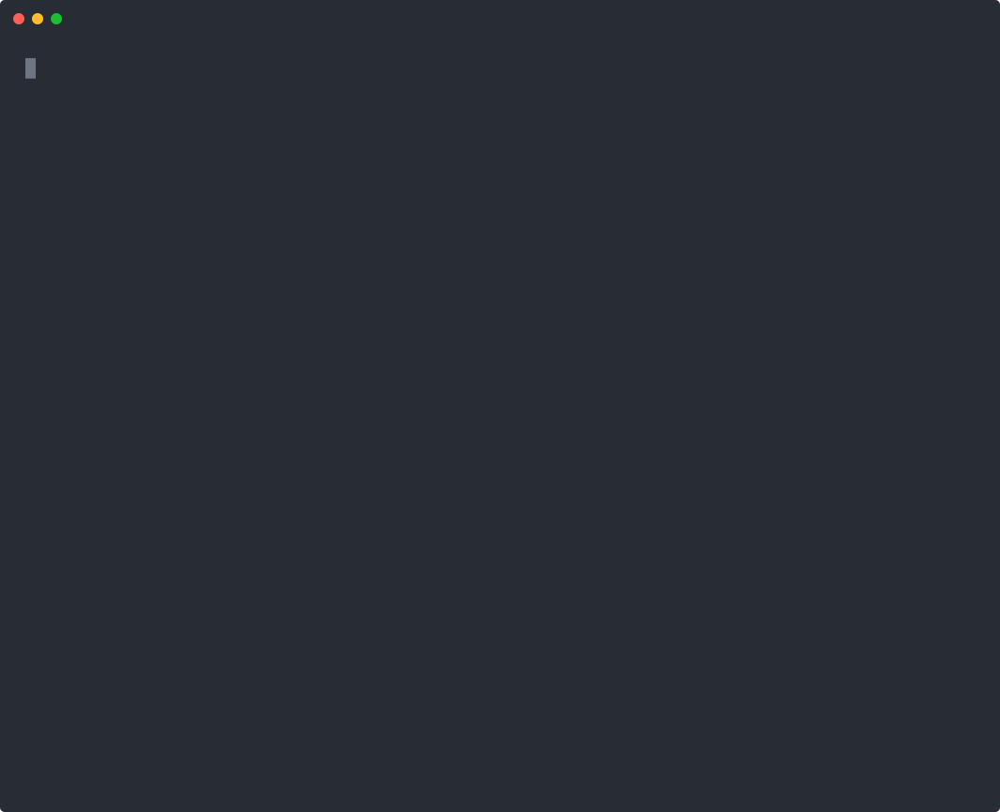

# Foreman

[](https://github.com/ChaseSunstrom/foreman/actions/workflows/test.yml)

**The discipline layer for Claude Code.** Foreman makes Claude plan before it edits, prove its work with commands it actually ran, stay on one task at a time, and keep going through the queue until it's done or needs you, while a guard hook stops the commands you'd never want run in bypass mode.

<p align="center">
  
</p>
<p align="center"><sub>A real session, recorded in a copy of this repo: one typed request (make <code>fm audit prep</code> tell reviewers to read long diffs in parts), the rest is Claude working through Foreman, about 7 minutes, sped up where the model thinks. Its commit is in Foreman now. <a href="demo/live.mp4">MP4</a>.</sub></p>

## Why

Claude Code is fast. Left to itself it also fails in familiar ways: it edits before it understands the problem, says "tests pass" without running them, chases every new idea halfway through a task, loses its place after `/compact`, and in bypass mode it will run the one command you'd never type. Foreman is the foreman on that job site.

| | |
|---|---|
| **Plans first** | Every request becomes a brief before any edit: its type and size, what "done" means, the command that proves it, and the steps. An edit with no active task is refused. |
| **Proves it** | Evidence is a command fm ran and recorded, not a sentence. A fix needs a test that failed first. A reply claiming the tests pass is checked against the turn's own runs. Nothing closes without its audits. |
| **Guards bypass mode** | A fail-closed guard stops recursive deletes outside the project, force-pushes, credential reads, `curl \| sh`, publishes and edits to Foreman itself. Before a git command throws away uncommitted work, Foreman saves that work first. |
| **Stays on task** | One active task. New requests go to the inbox instead of being chased. `NOW:` switches tasks on purpose. |
| **Never loses its place** | State lives on disk, so after `/compact` or in a new session Claude resumes at the exact step. |
| **Keeps going** | Drive mode works through the whole queue. In full auto, Claude decides and records its decisions instead of asking. When the queue drains it finds its own next work (`fm scout`: a newer Claude Code to adopt, dependencies with no stack card, doctor failures, a weekly brainstorm), so you never have to ask. `fm run` and `fm serve` keep it working headless. |
| **Learns** | Lessons, tripwires and a self-improvement loop turn your corrections and Foreman's own friction into fixes. |

## Quick start

```bash
curl -fsSL https://raw.githubusercontent.com/ChaseSunstrom/foreman/main/install.sh | bash
```

Or from inside Claude Code:

```
/plugin marketplace add ChaseSunstrom/foreman
/plugin install foreman@foreman
```

Then just ask Claude for something: `fix the login timeout on slow wifi`. To see it work before you trust it with your repo, run `fm demo`: the real `fm` and guard hook on a seeded bug, in a throwaway repo, with no model calls and nothing left behind (`--pace 1` plays it at this speed). Bare `fm` in a project says where things stand and what's next; `eval "$(fm complete --shell bash)"` in your `~/.bashrc` (or `--shell zsh`) gives tab completion for commands, options and live task ids.

<p align="center">
  
</p>

<details>
<summary><b>More ways to install, requirements and flags</b></summary>

The plugin-system install changes nothing outside the plugin: the hooks and the guard run, and the first session reads Foreman's rules from the plugin. Say "finish setting up Foreman" later to add the rest (status line, deny rules, the bypass question, `fm` in your shell). `fm uninstall-user` undoes it.

**Having Claude install it for you?** Tell it: "install Foreman following https://github.com/ChaseSunstrom/foreman/blob/main/INSTALL.md". [INSTALL.md](INSTALL.md) has it explain the defaults and ask before each change.

**Private repo** (uses your `gh` login):

```bash
gh repo clone ChaseSunstrom/foreman ~/.claude/foreman && ~/.claude/foreman/install.sh
```

**Requirements:** Linux, macOS or WSL (not native Windows), `git`, `claude` (tested on 2.1.301; the pane needs 2.1.299 or later), and Python 3.12.7 or newer as `python3`. When Python is older or missing, the installer gets it with Homebrew on macOS or with `uv` elsewhere (no sudo; `python3` goes in `~/.local/bin`).

**Flags:**

- `--security`: Trail of Bits security skills.
- `--docs`: Office and PDF skills.
- `--apply-conflicts`: disable plugins that compete with Foreman instead of only reporting them.
- `--no-plugins`: skip the curated plugin setup.
- `--bypass` / `--no-bypass`: make bypass mode your default, or keep your current permission mode, without being asked.
- `--no-mod`: skip the foreman-ui mod.
- `--no-wiring`: don't touch `~/.claude`.
- `--build`: open Claude Code on `/foreman:build` to rebuild from `BUILD_PROMPT.md`.
- `--desktop`: also install Foreman Desktop from its newest release (the AppImage and a menu entry on Linux x86_64, the app in `~/Applications` on macOS).

**What `install.sh` does:**

1. Clones this repo to `~/.claude/foreman`, or fast-forwards it if it's clean and on `main`.
2. Runs `setup-plugins.sh`. It installs the curated plugins that are missing, and installs language-server plugins only when the server is on your PATH. It reports conflicting or heavy plugins but never uninstalls anything.
3. Registers this repo as a local plugin marketplace and installs `foreman@foreman`. The plugin loads in place, so edits under `plugin/` apply on `/reload-plugins`.
4. Asks whether to make `bypassPermissions` your default permission mode. That is Foreman's recommended mode, because its guard is built for it. On a yes (or `--bypass`) it sets it, backing up `settings.json` and recording the original. With no terminal to ask on and no `--bypass`, your permission mode stays as it was.
5. Wires Foreman into `~/.claude` with `fm install-user` unless you pass `--no-wiring`. That adds:
   - a statusLine wrapper (your original line and claude-hud still render above the Foreman line);
   - deny rules for catastrophic commands;
   - a raised Stop-hook continuation cap for drive mode;
   - a marked block in `~/.claude/CLAUDE.md` and the `~/.claude/rules/foreman.md` symlink;
   - a `~/.local/bin/fm` link so `fm` works in any shell (unless a different `fm` is already there).

   Every change is recorded in `state/install-manifest.json`, so it can be undone exactly.

</details>

## Talking to it

Plain requests work. Tags and a few lines of context make them precise:

```
fix the login timeout on slow wifi                    # plain request: classified, planned, done with evidence
FIX: login times out after 30s on slow networks
FEATURE: export report as CSV @src/reports
CLEAN: collapse the three date helpers into one
CONTEXT: Django app; don't touch migrations
DONE-WHEN: all tests pass and the CSV opens in Excel
```

Work runs in the order CLEAN → PERFORMANCE → SECURITY → FIX → FEATURE, after a baseline check. Mid-task ideas are captured and queued: `NOW:` switches tasks, `PAUSE` checkpoints and `STATUS` shows where things stand. You never have to run a command yourself. Say it in plain words ("is foreman ok?", "clean up", "this repo is sensitive") and Claude runs it.

- **Open-ended requests** ("super improve it", "just get it done") get a brainstorm first. Several tool-less sub-agents each look through a different lens, then Claude checks every idea against the real code and queues the best. A brainstorm runs up to six short `claude -p` (Sonnet) sessions, which count against your plan's usage.
- **Audits before done:** finished work is checked through independent lenses: intent, adversary, edge cases, operations and maintainability. Each lens gets different prompts and context. Small tasks get a self-check; large ones get all five.
- **Docs stay current:** bigger tasks can't close until they record which docs they changed, and those docs must exist and match the code. Drift elsewhere is reported when a task closes (`fm docs` shows it any time). Long sessions compact earlier, since Foreman's state makes that cheap.
- **Full auto:** say `FULL AUTO` (or "don't ask me anything") and Claude works through the whole queue without questions, recording its decisions. Anything only you can approve waits for one summary at the end. `STANDARD AUTONOMY` switches back.

## What it does for you

**Plans.** Intake turns a request into briefs: type and tier (S, M or L), acceptance criteria with the commands that prove them, steps, scope and risks. M and L work lists the approaches first. The queue orders itself, dependencies included. Each brief lives in Foreman's state, outside your repo, unless you turn on `fm sync`.

**Knows your stack.**
- A library of over 1,000 stack cards spans 27 areas: languages, Python, Node, web, JVM, .NET, mobile, Rust, Go, C/C++ and embedded, data, ML and LLM apps, infra, cloud, ops, testing, security, architecture, product domains, tools, games and hardware, building Claude Code plugins, hooks, skills and mods, and practice (brainstorming, premortems, experiments, self-improvement loops).
- Each card gives the exact commands that verify the work, a failing-test recipe, the mistakes models actually make, and a review checklist.
- Cards cost no context until they are read. `fm lib` picks the ones that match your repo's manifests and files, and the session start names them.
- `fm lib show fastapi pytest --section verify` reads just the parts you need.
- The first edit of a file a card covers brings that card's pitfalls (its Avoid section, under 700 characters) into Claude's context, once per card per task. `fm lib inject off` turns it off; `fm doctor -v` counts how often it and the other enforced checks fired this week.
- `fm lib search` also finds installed plugins' skills, disabled ones included, so a big skill pack can stay off and still be found.
- `fm lib source add <git URL>` indexes a third-party skills repo read-only: a shallow, markdown-only checkout in Foreman's state, with no hooks, filters, submodules or symlinks, and nothing run. `fm lib source defaults` adds six vetted ones (wshobson/agents, anthropics/skills, trailofbits/skills, VoltAgent subagents, K-Dense scientific skills, morluto/rea): about 870 skills and agents, searchable next to the cards at no context cost.

**Verifies.**
- `fm check` runs the project's gates and reuses a pass on an identical tree.
- `fm task evidence --run` records a command's real exit code and output.
- `fm task prove` shows a test failing on the start tree and passing now. `--hunks` reverts each hunk to show the tests notice it.
- `fm task finish` closes a task in one call, but only with fresh evidence and the audits, docs note and lesson its size needs. It counts its warnings in one line first (a leftover `breakpoint()` or conflict marker among them) and ends by saying where the work landed: committed and pushed, or not.
- The suite runs in CI on every push.

**Protects.**
- The guard reads every Bash command and file edit before it runs, including the commands fm stores and runs later.
- Work snapshots save uncommitted work before `git reset --hard`, `checkout -- .`, `clean -f` and the like. `fm snapshots` lists them, each with the command that brings it back; `fm oops` shows the newest and `fm oops --apply` restores it.
- `fm sensitive on` keeps a repo's content from leaving the machine; `fm sensitive suggest` lists what hints a repo needs it (`.env*`, `*.pem`, secret or prod in a path) and changes nothing.
- `fm posture lite` (yours to type: `! fm posture lite`; Claude may not lower it) keeps only the guard and the evidence gate in a repo where the rest of Foreman is in the way (no injected notes, no drive); `fm posture full` brings it back.

**Shows you what happened.**
- `fm tour --since main` ranks a whole branch, or a night's run, by review risk and says which files are safe to skim.
- `fm why FILE:LINE` traces a line back to the task and the words you asked in.
- `fm at T-0042 -- pytest` runs any command as of a task's start.
- `fm show X` takes a task id, a FILE:LINE or plain words and shows the task, the line's history or related past work.
- `fm digest` sums up the week; `fm outcomes --readme` gives the track record in one sentence; `fm round close` tags a round and lists what it closed.

**Runs unattended.** Drive mode, full autonomy, `fm run` (one fresh `claude -p` session per task), `fm serve` (Remote Control on a server), `fm scout` (finds work nobody asked for), `fm night` (budgeted background jobs) and `fm notify` for when it's done.

**Improves itself.** `fm friction` digests Foreman's own friction (`--minutes`: an estimate of the minutes it cost this week), `fm burden --by-verb` lists the verbs nobody calls, `/foreman:improve` builds candidate changes in a worktree and keeps only the ones that score at least as well on the eval suite, and lessons come back as tripwires on related work.

## Seeing what's going on

**In Claude Code**, the `foreman-ui` mod draws Foreman live in the session: a card above the prompt shows the task, a mini stage rail and a step bar, and each tool call gets an animated row. `/fm` opens a dashboard that reads top-down by urgency, with live charts. Below the prompt is a true-color status line. **Foreman Desktop** shows every project, agent session and device in one window. **Other agents** (Codex, Gemini CLI, opencode) can run the same guard and context.

<details>
<summary><b>The foreman-ui mod in detail</b></summary>

The `foreman-ui` mod draws Foreman live inside the session.

**The card.** Above the prompt sits a card showing:
- the task's type chip, id and title, and its stage on a mini rail (●━●━◉─○─○);
- a true-color gradient step bar that animates while Claude works;
- audits, queue and inbox counts, and what waits on you;
- `[f]` dashboard and `[n]` next.

**Tool rows.** Every running tool call is an animated row: a spinner, the verb, the file or command, `+N −M` for edits, an activity comet and the elapsed time. A subagent row also counts its tool calls and shows its latest one. Finished rows go back to Claude Code, which draws diffs and output as usual. Successful `fm` bookkeeping commands fold to one quiet `⚙ fm …  ✓ …` line, while failures keep their full row. Finished reads and background-task notifications also fold to one quiet line.

**Turns.** The working spinner names the Foreman step it's on. The line closing each turn says what the turn did (`4 tools · 2 edits +30 −4 · ✓ T-0012 step 3/5`). When Claude stops with Foreman work waiting, the prompt offers `/foreman:next` as ghost text (never while a question waits on you). The footer says when Foreman needs you and shows `full auto` and `drive off` as modes.

**Context.** The band carries a context meter. At 85% Foreman checkpoints the task once, so a `/compact` resumes at the exact step. When a task closes with context at 40% or more, the mod compacts right there. It keeps your standing requests and live decisions, drops finished work, and Foreman's resume note restores the exact point. The threshold is the mod's `freshAt` setting; 0 turns it off.

**Your project's own timings.** Sizes read as words (`FIX · small`, `· medium`, `· large`) and carry this project's history:
- The band shows how long you've been on the task and what that type and size usually takes (`12m on it · usually ~25m`). That is the median from first focus to done, once three such tasks have closed.
- Queue rows show their usual time, and the gates card shows what a full run costs.
- The band shows the whole queue (done today, queued, in the inbox, what's next), so it never looks nearly finished while work waits.

**Prompts and background work.**
- Every Foreman permission prompt gets a plain-words note under it saying what a yes grants and why.
- When Claude waits on background shells (started in the background, or moved there with ctrl+b), the band says so (`◷ waiting on 2 background shells · cargo test · 3m 12s · Claude picks up when they finish`) and the pane lists them. Each leaves when its notification arrives or it is stopped.
- Coming back to a long unattended run, the band tells you what closed since your last message (`✔ since your last message: 3 done · …`) until you write again.

**The mascot.** The pane's top-right corner has Claude Code's own Claude from the welcome screen. Its `mascot` setting picks blue, orange, purple, green or off. It dances while Claude works, blinks while idle and cheers when a task closes, with a mini Claude in its own color beside it for each running subagent.

**The dashboard.** `/fm` (or `[f]`) opens a dashboard pane that reads top-down by urgency:
- what needs you: a yes Foreman is waiting for, and any plan waiting for approval, shown in full beside its Approve button;
- the task: type, size, id and title, a stage rail from plan to close with a comet on the stage being worked, the steps bar, the current step, and time on the task against the usual for its type and size (a ┃ marks the usual; past it the bar turns amber);
- **Now**: each call running this moment with a moving bar (a question waiting on you reads as waiting, not running). Live cards hold their place: one that empties stays dimmed ("idle · last: …") for 8 s and gives rows back one a second, so the pane doesn't jump as calls come and go;
- **Plan**: the steps (one glows green as it gets done), the done-when criteria with the check that proves each, audits and what is left before done;
- **Skills**: the skills invoked (✦) and stack cards read with `fm lib show` (▤) this week as chips with their age, the most used, and this repo's suggested cards not read yet, dimmed as `fm lib show NAME` (folded, its head still counts them; gone when there is nothing to show);
- **Pulse**: swim lanes of the session's tool calls by kind (edit, run, read, agent, web) over the last 1 to 30 minutes, tasks closed per day for 14 days, and context, spend, hook-latency and guard gauges;
- queue and inbox, with type chips, usual times and Start/Drop (one *Up next* card with the capture box when both are empty);
- then the quieter cards: gates, brainstorm, files, fleet, spend, bench, research and activity (newest first), each folding to its head line with ▾/▸;
- Next, Drive and Autonomy controls.

When a task closes, its done card tops the pane for six seconds: a green sweep, the grade and lenses, the criteria it proved and its time against the usual. The charts move at about 30 fps while Claude works and stand still when idle; the `motion` setting picks `full`, `calm` (8 fps) or `off`.

Every card shares the animated look: borders that breathe while Claude works, true-color bars and recency fades. Queue rows have step bars, and inbox rows show their age. A quick-capture box takes an idea on Enter and runs `fm capture` without interrupting Claude. Other cards show live subagents with their tool counts, files touched this session with +/− bars, the last `fm check` gates, and activity with a hook-latency sparkline. Toasts mark finished steps and tasks, needed yeses (with a soft chime; Sound off in the pane) and guard refusals. The mod only renders `fm ui --json` and runs `fm` on your presses; rules and gates stay in fm and the classic hooks.

**The status line.** Under the prompt is one clean true-color layout:
- a session line: model, folder, branch, context and rate-limit bars, cost, lines changed;
- a Foreman line: task, stage, step bar, audits, queue, autonomy, guard.

When the mod's card is above the prompt, the Foreman line shrinks to a chip on the session line. `"statusline_layout": "stack"` in the install manifest brings back the old stack of your original line, claude-hud and the Foreman lines. `NO_COLOR` set drops the colour from Foreman's own lines. In tmux, `set -g status-right '#(cd #{pane_current_path} && fm state --line)'` puts the same task, step and queue in the status bar for the pane you're in (it never creates a project).

Also: per-subagent rows, terminal titles and desktop notifications, `fm watch`, and an optional OpenTelemetry → telegraf → InfluxDB → Grafana setup in `plugin/observability/`. `/tui fullscreen`, `/focus` and `Ctrl+O` help too.

</details>

<details>
<summary><b>Other agents and the desktop app</b></summary>

**Other agents:** `fm agents install codex|gemini|opencode` puts Foreman into Codex, Gemini CLI or opencode: its guard, per-turn context, `fm mcp` server and a short rules block. They run through the same hook Claude Code runs (`hook --agent X EVENT`). The adapters are built to each tool's documented hook format and tested against recorded payloads, but not yet verified against live CLIs: check that a refused command is refused there before relying on the guard.
- `fm agents list` shows what's wired, and `fm agents uninstall X` takes out exactly what install added.
- Codex also gets the drive and done-gate (its Stop hook).
- Two things stay Claude Code only: Gemini's AfterAgent would discard the answer it blocks, and the `fm ask` permission prompt needs Claude Code to show it.

**MCP:** `fm mcp` serves the project to any MCP client over stdio, read-only: its state, next action, recall, research and briefs, the stack library (`lib_suggest`, `lib_search`, `lib_show`) and the instruments (`outline`, `sym`, `impact`, `why`, `fail` on given text, `logs`, `data`, `trace`). Paths must resolve inside the project, values can't start with `-`, each is length-capped, each call has a timeout, and everything sent is redacted. `fm mcp register claude` prints the `claude mcp add` line. `fm mcp new NAME --wrap 'CMD' [--sub a,b]` writes a stdlib-only MCP server for any CLI, plus a test that drives it over stdio. The server runs argv, never a shell; each argument is a plain value or one of the subcommands; it has a timeout and an output cap; and it refuses to wrap destructive commands (`rm`, `git push`, a shell…). Register it with `fm mcp register claude DIR`.
- A config with comments (JSONC) is left alone with a note.
- The files that load the hooks are protected core, like Claude Code's settings: `~/.codex/hooks.json` and `config.toml`, `~/.gemini/settings.json`, and opencode's `opencode.json` and `plugins/`, including their project-level copies. An agent that edits them, or runs `fm agents uninstall`, needs your yes.

**Knowledge out:** `fm recall --export-rules` writes the lessons from finished tasks to `.claude/rules/foreman-lessons/`, one rule file per task scoped by `paths:` to the files it touched, so Claude Code loads a lesson only with its files, even without Foreman. `fm decide --export-adr DIR` writes one ADR file per recorded decision. `fm task defer ID --until "when PATH changes"` brings a task back in `fm next` once that file changes.

**Desktop app:** [Foreman Desktop](https://github.com/ChaseSunstrom/foreman-desktop) (Tauri 2 + Svelte 5; `install.sh --desktop` installs its newest release) shows every project, agent session and device in one animated window.
- Live project dashboards with Start, Drop, Approve-plan, capture, drive and autonomy controls.
- It starts, watches, messages and stops sessions for Claude Code, Codex, Gemini CLI and opencode.
- It opens every Claude Code session on every device: terminal, Remote Control and headless. For each, it shows the conversation with images, subagents and their transcripts, and scratchpad files and pictures, and it can continue the session.
- A Remote control page, a Ctrl+K palette, and agents and devices pages, with your tailnet's machines suggested.

The app never talks to a server: it runs `fm … --json` on this machine, and on other devices over ssh. Its live views come from `fm projects --follow`, `fm ui --follow`, `fm session list --follow` and `fm session tail --follow`.

</details>

## Permissions

Foreman is built for bypass mode (no tool-call prompts), which the installer offers to turn on. What still stops a dangerous command is Foreman's guard hook, plus 20 deny rules for the truly catastrophic cases. The guard covers:
- recursive deletes outside the project;
- force-pushes and hard resets on default branches;
- credential files and `curl | sh`;
- disk, firewall and system-service changes;
- publish and deploy commands;
- direct writes to Foreman state, edits to Foreman's own protected core and to Claude Code's `~/.claude.json`;
- starting a remote session.

A blocked command says how to authorize it for the current task. For anything that needs you (Foreman's own code, a remote session, installing plugins or MCP servers, destructive categories), Claude Code shows its own permission prompt saying exactly what would be granted. Approving it grants it, and nothing else can. Chat messages don't cancel it. Like the rest of the guard it is a speed bump, not a sandbox.

<details>
<summary><b>Standing yes, trust mode, sensitive repos and turning bypass off</b></summary>

**Working on Foreman itself a lot?** Say "don't ask to edit Foreman". One prompt (`fm ask ID core --standing`) asks for a standing yes. It covers Foreman's own code, rules and evals for every later task, until `fm standing off`. Claude Code's settings, Foreman state and the guard file itself still ask each time.

**Trust mode.** To let Claude edit those too (the guard and Claude Code's settings, never Foreman state), type `/fm-trust on` yourself. The foreman-ui mod only accepts it from your own prompt (or your phone), never from Claude, a scheduled prompt or a skill, and the guard refuses any attempt by Claude to turn it on. The band shows `⚠ trust on` while it lasts. `/fm-trust off` (or `fm trust off`) ends it. Other questions come as a prompt too.

**Sensitive repos.** To opt a repo out (client code, anything with production credentials), tell Claude "this repo is sensitive" (it runs `fm sensitive on`). That writes this to the repo's `.claude/settings.local.json`, kept out of commits via `.git/info/exclude`, and Foreman shows the repo as sensitive at session start:

```json
{ "permissions": { "defaultMode": "default" } }
```

Use `"default"` (or `"acceptEdits"`), not `"auto"`: Claude Code ignores `auto` and `bypassPermissions` in project and local settings. `fm sensitive off` undoes it.

**Turning bypass off.** To turn bypass off everywhere, set `defaultMode` back to `"auto"` (or delete it) in `~/.claude/settings.json`. The original is in `~/.claude/foreman/backups/`.

</details>

## Headless: keep it working on a server

In a repo on your server, ask Claude to "serve this repo". Claude asks you once (a yes grants `remote`), then `fm serve` starts Claude Code Remote Control there as a systemd user unit, and the project switches to full autonomy with drive on.
- The unit survives logout and reboot: it turns on linger, or says why it couldn't.
- It restarts on failure. After five failed restarts in ten minutes it stops, and `fm serve status` or `fm doctor` says why. It doesn't wait out usage limits.
- Send feature requests from claude.ai/code or the Claude app whenever you like. They're captured, planned, built, audited and committed one after another.
- "Stop serving" (`fm serve stop`) undoes it, and uninstall stops every unit.
- Claude Code has to trust the repo first: open `claude` there once.

`fm run` is the other option. It works the queue in fresh `claude -p` sessions, one task each, so a long queue never piles up in one context. It waits out a usage limit (up to six hours by default) before retrying. A task that makes no progress is blocked with the reason, so the next run moves on, and the machine is kept from sleeping while it runs (systemd-inhibit, where there is one). To run `fm night` every night, `fm night --print-timer` prints a systemd timer and a crontab line to paste.

## When not to use Foreman

- **Quick one-off questions or scripts.** Planning, evidence and audits are overhead for a five-minute job; plain Claude Code is faster. Foreman sizes work as S/M/L, but even S has a brief.
- **Native Windows.** Foreman needs Linux, macOS or WSL.
- **When you want to approve every command yourself.** Foreman is built for bypass mode with its guard as the brake. It works in the default mode too, but its unattended drive will keep stopping at prompts.
- **Tight token budgets.** Brainstorms, second plans and audits run extra model sessions (capped by `fm budget`). Turn them down, or skip Foreman for budget-critical work.
- **Code that must not leave the machine.** Mark the repo sensitive (`fm sensitive on`) so outward tools are refused, or don't use cloud-facing features there at all.

## Does it improve itself?

Within limits. Ideas come from retros, your corrections and its own metrics, and land in Foreman's own inbox. `/foreman:improve` builds candidates in a separate git worktree, runs the `claude plugin eval` suite against the live version, and only proposes changes that score at least as well. You approve every merge, and it can't edit its own guard, permission settings, rules or eval suite without your authorization.

## Documentation

| | |
|---|---|
| [`MASTER.md`](MASTER.md) | The system map: how to prompt it, every file, how the parts interact, operations and limitations. Start here. |
| [`INSTALL.md`](INSTALL.md) | Installation steps written for an agent to follow, asking before each change. |
| [`CHANGELOG.md`](CHANGELOG.md) | Release notes. |
| [`BUILD_PROMPT.md`](BUILD_PROMPT.md) | The spec Foreman was built from, including the plugin choices (§4.6 and Appendix A). |

## Updating and removing

- **Update:** `git pull` in `~/.claude/foreman` (then `/reload-plugins`), or rerun `install.sh`.
- **Health check:** ask "is foreman ok?" (`fm doctor`). **Hygiene:** "clean up" (`fm tidy`).
- **Remove:** `~/.claude/foreman/plugin/uninstall.sh`. It uninstalls the plugin and marketplace and undoes the wiring. It keeps `state/` unless you pass `--purge-state`, and `--dry-run` previews.

<details>
<summary><b>Starting from a clean slate (optional)</b></summary>

`reset-claude.sh` resets only the parts that change Claude's behavior, after backing up `~/.claude` and `~/.claude.json` to `~/.claude-reset/<timestamp>/`. It resets:
- plugins, except the ones Foreman keeps;
- user hooks and permissions;
- the global CLAUDE.md, rules, skills, agents and commands.

Login, MCP servers, history, memory, themes and per-repo `.claude/` folders are untouched. Undo with the `tar` command it prints.

```bash
./reset-claude.sh            # dry run
./reset-claude.sh --apply    # close Claude Code first
```

</details>

## Development

```bash
python3 plugin/tests/run.py                                     # unit + behaviour, one test class per core (~80 s)
python3 plugin/tests/bench_hooks.py --runs 50                   # hook latency
python3 plugin/tests/e2e/roundtrip.py                           # install/uninstall/reinstall in a sandbox HOME
python3 plugin/tests/e2e/scenarios.py                           # live §12 scenarios (uses claude -p; costs tokens)
python3 demo/record.py [--mp4]                                  # re-record the demo above (demo/demo.cast, .svg, .mp4)
python3 demo/record_live.py [--from-cast]                       # re-record Claude Code + the mod (demo/live.*; a Sonnet turn)
```

```
BUILD_PROMPT.md       the spec Foreman was built from
MASTER.md             system map (start here)
CHANGELOG.md          release notes
install.sh            one-liner bootstrap
setup-plugins.sh      curated plugin setup (safe to re-run; --dry-run to preview)
configure-repo.sh     one-time for forks: point everything at your GitHub repo
reset-claude.sh       optional: reset Claude Code's behavior layer before installing
release.py            release Foreman: python3 release.py VERSION [--canary] [--push URL] (fm release-check first)
.claude-plugin/       local marketplace "foreman"
plugin/               the Foreman plugin (fm, hooks, skills, rules, agents, tests, evals)
demo/                 the README's recordings (Claude Code with the mod; fm demo) and the scripts that make them
local/ state/ backups/   machine-specific, gitignored
```

The reasoning behind the curated plugins, their measured context costs and conflicts are in `BUILD_PROMPT.md` (§4.6 and Appendix A) and `MASTER.md`. Preview what `setup-plugins.sh` would change with `./setup-plugins.sh --dry-run`.
